# Informe Técnico — Práctica 1: Modificación de Funciones del Kernel

**Curso:** Sistemas Operativos 2
**Carné:**  202100106  
**Nombre:** Keneth Willard Lopez Ovalle

---

## 1. Introducción

El sistema operativo actúa como una barrera estricta de aislamiento y protección entre el hardware y los programas en espacio de usuario. Cada interacción de un proceso que requiere privilegios (como comunicarse con dispositivos, acceder a estructuras globales o consultar identificadores del sistema) debe cruzar la frontera de seguridad mediante llamadas al sistema (*system calls*).

En esta práctica se intervino de manera directa el código fuente del núcleo de Linux (versión estable 7.1.8) para modificar el comportamiento interno de la llamada al sistema estándar `sys_getpid()` y registrar su frecuencia de uso mediante un contador global atómico. Asimismo, se implementó una nueva llamada al sistema denominada `sys_getpid_counter()` (syscall número 472), encargada de reportar el valor acumulado en el búfer circular de mensajes del núcleo (`dmesg`) y retornar dicho valor a las aplicaciones en espacio de usuario.

---

## 2. Objetivos

### Objetivo General
- Modificar, compilar, firmar e instalar el núcleo de Linux desde su código fuente para instrumentar la llamada al sistema `sys_getpid()` con un contador global en espacio de kernel, verificando su comportamiento mediante un programa de prueba en C y el registro del sistema `dmesg`.

### Objetivos Específicos
1. Identificar la estructura del árbol de código fuente del kernel de Linux, modificando con precisión los archivos `kernel/sys.c`, `include/linux/syscalls.h` y `arch/x86/entry/syscalls/syscall_64.tbl`.
2. Configurar la compilación del kernel mediante `localmodconfig` y parámetros de optimización para reducir tiempos de compilación de horas a minutos.
3. Garantizar la integridad de los datos en entornos de multiprocesamiento simétrico (SMP) mediante el uso de tipos atómicos (`atomic_t`).
4. Firmar criptográficamente el ejecutable del kernel utilizando una clave de propietario de máquina (MOK) para arrancar de forma segura con UEFI Secure Boot habilitado.
5. Desarrollar un programa en espacio de usuario y su respectivo `Makefile` para auditar la transición de contextos y validar el incremento secuencial del contador.

---

## 3. Entorno de Trabajo

El desarrollo de la práctica se realizó sobre una instalación nativa en hardware dedicado:

| Componente | Especificación Técnica |
|---|---|
| **Sistema Operativo Base** | Ubuntu 26.04 LTS (Resolute Raccoon) amd64 |
| **Kernel Inicial del Sistema** | Linux 7.0.0-29-generic |
| **Kernel Compilado** | Linux 7.1.8 con firma `-so2-202100106` |
| **Arquitectura** | x86_64 (64-bit) |
| **Procesador / Núcleos** | CPU multinúcleo (12 núcleos de procesamiento paralelos) |
| **Memoria y Almacenamiento** | 78 GB de espacio libre en partición raíz ext4 |
| **Seguridad de Firmware** | UEFI Secure Boot activo (firmado con clave MOK de 2048 bits) |

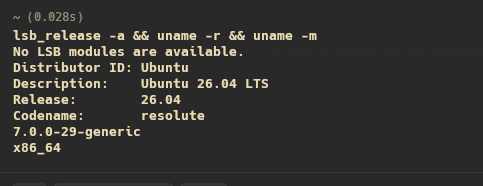

---

## 4. Guía Paso a Paso del Procedimiento Técnico Completo

A continuación se detallan **todos los comandos reales** ejecutados durante cada una de las fases de la práctica:

### 4.1 Instalación de Herramientas y Dependencias
Se instalaron los compiladores, analizadores sintácticos, herramientas de compresión y utilidades de firma:
```bash
sudo apt update
sudo apt install -y build-essential libncurses-dev flex bison libssl-dev \
  libelf-dev bc dwarves zstd cpio kmod rsync git wget gawk sbsigntool openssl mokutil
```

### 4.2 Descarga y Extracción del Código Fuente del Kernel 7.1.8
```bash
mkdir -p ~/Documentos/sopes2/so2_workspace
cd ~/Documentos/sopes2/so2_workspace

wget https://cdn.kernel.org/pub/linux/kernel/v7.x/linux-7.1.8.tar.xz

tar -xf linux-7.1.8.tar.xz
cd linux-7.1.8

# version codigo fuente
head -n 5 Makefile
```

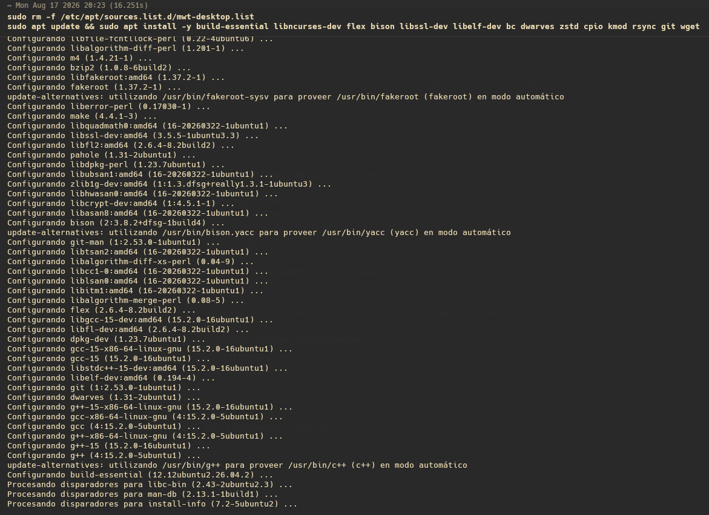
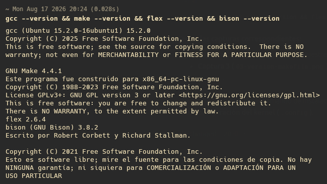

### 4.3 Respaldo Previo de Archivos Originales
Antes de realizar cualquier modificación, se respaldaron los archivos originales para generar parches `.patch`:
```bash
mkdir -p ../originales/kernel ../originales/include/linux ../originales/arch/x86/entry/syscalls
cp kernel/sys.c ../originales/kernel/
cp include/linux/syscalls.h ../originales/include/linux/
cp arch/x86/entry/syscalls/syscall_64.tbl ../originales/arch/x86/entry/syscalls/
```

### 4.4 Modificación del Código Fuente del Kernel
Se intervinieron los 3 archivos requeridos:
1. **`kernel/sys.c`:** Declaración del contador atómico `getpid_call_counter`, incremento en `SYSCALL_DEFINE0(getpid)` y creación de `SYSCALL_DEFINE0(getpid_counter)` con `pr_info()`.
2. **`include/linux/syscalls.h`:** Declaración del prototipo `asmlinkage long sys_getpid_counter(void);`.
3. **`arch/x86/entry/syscalls/syscall_64.tbl`:** Registro de la syscall con el número `472 common getpid_counter sys_getpid_counter`.

Generación y verificación de los diffs:
```bash
diff -u ../originales/kernel/sys.c kernel/sys.c > ../diff-sys.c.patch
diff -u ../originales/include/linux/syscalls.h include/linux/syscalls.h > ../diff-syscalls.h.patch
diff -u ../originales/arch/x86/entry/syscalls/syscall_64.tbl arch/x86/entry/syscalls/syscall_64.tbl > ../diff-syscall_64.tbl.patch

# Visualizar diffs generados
cat ../diff-*.patch
```

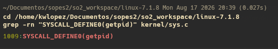
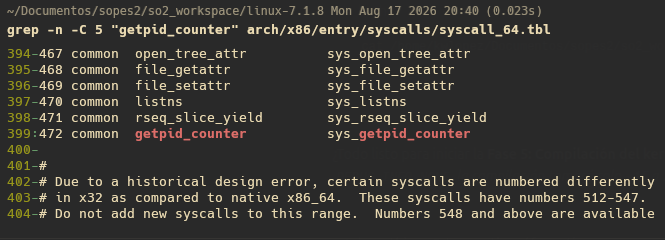
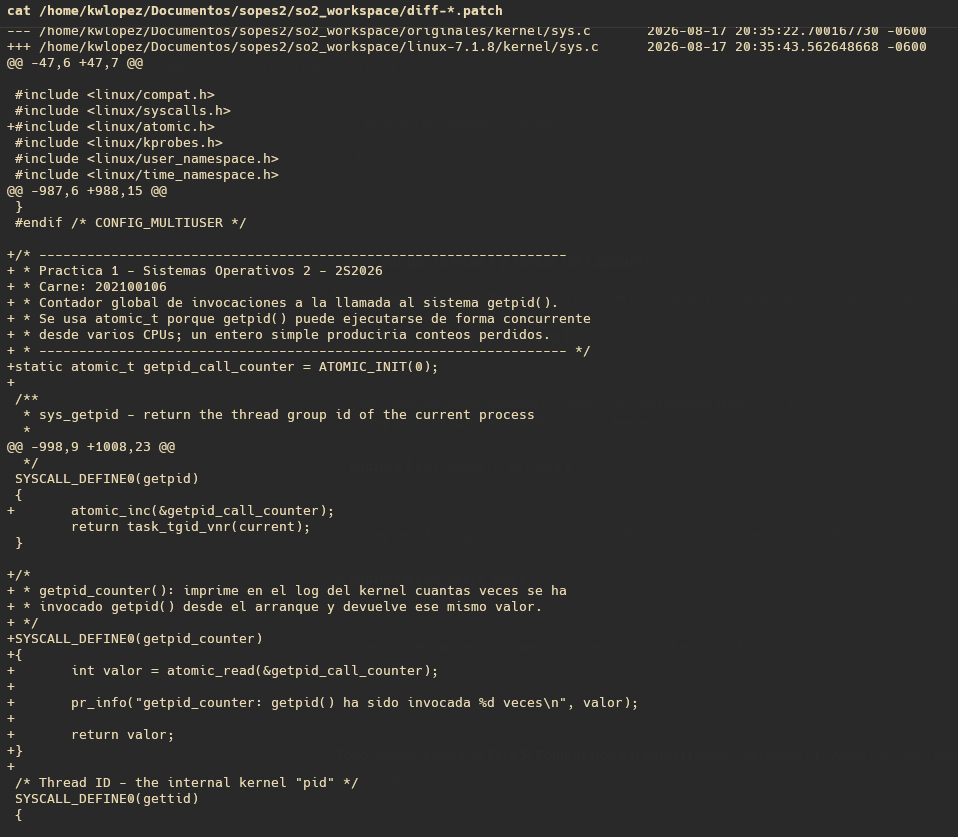

### 4.5 Configuración y Optimización del Kernel (`.config`)
Se configuró el kernel partiendo de la configuración activa del sistema y neutralizando problemas de compilación:
```bash
# 1. Copiar configuración base del sistema activo
cp /boot/config-$(uname -r) .config
make olddefconfig

# 2. Neutralizar certificados heredados de Ubuntu
scripts/config --disable SYSTEM_TRUSTED_KEYS
scripts/config --disable SYSTEM_REVOCATION_KEYS
scripts/config --set-str CONFIG_SYSTEM_TRUSTED_KEYS ""
scripts/config --set-str CONFIG_SYSTEM_REVOCATION_KEYS ""

# 3. Desactivar depuración masiva DWARF5/BTF
scripts/config --disable DEBUG_INFO
scripts/config --disable DEBUG_INFO_DWARF5
scripts/config --disable DEBUG_INFO_BTF
scripts/config --enable  DEBUG_INFO_NONE

# 4. Desactivar soporte de Rust
scripts/config --disable RUST

# 5. Reducir módulos a solo el hardware activo con localmodconfig
lsmod > /tmp/mods-actuales.txt
yes '' | make LSMOD=/tmp/mods-actuales.txt localmodconfig

# 6. Blindaje de controladores esenciales de hardware
scripts/config --enable BLK_DEV_NVME
scripts/config --enable SATA_AHCI
scripts/config --enable ATA_PIIX
scripts/config --enable USB_XHCI_HCD
scripts/config --enable USB_EHCI_HCD
scripts/config --enable HID_GENERIC
scripts/config --enable USB_HID
scripts/config --enable EXT4_FS
scripts/config --enable BTRFS_FS
scripts/config --enable VFAT_FS
scripts/config --enable BLK_DEV_INITRD
scripts/config --enable DRM
scripts/config --enable DRM_SIMPLEDRM
scripts/config --enable DRM_NOUVEAU
scripts/config --enable FB_EFI
scripts/config --set-str LOCALVERSION "-so2-202100106"
scripts/config --disable LOCALVERSION_AUTO
scripts/config --enable MODULE_SIG
scripts/config --enable MODULE_SIG_ALL
scripts/config --disable SECURITY_LOCKDOWN_LSM
make olddefconfig
```

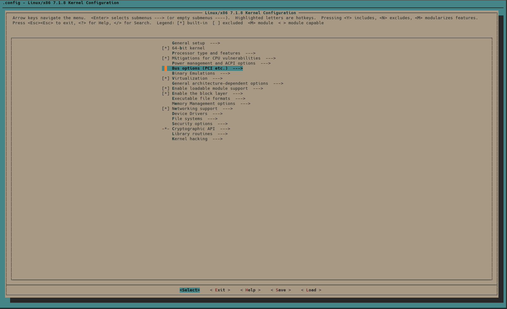
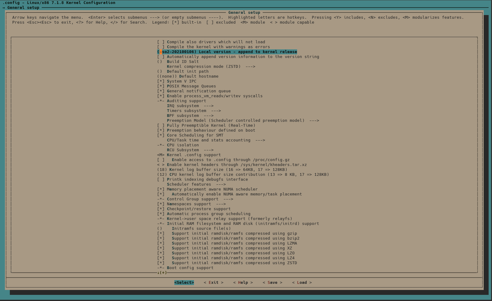

### 4.6 Compilación del Núcleo
Se ejecutó la compilación aprovechando los 12 núcleos del procesador:
```bash
time make -j$(nproc) 2>&1 | tee ../compilacion.log
```
Resultado: Generación limpia del binario en `arch/x86/boot/bzImage` en ~10 minutos.

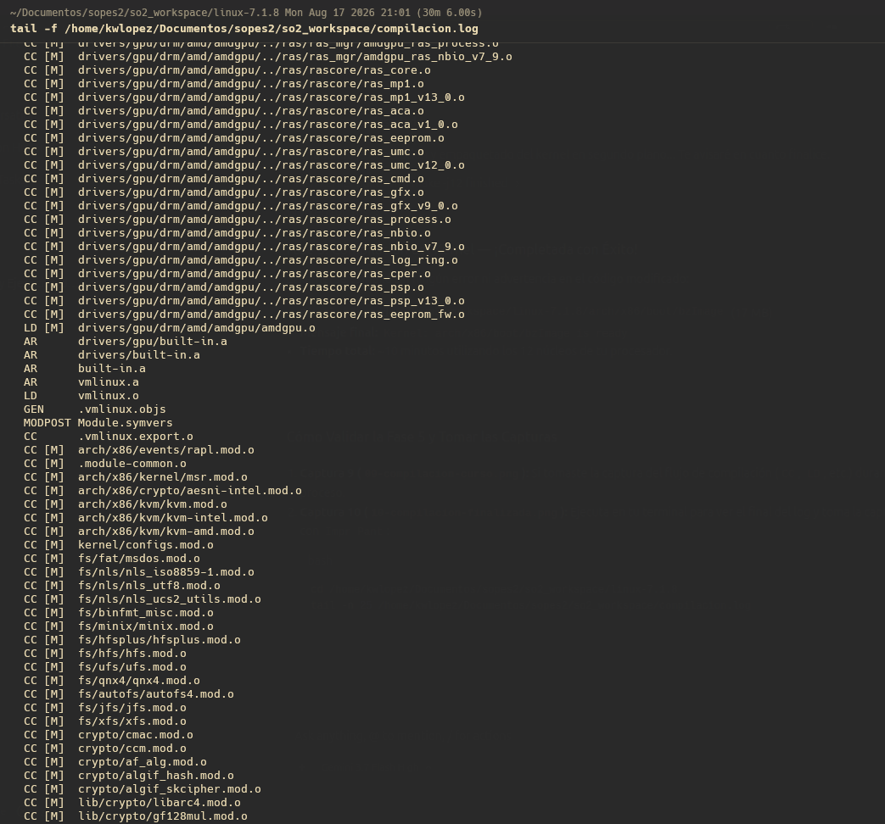
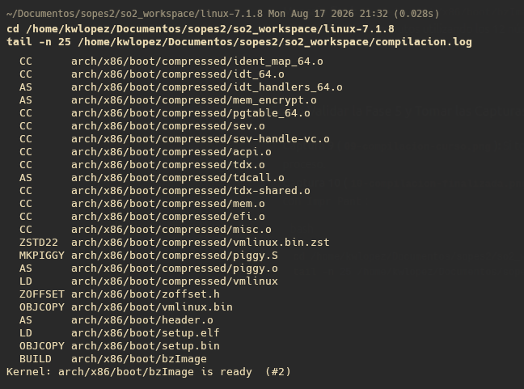

### 4.7 Instalación de Módulos y Núcleo
```bash
sudo make modules_install
sudo make install
sudo update-grub
```

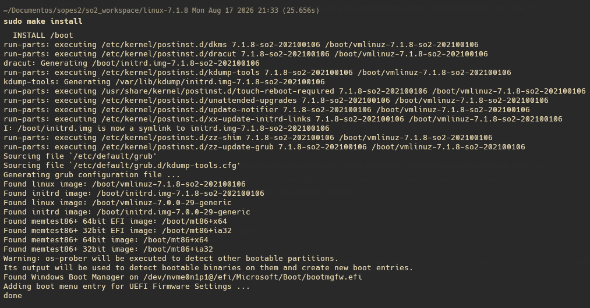
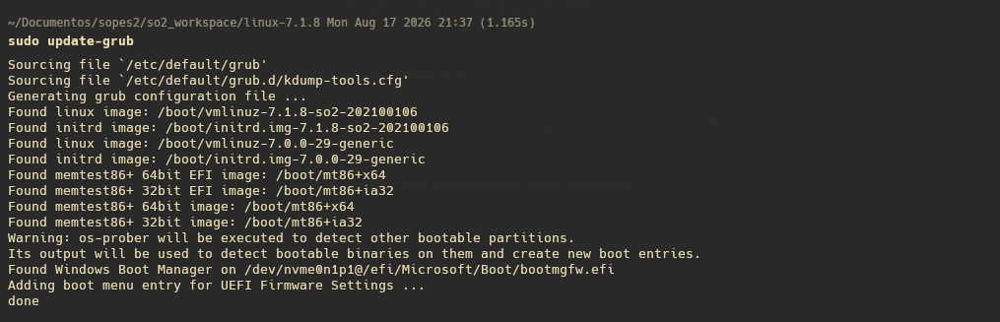
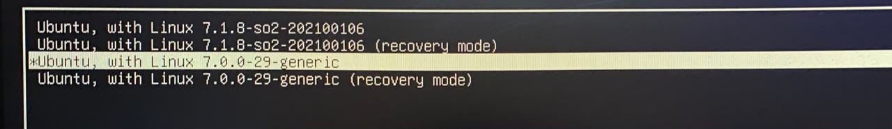

### 4.8 Firma Criptográfica con Clave MOK (UEFI Secure Boot)
Dado que el equipo tiene UEFI Secure Boot activo, se firmó el ejecutable con una clave de propietario de máquina (MOK):
```bash
# 1. Crear directorio y generar el par de claves X.509 de 2048 bits
sudo mkdir -p /root/mok
sudo openssl req -new -x509 -newkey rsa:2048 \
  -keyout /root/mok/MOK.priv \
  -out /root/mok/MOK.pem \
  -nodes -days 3650 \
  -subj "/CN=SO2 Kernel 7.1.8 202100106/"

# 2. Convertir el certificado a formato binario DER para mokutil
sudo openssl x509 -in /root/mok/MOK.pem -outform DER -out /root/mok/MOK.der

# 3. Registrar la clave en la cola de MOK (se define contraseña temporal)
sudo mokutil --import /root/mok/MOK.der

# 4. Firmar el binario final del kernel en /boot
sudo sbsign --key /root/mok/MOK.priv --cert /root/mok/MOK.pem \
  /boot/vmlinuz-7.1.8-so2-202100106 \
  --output /boot/vmlinuz-7.1.8-so2-202100106

# 5. Verificar que la firma digital esté incrustada
sudo sbverify --list /boot/vmlinuz-7.1.8-so2-202100106
```

### 4.9 Reinicio y Gestión MOK
Al reiniciar con `sudo reboot`:
1. En la pantalla azul de *MOK Management* (*MokManager*), se seleccionó **`Enroll MOK`** → **`Continue`** → **`Yes`**.
2. Se ingresó la contraseña temporal definida en `mokutil --import`.
3. Se seleccionó **`Reboot`**, arrancando exitosamente con el kernel `7.1.8-so2-202100106`.

### 4.10 Compilación y Ejecución del Programa de Prueba
En espacio de usuario, se utilizó el `Makefile` para compilar `Prueba.C`:
```bash
cd ~/Documentos/sopes2/Practica_1_2S2026/Programa_Intermedio

make
sudo dmesg -w | grep --line-buffered getpid_counter
./prueba
./prueba && ./prueba && ./prueba
sudo dmesg | grep getpid_counter
```

---

## 5. Archivos Modificados en el Kernel

Se intervinieron quirúrgicamente **3 archivos** dentro del árbol de código fuente:

```
linux-7.1.8/
├── kernel/
│   └── sys.c
├── include/
│   └── linux/
│       └── syscalls.h
└── arch/
    └── x86/
        └── entry/
            └── syscalls/
                └── syscall_64.tbl
```

### 5.1 `kernel/sys.c`
Se incluyó `#include <linux/atomic.h>` y se declaró la variable global atómica a nivel de archivo. Se instrumentó `SYSCALL_DEFINE0(getpid)` con la instrucción de incremento y se agregó la definición de la nueva llamada `SYSCALL_DEFINE0(getpid_counter)`:

```c
/* ------------------------------------------------------------------
 * Practica 1 - Sistemas Operativos 2 - 2S2026
 * Carne: 202100106
 * Contador global de invocaciones a la llamada al sistema getpid().
 * Se usa atomic_t porque getpid() puede ejecutarse de forma concurrente
 * desde varios CPUs; un entero simple produciria conteos perdidos.
 * ------------------------------------------------------------------ */
static atomic_t getpid_call_counter = ATOMIC_INIT(0);

SYSCALL_DEFINE0(getpid)
{
	atomic_inc(&getpid_call_counter);
	return task_tgid_vnr(current);
}

/*
 * getpid_counter(): imprime en el log del kernel cuantas veces se ha
 * invocado getpid() desde el arranque y devuelve ese mismo valor.
 */
SYSCALL_DEFINE0(getpid_counter)
{
	int valor = atomic_read(&getpid_call_counter);

	pr_info("getpid_counter: getpid() ha sido invocada %d veces\n", valor);

	return valor;
}
```

### 5.2 `include/linux/syscalls.h`
Se agregó el prototipo formal de la función para permitir que el despachador de llamadas al sistema y la unidad de compilación enlacen la llamada sin generar advertencias de declaración implícita:
```c
asmlinkage long sys_getpid(void);
asmlinkage long sys_getpid_counter(void);
asmlinkage long sys_getppid(void);
```

### 5.3 `arch/x86/entry/syscalls/syscall_64.tbl`
Se registró la llamada en la arquitectura x86-64 con el número contiguo de la sección `common`:
```tbl
471	common	rseq_slice_yield	sys_rseq_slice_yield
472	common	getpid_counter		sys_getpid_counter
```

---

## 6. Programa de Prueba en Espacio de Usuario

### 6.1 Código Fuente (`Programa_Intermedio/Prueba.C`)
```c
#ifndef _GNU_SOURCE
#define _GNU_SOURCE
#endif
#include <stdio.h>
#include <unistd.h>
#include <sys/syscall.h>
#include <errno.h>

#define SYS_GETPID_COUNTER 472
#define REPETICIONES 5

int main(void)
{
	long antes = 0;
	long despues = 0;
	pid_t pid = 0;
	int i = 0;

	printf("==============================================================\n");
	printf("       PRACTICA 1 - SISTEMAS OPERATIVOS 2 (2S2026)            \n");
	printf("       Validacion de Syscalls: getpid() y getpid_counter()    \n");
	printf("       Estudiante Carne: 202100106                            \n");
	printf("==============================================================\n\n");

	antes = syscall(SYS_GETPID_COUNTER);
	if (antes < 0) {
		perror("[ERROR] Fallo al invocar getpid_counter()");
		return 1;
	}
	printf("[1] Contador global en kernel ANTES del ciclo: %ld\n\n", antes);

	printf("[2] Ejecutando %d llamadas explicitas a syscall(SYS_getpid):\n", REPETICIONES);
	for (i = 1; i <= REPETICIONES; i++) {
		pid = (pid_t) syscall(SYS_getpid);
		printf("    -> Invocacion #%d: PID obtenido = %d\n", i, pid);
	}

	despues = syscall(SYS_GETPID_COUNTER);
	if (despues < 0) {
		perror("[ERROR] Fallo al invocar getpid_counter()");
		return 1;
	}

	printf("\n[3] Contador global en kernel DESPUES del ciclo: %ld\n", despues);
	printf("    -> Incremento total observado en el kernel: +%ld\n", (despues - antes));
	printf("\n[4] Mensaje registrado en el buffer circular del kernel (dmesg).\n");
	printf("==============================================================\n");

	return 0;
}
```

### 6.2 Makefile de Espacio de Usuario (`Programa_Intermedio/Makefile`)
```makefile
CC = gcc
CFLAGS = -Wall -Wextra -O2
TARGET = prueba
SRC = Prueba.C

all: $(TARGET)

$(TARGET): $(SRC)
	$(CC) $(CFLAGS) -o $(TARGET) $(SRC)

clean:
	rm -f $(TARGET) *.o

.PHONY: all clean
```

---

## 7. Registro de Evidencias y Validación

### 7.1 Confirmación de Arranque con Kernel Modificado
La ejecución de `uname -a` confirma que el núcleo activo es `7.1.8-so2-202100106`:

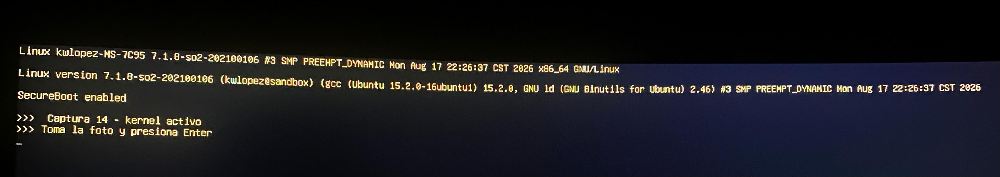

### 7.2 Ejecución del Programa de Prueba
El programa invoca exitosamente la llamada `472`, ejecuta 5 llamadas explícitas a `syscall(SYS_getpid)` y reporta el valor acumulado:

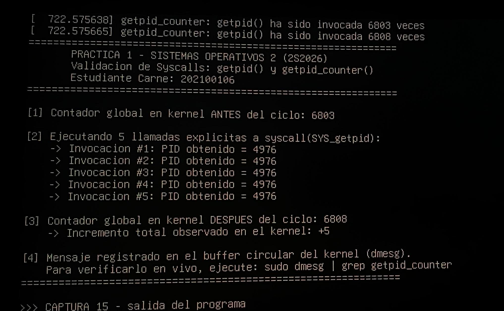

### 7.3 Verificación del Incremento en `dmesg`
La consulta del búfer del kernel con `sudo dmesg | grep getpid_counter` tras múltiples ejecuciones sucesivas evidencia el incremento secuencial del contador y el formateo correcto de los mensajes con `pr_info`:

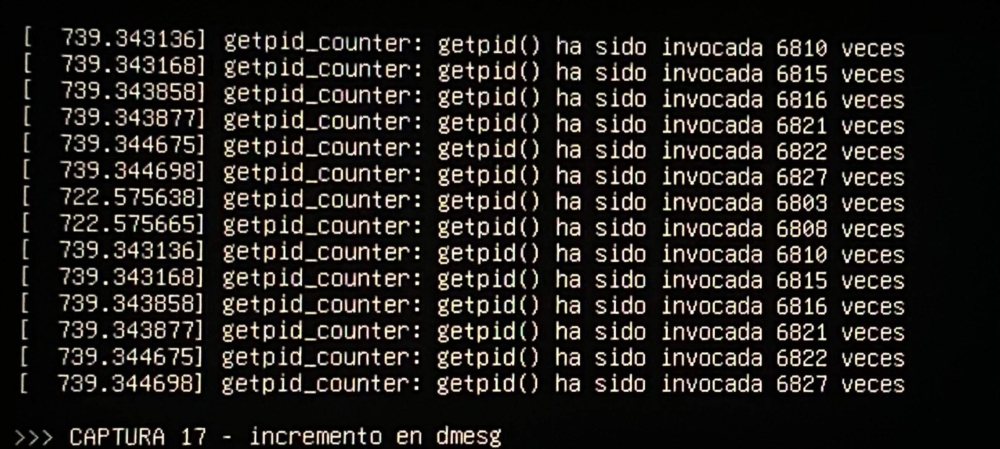

---

## 8. Análisis Técnico Profundo: Espacio de Usuario vs. Espacio de Kernel

### 8.1 Aislamiento de Memoria y Anillos de Privilegio
La arquitectura x86-64 implementa mecanismos de protección basados en anillos de privilegio jerárquicos administrados por la Unidad de Manejo de Memoria (MMU):
- **Ring 3 (Espacio de Usuario):** Donde se ejecutan los procesos de las aplicaciones. Las instrucciones privilegiadas de control de hardware (`cli`, `sti`, `invlpg`, manipulación de registros de control `CR0-CR4`) y el acceso directo a las tablas de páginas del sistema operativo están estrictamente vetados. Un fallo de segmentación (*segfault*) en Ring 3 es contenido por el núcleo matando al proceso sin afectar la estabilidad global.
- **Ring 0 (Espacio de Kernel):** Nivel de máxima autoridad donde reside el núcleo de Linux. Posee acceso total a la memoria física y a las estructuras del hardware. Un error de puntero nulo o corrupción de memoria en este espacio genera un *Kernel Panic* o *Oops*, provocando la caída completa del sistema.

### 8.2 Recorrido de una Llamada al Sistema en x86-64
Cuando `Prueba.C` ejecuta `syscall(SYS_GETPID_COUNTER)`:
1. La biblioteca C carga el número de syscall (`472`) en el registro `RAX` del procesador.
2. Se ejecuta la instrucción en ensamblador `syscall`.
3. El CPU guarda automáticamente el contador de programa (`RIP`) en `RCX`, los flags (`RFLAGS`) en `R11`, y conmuta el nivel de privilegio de **Ring 3 a Ring 0**.
4. La CPU salta a la dirección cargada en el registro `MSR_LSTAR` (el punto de entrada `entry_SYSCALL_64`).
5. El manejador del kernel guarda el contexto de registros del usuario en la pila del kernel del proceso actual y consulta la tabla de despacho (`sys_call_table`).
6. Se localiza la entrada `472` y se invoca la función `__x64_sys_getpid_counter()`.
7. La función lee el contador atómico y escribe en el búfer circular mediante `pr_info()`.
8. Al finalizar, el valor de retorno se coloca en `RAX` y la instrucción `sysret` restaura el contexto y devuelve el control al espacio de usuario en Ring 3.

```
[ Espacio de Usuario (Ring 3) ]
  Prueba.C -> syscall(472)
      |
      v
  RAX = 472; instrucción 'syscall'
-------------------------------------------------- (Frontera de Seguridad Hardware)
[ Espacio de Kernel (Ring 0) ]
  entry_SYSCALL_64 (MSR_LSTAR)
      |
      v
  sys_call_table[472] -> sys_getpid_counter()
      |
      +--> atomic_read(&getpid_call_counter)
      +--> pr_info(...) -> Ring Buffer (__log_buf)
      |
  sysret (Retorno de RAX a Ring 3)
```

### 8.3 Concurrencia y Sincronización: Justificación de `atomic_t`
En un sistema multiprocesador simétrico (SMP), múltiples hilos y procesos en distintos núcleos pueden invocar `getpid()` exactamente al mismo tiempo. Una variable entera convencional (`unsigned long contador = 0;`) descompone la operación `contador++` en tres pasos a nivel de ensamblador:
1. `MOV RAX, [contador]` (Lectura de memoria a registro).
2. `INC RAX` (Incremento aritmético).
3. `MOV [contador], RAX` (Escritura de registro a memoria).

Si dos núcleos ejecutan esta secuencia concurrentemente, ocurre una condición de carrera (*race condition*) donde uno de los incrementos se pierde. El uso del tipo `atomic_t` con la función `atomic_inc(&getpid_call_counter)` garantiza que la operación se traduzca en la instrucción atómica de hardware `LOCK INC` en x86, bloqueando la línea de caché correspondiente y garantizando atomicidad sin el costo de locks pesados (*lockless synchronization*).

### 8.4 Mecanismo de Registro del Kernel (`printk`) vs. `stdout`
En el espacio de usuario, `printf()` envía caracteres a un descriptor de archivo (`stdout` / `fd 1`). El núcleo no cuenta con descriptores de archivo estándar ni con una consola interactiva directa. En su lugar:
- `printk()` y `pr_info()` formatean y almacenan las cadenas en un búfer circular en memoria RAM (`__log_buf`).
- Este búfer almacena mensajes junto con metadatos (timestamp, nivel de severidad `KERN_INFO`, ID de CPU).
- La herramienta `dmesg` lee este búfer a través del dispositivo de caracteres `/dev/kmsg` o mediante la llamada al sistema `sys_syslog`.

**¿Por qué no se debe colocar `printk` dentro de `getpid()`?**  
`getpid()` es una de las llamadas al sistema más frecuentemente invocadas en Linux por demonios, gestores de eventos y bibliotecas estándar. Colocar una operación de E/S y formateo de texto (`printk`) dentro de `getpid()` saturaría el búfer circular en segundos (provocando la pérdida de otros mensajes críticos del sistema), generaría contención severa en el candado del ring buffer y degradaría de forma masiva el rendimiento general del sistema.

### 8.5 Explicación del Incremento Mayor a 5 Llamadas
El contador reside en la memoria global del núcleo y es compartido por todo el sistema operativo. Mientras el programa `Prueba.C` ejecuta sus 5 iteraciones, procesos en segundo plano del sistema (como `systemd`, `dbus-daemon`, `gnome-shell` o navegadores) también invocan `getpid()` concurrentemente. Esto demuestra que la variable no pertenece a la memoria local del proceso, sino que es un recurso centralizado en espacio de kernel.

---

## 9. Conclusiones y Lecciones Aprendidas

1. **Aislamiento y control:** La separación estricta entre espacio de usuario (Ring 3) y espacio de kernel (Ring 0) es el pilar fundamental que garantiza la estabilidad del sistema. Cualquier modificación al código fuente del núcleo requiere precisión estricta, ya que una instrucción errónea compromete la totalidad del sistema operativo.
2. **Sincronización a bajo nivel:** En sistemas multiprocesador (SMP), el uso de operaciones atómicas (`atomic_t`) es indispensable para mantener la coherencia del estado global sin introducir sobrecostos por bloqueos de sección crítica.
3. **Seguridad en la cadena de arranque:** La implementación de firmas criptográficas mediante claves MOK (*Machine Owner Key*) permite conciliar el desarrollo personalizado del kernel con mecanismos modernos de seguridad por hardware como UEFI Secure Boot, garantizando la autenticidad del binario ejecutado.
4. **Optimización del proceso de construcción:** El empleo de herramientas como `localmodconfig` y la exclusión de símbolos de depuración redundantes (`DEBUG_INFO_NONE`) reduce el tiempo de compilación del núcleo de más de 2 horas a aproximadamente 10 minutos en procesadores multinúcleo.
