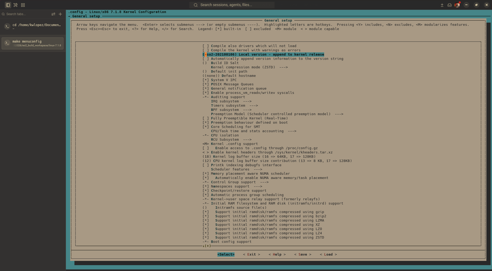
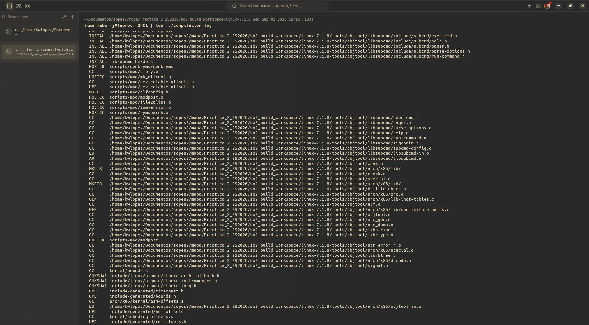
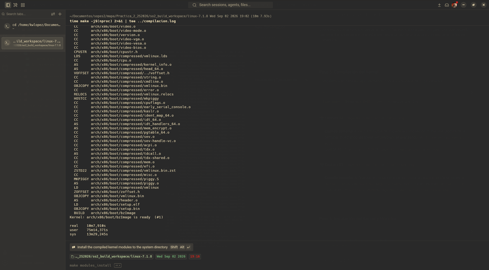
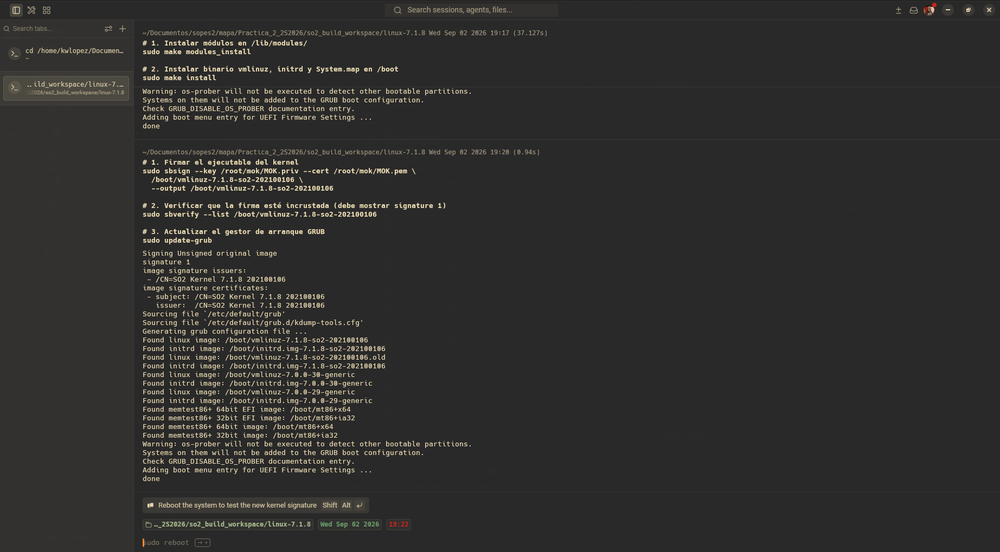
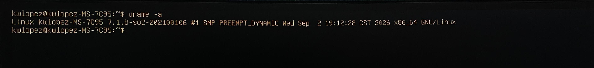
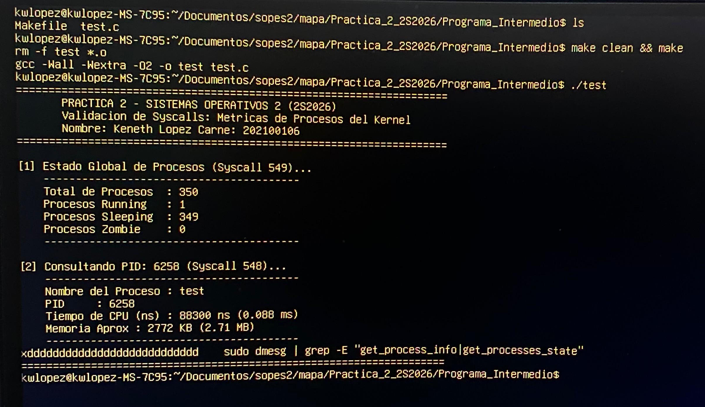
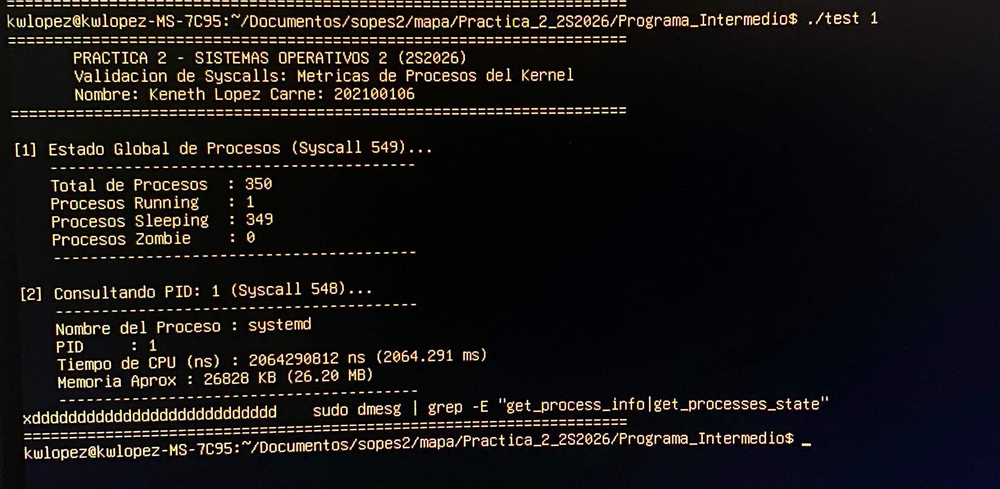
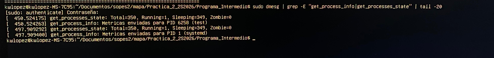
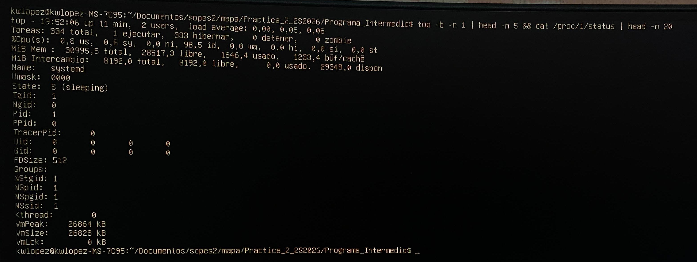

# Informe Técnico — Práctica 2: Syscalls Personalizadas de Métricas del Sistema

**Nombre:** Keneth Lopez  
**Carne:** 202100106

---

## 1. Introducción

En Linux, herramientas de monitoreo como `top` o `ps` obtienen información leyendo archivos de texto en `/proc`. Aunque esta interfaz es estándar, implica sobrecarga de procesamiento por múltiples operaciones de lectura y parseo.

En esta práctica se implementaron dos llamadas al sistema personalizadas en el kernel de Linux para obtener métricas directamente desde las estructuras internas:
1. `sys_get_process_info(pid, &struct)`: Retorna nombre, PID, tiempo de CPU y memoria de un proceso específico.
2. `sys_get_processes_state(&struct)`: Retorna el conteo global de procesos en estado Running, Sleeping y Zombie.

La transferencia de datos entre el espacio de kernel y el espacio de usuario se realiza de forma segura mediante `copy_to_user()`.

---

## 2. Objetivos

### Objetivo General
- Implementar, compilar y validar dos syscalls en el kernel de Linux para la extracción de métricas del sistema, verificando su funcionamiento con un programa de usuario en C y registros de `dmesg`.

### Objetivos Específicos
1. Agregar el código de las syscalls en `kernel/mi_syscall.c` y registrarlas en `arch/x86/entry/syscalls/syscall_64.tbl`.
2. Utilizar `find_task_by_vpid()` y `for_each_process()` con protección RCU para consultar procesos de forma segura.
3. Validar el acceso a memoria para evitar fallos con hilos del kernel que no poseen estructura `mm`.
4. Utilizar `copy_to_user()` para enviar los datos hacia el espacio de usuario.
5. Desarrollar un programa en C para invocar las syscalls y mostrar los datos en consola.

---

## 3. Entorno de Trabajo

| Componente | Detalle |
|---|---|
| **Sistema Operativo** | Ubuntu 26.04 LTS (amd64) |
| **Kernel Base** | Linux 7.0.0-29-generic |
| **Kernel Modificado** | Linux 7.1.8 con firma `-so2-202100106` |
| **Arquitectura** | x86_64 |
| **Compilación** | 12 núcleos paralelos |
| **Firmware** | UEFI Secure Boot con clave MOK |

---

## 4. Estructura del Repositorio

```text
202100106/
└── Practica_2_2S2026/
    ├── linux-6.X.X/
    │   ├── arch/
    │   │   └── x86/
    │   │       └── entry/
    │   │           └── syscalls/
    │   │               └── syscall_64.tbl
    │   └── kernel/
    │       ├── Makefile
    │       └── mi_syscall.c
    ├── Programa_Intermedio/
    │   ├── Makefile
    │   └── test.c
    ├── practica2.sh
    ├── imgs/
    └── README.md
```

---

## 5. Procedimiento Técnico

### 5.1 Instalación de Herramientas
```bash
sudo apt update
sudo apt install -y build-essential libncurses-dev flex bison libssl-dev \
  libelf-dev bc dwarves zstd cpio kmod rsync git wget gawk sbsigntool openssl mokutil pciutils
```

### 5.2 Descarga y Extracción del Kernel
```bash
mkdir -p ~/Documentos/sopes2/mapa/Practica_2_2S2026/so2_build_workspace
cd ~/Documentos/sopes2/mapa/Practica_2_2S2026/so2_build_workspace
wget -c https://cdn.kernel.org/pub/linux/kernel/v7.x/linux-7.1.8.tar.xz
tar -xf linux-7.1.8.tar.xz
cd linux-7.1.8
```

### 5.3 Integración de Archivos al Kernel
```bash
cp ../../linux-6.X.X/kernel/mi_syscall.c kernel/mi_syscall.c
echo "obj-y += mi_syscall.o" >> kernel/Makefile
echo "548	common	get_process_info	sys_get_process_info" >> arch/x86/entry/syscalls/syscall_64.tbl
echo "549	common	get_processes_state	sys_get_processes_state" >> arch/x86/entry/syscalls/syscall_64.tbl
sed -i '/asmlinkage long sys_getpid(void);/a asmlinkage long sys_get_process_info(pid_t pid, struct process_info __user *info);\nasmlinkage long sys_get_processes_state(struct processes_state __user *state);' include/linux/syscalls.h
```

### 5.4 Configuración del Kernel (`.config`)
```bash
cp /boot/config-$(uname -r) .config
make olddefconfig

scripts/config --disable SYSTEM_TRUSTED_KEYS
scripts/config --disable SYSTEM_REVOCATION_KEYS
scripts/config --set-str SYSTEM_TRUSTED_KEYS ""
scripts/config --set-str SYSTEM_REVOCATION_KEYS ""
scripts/config --disable DEBUG_INFO
scripts/config --disable DEBUG_INFO_DWARF5
scripts/config --disable DEBUG_INFO_BTF
scripts/config --enable  DEBUG_INFO_NONE
scripts/config --disable RUST

lsmod > /tmp/mods-actuales.txt
set +o pipefail
yes '' | make LSMOD=/tmp/mods-actuales.txt localmodconfig >/dev/null 2>&1 || true
set -o pipefail

for opt in BLK_DEV_NVME SATA_AHCI ATA_PIIX USB_XHCI_HCD USB_EHCI_HCD \
           HID_GENERIC USB_HID EXT4_FS BTRFS_FS VFAT_FS BLK_DEV_INITRD \
           DRM DRM_FBDEV_EMULATION DRM_SIMPLEDRM SYSFB_SIMPLEFB \
           FB FB_EFI FRAMEBUFFER_CONSOLE DRM_NOUVEAU; do
    scripts/config --enable "$opt"
done

scripts/config --set-str LOCALVERSION "-so2-202100106"
scripts/config --disable LOCALVERSION_AUTO
scripts/config --enable  MODULE_SIG
scripts/config --enable  MODULE_SIG_ALL
scripts/config --enable  MODULE_SIG_SHA256
scripts/config --disable SECURITY_LOCKDOWN_LSM

make olddefconfig
```

### 5.5 Compilación e Instalación
```bash
time make -j$(nproc) 2>&1 | tee ../compilacion.log
sudo make modules_install
sudo make install
```

### 5.6 Firma MOK y Actualización de GRUB
```bash
sudo sbsign --key /root/mok/MOK.priv --cert /root/mok/MOK.pem \
  /boot/vmlinuz-7.1.8-so2-202100106 \
  --output /boot/vmlinuz-7.1.8-so2-202100106

sudo sbverify --list /boot/vmlinuz-7.1.8-so2-202100106
sudo update-grub
```

### 5.7 Compilación y Ejecución del Programa de Prueba
```bash
cd ~/Documentos/sopes2/mapa/Practica_2_2S2026/Programa_Intermedio
make clean && make
./test
./test 1
sudo dmesg | grep -E "get_process_info|get_processes_state" | tail -15
```

---

## 6. Código Fuente

### 6.1 Estructuras Compartidas
```c
#define TASK_COMM_LEN 16

struct process_info {
	char name[TASK_COMM_LEN];
	pid_t pid;
	unsigned long long runtime_ns;
	unsigned long memory_kb;
};

struct processes_state {
	unsigned int total;
	unsigned int running;
	unsigned int sleeping;
	unsigned int zombie;
};
```

### 6.2 Código en Kernel (`kernel/mi_syscall.c`)
```c
#include <linux/kernel.h>
#include <linux/syscalls.h>
#include <linux/sched.h>
#include <linux/sched/signal.h>
#include <linux/sched/mm.h>
#include <linux/mm.h>
#include <linux/uaccess.h>
#include <linux/rcupdate.h>
#include <linux/pid.h>

#define TASK_COMM_LEN 16

struct process_info {
	char name[TASK_COMM_LEN];
	pid_t pid;
	unsigned long long runtime_ns;
	unsigned long memory_kb;
};

struct processes_state {
	unsigned int total;
	unsigned int running;
	unsigned int sleeping;
	unsigned int zombie;
};

SYSCALL_DEFINE2(get_process_info, pid_t, pid, struct process_info __user *, info)
{
	struct task_struct *task;
	struct process_info kinfo;

	if (!info)
		return -EINVAL;

	memset(&kinfo, 0, sizeof(kinfo));

	rcu_read_lock();
	task = find_task_by_vpid(pid);
	if (!task) {
		rcu_read_unlock();
		return -ESRCH;
	}

	get_task_struct(task);
	rcu_read_unlock();

	get_task_comm(kinfo.name, task);
	kinfo.pid = task->pid;
	kinfo.runtime_ns = task->se.sum_exec_runtime;

	if (task->mm) {
		kinfo.memory_kb = (task->mm->total_vm << (PAGE_SHIFT - 10));
	} else {
		kinfo.memory_kb = 0;
	}

	put_task_struct(task);

	if (copy_to_user(info, &kinfo, sizeof(kinfo)))
		return -EFAULT;

	pr_info("get_process_info: Metricas enviadas para PID %d (%s)\n", kinfo.pid, kinfo.name);
	return 0;
}

SYSCALL_DEFINE1(get_processes_state, struct processes_state __user *, state)
{
	struct task_struct *task;
	struct processes_state kstate;

	if (!state)
		return -EINVAL;

	memset(&kstate, 0, sizeof(kstate));

	rcu_read_lock();
	for_each_process(task) {
		kstate.total++;

		if (task->exit_state == EXIT_ZOMBIE || task->exit_state == EXIT_DEAD) {
			kstate.zombie++;
		} else if (task_is_running(task) || task->__state == TASK_RUNNING) {
			kstate.running++;
		} else {
			kstate.sleeping++;
		}
	}
	rcu_read_unlock();

	if (copy_to_user(state, &kstate, sizeof(kstate)))
		return -EFAULT;

	pr_info("get_processes_state: Total=%u, Running=%u, Sleeping=%u, Zombie=%u\n",
	        kstate.total, kstate.running, kstate.sleeping, kstate.zombie);
	return 0;
}
```

### 6.3 Programa de Usuario (`Programa_Intermedio/test.c`)
```c
#define _GNU_SOURCE
#include <stdio.h>
#include <stdlib.h>
#include <unistd.h>
#include <sys/syscall.h>
#include <errno.h>
#include <string.h>

#define SYS_GET_PROCESS_INFO    548
#define SYS_GET_PROCESSES_STATE 549

#define TASK_COMM_LEN 16

struct process_info {
	char name[TASK_COMM_LEN];
	pid_t pid;
	unsigned long long runtime_ns;
	unsigned long memory_kb;
};

struct processes_state {
	unsigned int total;
	unsigned int running;
	unsigned int sleeping;
	unsigned int zombie;
};

int main(int argc, char *argv[])
{
	struct process_info pinfo;
	struct processes_state pstate;
	pid_t target_pid;
	long ret;

	printf("=== Practica 2 SO2 - Carne 202100106 ===\n\n");

	ret = syscall(SYS_GET_PROCESSES_STATE, &pstate);
	if (ret < 0) {
		perror("Error en sys_get_processes_state");
	} else {
		printf("Estado de Procesos:\n");
		printf("  Total: %u\n", pstate.total);
		printf("  Running: %u\n", pstate.running);
		printf("  Sleeping: %u\n", pstate.sleeping);
		printf("  Zombie: %u\n\n", pstate.zombie);
	}

	target_pid = (argc > 1) ? atoi(argv[1]) : getpid();
	ret = syscall(SYS_GET_PROCESS_INFO, target_pid, &pinfo);
	if (ret < 0) {
		perror("Error en sys_get_process_info");
	} else {
		printf("Metricas de Proceso (PID %d):\n", target_pid);
		printf("  Nombre: %s\n", pinfo.name);
		printf("  PID: %d\n", pinfo.pid);
		printf("  Tiempo CPU: %llu ns (%.2f ms)\n", pinfo.runtime_ns, (double)pinfo.runtime_ns / 1000000.0);
		printf("  Memoria: %lu KB (%.2f MB)\n", pinfo.memory_kb, (double)pinfo.memory_kb / 1024.0);
	}

	return 0;
}
```

---

## 7. Registro de Evidencias

### 7.1 Configuración en `menuconfig`
Configuración del Local Version con el carné (`-so2-202100106`):



---

### 7.2 Compilación en Paralelo
Compilación del kernel con los 12 núcleos:



---

### 7.3 Finalización de Compilación
Generación exitosa de la imagen `bzImage`:



---

### 7.4 Instalación y GRUB
Instalación de módulos y actualización de GRUB:



---

### 7.5 Kernel Activo
Confirmación del kernel en ejecución con `uname -a`:



---

### 7.6 Validación del Programa (Proceso Actual)
Ejecución de `./test` consultando las métricas del proceso actual:



---

### 7.7 Validación del Programa (PID 1)
Ejecución de `./test 1` consultando `systemd`/`init`:



---

### 7.8 Mensajes en `dmesg`
Registro de las llamadas al sistema en el búfer del kernel:



---

### 7.9 Validación Cruzada con `top` y `/proc`
Comparación de los datos obtenidos con utilidades del sistema:



---

## 8. Análisis Técnico

### 8.1 Espacio de Usuario vs. Espacio de Kernel
El hardware x86-64 divide la ejecución en anillos de privilegio:
- **Ring 3 (Usuario):** Las aplicaciones tienen acceso restringido a memoria y no pueden ejecutar instrucciones de control de hardware ni acceder a estructuras internas del núcleo.
- **Ring 0 (Kernel):** El núcleo tiene acceso completo a la memoria física y dispositivos. Si ocurre un fallo en este anillo (como desreferenciar un puntero inválido), el sistema colapsa en un Kernel Panic.

### 8.2 Estructura `task_struct`
En Linux, cada proceso o hilo es representado por un `task_struct`:
- `comm`: Contiene el nombre del ejecutable (hasta 16 caracteres).
- `pid`: Identificador del proceso.
- `se.sum_exec_runtime`: Tiempo de CPU consumido en nanosegundos.
- `mm`: Descriptor de memoria virtual. Los hilos de kernel (*kthreads*) no tienen espacio de usuario propio (`task->mm == NULL`), por lo que siempre se debe verificar su existencia antes de leer `total_vm`.
- `__state` y `exit_state`: Indican si la tarea está en ejecución, durmiendo o en estado zombie.

### 8.3 Sincronización RCU (*Read-Copy-Update*)
Para recorrer la lista de procesos sin bloquear el sistema con candados pesados, Linux utiliza RCU:
- `rcu_read_lock()` marca el inicio de una lectura segura.
- Mientras se recorre la lista con `for_each_process()`, el kernel garantiza que ningún descriptor `task_struct` sea liberado de memoria.
- `rcu_read_unlock()` finaliza la sección crítica y permite que continúe la recolección de memoria diferida.

### 8.4 Transferencia Segura con `copy_to_user()`
El kernel nunca debe escribir directamente en un puntero de usuario (`*ptr = valor`) porque:
1. El puntero podría ser nulo o apuntar a memoria del kernel, lo que provocaría corrupción de datos o brechas de seguridad.
2. La página de memoria de usuario podría no estar cargada en RAM en ese momento.

`copy_to_user()` valida la dirección y captura cualquier fallo de página de forma controlada, retornando `-EFAULT` en caso de error sin afectar la estabilidad del sistema.

---

## 9. Preguntas Teóricas

### Pregunta 1: ¿Por qué es necesario usar `copy_to_user()` en lugar de asignar directamente el puntero?
**Respuesta:**  
Porque los punteros de usuario provienen de un contexto no confiable (Ring 3). Una asignación directa podría permitir que un programa malicioso pase una dirección del propio kernel para sobrescribirla. Además, si la memoria del usuario está paginada en swap o no es válida, una escritura directa provocaría una falla crítica en el kernel; `copy_to_user()` maneja estos fallos de forma segura y devuelve `-EFAULT`.

---

### Pregunta 2: ¿Cuál es el rol de RCU al iterar sobre los procesos y qué ocurriría sin él?
**Respuesta:**  
RCU permite recorrer la lista global de procesos de forma concurrente sin usar bloqueos que detengan el procesador. Garantiza que ningún proceso sea eliminado de memoria mientras el bucle `for_each_process` lo está leyendo. Si no se usa RCU, un proceso que termine en otro núcleo podría ser liberado durante la iteración, dejando un puntero inválido (*use-after-free*) que causaría un cuelgue del sistema.

---

## 10. Conclusiones

1. **Aislamiento de memoria:** La separación entre Ring 0 y Ring 3 protege la estabilidad del sistema operativo, requiriendo funciones como `copy_to_user()` para intercambiar datos de forma segura.
2. **Eficiencia en métricas:** Implementar syscalls dedicadas permite consultar información de procesos de forma directa y más rápida que abrir y parsear archivos en `/proc`.
3. **Manejo seguro de procesos:** La estructura `task_struct` varía según el tipo de proceso; validar campos como `task->mm` es indispensable para evitar caídas al consultar hilos del kernel.
4. **Sincronización sin bloqueos:** El uso de RCU permite leer listas dinámicas del núcleo sin degradar el rendimiento del sistema en arquitecturas multinúcleo.
