# Informe Técnico — Práctica 3: Sincronización e Instrumentación

**Nombre:** Keneth Lopez
**Carne:** 202100106
**Curso:** Sistemas Operativos 2 — 2S2026

---

## 1. Introducción

Linux ofrece mecanismos estándar de comunicación entre procesos (pipes, sockets, colas de mensajes System V y POSIX) y de monitoreo de archivos (`inotify`). En esta práctica se construyen esas primitivas desde cero dentro del kernel, con el objetivo de comprender qué ocurre por debajo de esas abstracciones.

Se implementaron cuatro llamadas al sistema en **Linux 6.12.69 LTS**:

1. `sys_ipc_channel_send(char *mensaje)` — copia un mensaje desde espacio de usuario y lo agrega a una cola FIFO del kernel protegida por `mutex`.
2. `sys_ipc_channel_receive(char *buffer)` — bloquea pasivamente al proceso llamante hasta que exista un mensaje disponible, sin espera activa.
3. `sys_start_log_watch(char **rutas, int cantidad, char *ruta_log_central, char *palabra_clave)` — lanza un hilo de kernel que vigila de forma autónoma una lista de archivos de log y centraliza los hallazgos. Retorna un `watch_id`.
4. `sys_stop_log_watch(int id_monitoreo)` — detiene de forma segura el hilo de monitoreo y libera sus recursos.

Los dos problemas que resuelven son distintos pero comparten el mismo desafío: **coordinar acceso concurrente a estructuras compartidas dentro del kernel sin degradar el rendimiento ni comprometer la estabilidad del sistema**.

---

## 2. Objetivos

### Objetivo General

Implementar, compilar y validar cuatro llamadas al sistema que provean un canal de comunicación entre procesos con bloqueo pasivo y un mecanismo de monitoreo de logs ejecutado en un hilo de kernel autónomo.

### Objetivos Específicos

1. Implementar una cola FIFO en espacio de kernel protegida contra condiciones de carrera mediante `mutex`.
2. Bloquear al proceso receptor mediante colas de espera (`wait queues`), garantizando cero espera activa.
3. Crear, ejecutar periódicamente y detener de forma segura un hilo de kernel (`kthread`).
4. Leer y escribir archivos desde espacio de kernel con `filp_open`, `kernel_read` y `kernel_write`.
5. Transferir datos entre Ring 3 y Ring 0 con `copy_from_user`, `strncpy_from_user`, `strndup_user` y `copy_to_user`.
6. Desarrollar cuatro programas de espacio de usuario que validen cada syscall.
7. Automatizar la preparación completa del entorno mediante un script portable a cualquier máquina.

---

## 3. Entorno de Trabajo

| Componente | Detalle |
|---|---|
| **Sistema Operativo** | (completar con `lsb_release -a`) |
| **Kernel Base** | (completar con `uname -r` antes de la práctica) |
| **Kernel Modificado** | Linux 6.12.69 con firma `-so2-202100106` |
| **Arquitectura** | x86_64 |
| **Compilación** | (completar con `nproc`) núcleos paralelos |
| **Firmware** | UEFI Secure Boot con clave MOK |

```bash
lsb_release -a
uname -a
nproc
df -h /
```

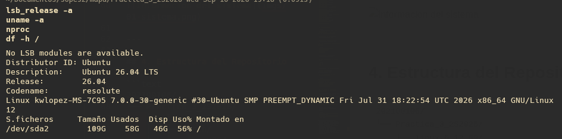

---

## 4. Estructura del Repositorio

```text
202100106/
└── Practica_3_2S2026/
    ├── linux-6.12.69/
    │   ├── arch/
    │   │   └── x86/
    │   │       └── entry/
    │   │           └── syscalls/
    │   │               └── syscall_64.tbl
    │   ├── include/
    │   │   └── linux/
    │   │       └── syscalls.h
    │   └── kernel/
    │       ├── Makefile
    │       ├── ipc_channel.c
    │       └── log_watch.c
    ├── Programa_Intermedio/
    │   ├── Makefile
    │   ├── test_ipc_channel_send.c
    │   ├── test_ipc_channel_receive.c
    │   ├── test_start_log_watch.c
    │   └── test_stop_log_watch.c
    ├── imgs/
    ├── diagrama_flujo.drawio
    ├── estructura_carpetas.drawio
    ├── practica3.sh
    └── README.md
```

---

## 5. Tabla de Syscalls Implementadas

| Nº | Nombre | Archivo | Parámetros | Retorno |
|---|---|---|---|---|
| 548 | `ipc_channel_send` | `kernel/ipc_channel.c` | `const char *mensaje` | `0` en éxito |
| 549 | `ipc_channel_receive` | `kernel/ipc_channel.c` | `char *buffer` | `0` en éxito |
| 550 | `start_log_watch` | `kernel/log_watch.c` | `char **rutas, int cantidad, char *log_central, char *palabra` | `watch_id > 0` |
| 551 | `stop_log_watch` | `kernel/log_watch.c` | `int id_monitoreo` | `0` en éxito |

### Códigos de error devueltos

| Código | Valor | Cuándo se devuelve |
|---|---|---|
| `-EINVAL` | -22 | Puntero nulo o parámetro fuera de rango |
| `-EFAULT` | -14 | Falla la copia entre espacio de usuario y kernel |
| `-ESRCH` | -3 | El `watch_id` no existe o ya fue detenido |
| `-ERESTARTSYS` | -512 | El receptor fue interrumpido por una señal |
| `-ENOMEM` | -12 | No hay memoria disponible en el kernel |
| `-EMSGSIZE` | -90 | El mensaje excede 256 bytes |
| `-EAGAIN` | -11 | La cola FIFO alcanzó los 128 mensajes |

---

## 6. Procedimiento Técnico Paso a Paso

### 6.1 Instalación de Herramientas

```bash
sudo apt update
sudo apt install -y build-essential libncurses-dev flex bison libssl-dev \
  libelf-dev bc dwarves zstd cpio kmod rsync git wget gawk sbsigntool \
  openssl mokutil pciutils initramfs-tools
```

### 6.2 Descarga y Extracción del Kernel 6.12.69

Todos los comandos de las secciones 6.3 a 6.11 se ejecutan **desde el árbol de compilación**, así que el punto de partida debe ser exacto. El primer `cd` usa la ruta completa para no depender del directorio actual:

```bash
cd ~/Documentos/sopes2/mapa/Practica_3_2S2026
mkdir -p so2_build_workspace
cd so2_build_workspace
wget -c https://cdn.kernel.org/pub/linux/kernel/v6.x/linux-6.12.69.tar.xz
tar -xf linux-6.12.69.tar.xz
cd linux-6.12.69
make kernelversion
pwd
```

El `pwd` debe terminar en:

```text
Practica_3_2S2026/so2_build_workspace/linux-6.12.69
```

Si aparece `Practica_3_2S2026/Practica_3_2S2026` significa que el `mkdir` se ejecutó desde dentro de la carpeta de la práctica y creó un árbol anidado. En ese caso las copias de la sección 6.3 fallan y la compilación se detiene con `No hay ninguna regla para construir el objetivo 'kernel/ipc_channel.o'` después de varios minutos.

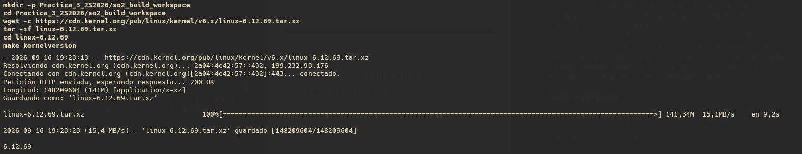

### 6.3 Archivo Modificado 1: `kernel/ipc_channel.c`

Archivo nuevo que contiene las dos syscalls del canal IPC.

```bash
cp ../../linux-6.12.69/kernel/ipc_channel.c kernel/ipc_channel.c
ls -l kernel/ipc_channel.c
```

### 6.4 Archivo Modificado 2: `kernel/log_watch.c`

Archivo nuevo que contiene las dos syscalls de monitoreo y la función del hilo de kernel.

```bash
cp ../../linux-6.12.69/kernel/log_watch.c kernel/log_watch.c
ls -l kernel/log_watch.c
```

Antes de continuar hay que confirmar que **ambos archivos llegaron al árbol**. Un `cp` fallido no detiene el proceso, pero sí detiene la compilación 20 minutos más tarde:

```bash
ls -l kernel/ipc_channel.c kernel/log_watch.c
```

### 6.5 Archivo Modificado 3: `kernel/Makefile`

Se agregan los dos objetos para que se enlacen estáticamente en la imagen del kernel.

```bash
echo "obj-y += ipc_channel.o" >> kernel/Makefile
echo "obj-y += log_watch.o"   >> kernel/Makefile
tail -5 kernel/Makefile
```

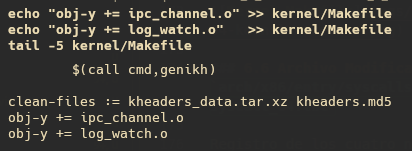

### 6.6 Archivo Modificado 4: `arch/x86/entry/syscalls/syscall_64.tbl`

Registro de los cuatro números de syscall. Los separadores deben ser **tabuladores**.

```bash
printf '548\tcommon\tipc_channel_send\tsys_ipc_channel_send\n'       >> arch/x86/entry/syscalls/syscall_64.tbl
printf '549\tcommon\tipc_channel_receive\tsys_ipc_channel_receive\n' >> arch/x86/entry/syscalls/syscall_64.tbl
printf '550\tcommon\tstart_log_watch\tsys_start_log_watch\n'         >> arch/x86/entry/syscalls/syscall_64.tbl
printf '551\tcommon\tstop_log_watch\tsys_stop_log_watch\n'           >> arch/x86/entry/syscalls/syscall_64.tbl
tail -6 arch/x86/entry/syscalls/syscall_64.tbl
```

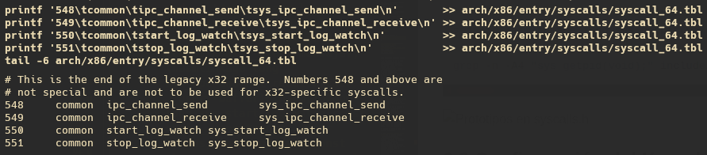

### 6.7 Archivo Modificado 5: `include/linux/syscalls.h`

Declaración de los prototipos para que el compilador conozca las firmas.

```bash
sed -i '/asmlinkage long sys_getpid(void);/a asmlinkage long sys_ipc_channel_send(const char __user *mensaje);\nasmlinkage long sys_ipc_channel_receive(char __user *buffer);\nasmlinkage long sys_start_log_watch(const char __user *const __user *rutas, int cantidad, const char __user *ruta_log_central, const char __user *palabra_clave);\nasmlinkage long sys_stop_log_watch(int id_monitoreo);' include/linux/syscalls.h

grep -n -A4 "sys_getpid(void);" include/linux/syscalls.h
```

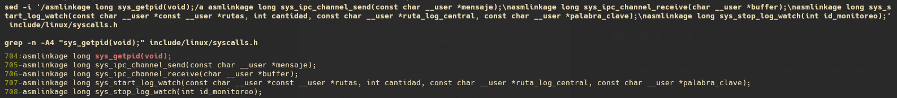

### 6.8 Configuración del Kernel

Se parte del `.config` de la distribución y se neutralizan las opciones que impiden compilar fuera del entorno de Ubuntu:

```bash
cp /boot/config-$(uname -r) .config
make olddefconfig

scripts/config --disable SYSTEM_TRUSTED_KEYS
scripts/config --disable SYSTEM_REVOCATION_KEYS
scripts/config --set-str SYSTEM_TRUSTED_KEYS ""
scripts/config --set-str SYSTEM_REVOCATION_KEYS ""
scripts/config --disable DEBUG_INFO
scripts/config --disable DEBUG_INFO_DWARF5
scripts/config --disable DEBUG_INFO_BTF
scripts/config --enable  DEBUG_INFO_NONE
scripts/config --disable RUST
```

#### Reducción con `localmodconfig`

Este es el paso que determina el tiempo de compilación. El `.config` de Ubuntu marca más de 6000 controladores como módulos (`=m`), la mayoría para hardware que la máquina no tiene. `localmodconfig` conserva únicamente los módulos que `lsmod` reporta cargados en este momento.

> **Importante:** antes de ejecutarlo hay que tener conectado y activo todo el hardware que se vaya a usar (wifi, USB, audio, webcam). Lo que no esté cargado en `lsmod` no se compilará, y el kernel nuevo arrancará sin ese soporte.

```bash
lsmod > /tmp/modulos-activos.txt
wc -l /tmp/modulos-activos.txt
grep -c '=m$' .config

yes '' | make LSMOD=/tmp/modulos-activos.txt localmodconfig

grep -c '=m$' .config
```

El conteo de `=m` debe caer de varios miles a aproximadamente el número de módulos que reporta `lsmod`. Si no baja, `localmodconfig` no se aplicó y la compilación tardará horas en lugar de minutos.

`yes ''` responde con la opción por defecto a las preguntas sobre símbolos nuevos. El comando termina con código 141 (`SIGPIPE` de `yes` al cerrarse la tubería); es normal y no indica fallo.

#### Versión, firma de módulos y lockdown

```bash
scripts/config --set-str LOCALVERSION "-so2-202100106"
scripts/config --disable LOCALVERSION_AUTO
scripts/config --enable  MODULE_SIG
scripts/config --enable  MODULE_SIG_ALL
scripts/config --enable  MODULE_SIG_SHA256
scripts/config --disable SECURITY_LOCKDOWN_LSM

make olddefconfig
```

#### Verificación previa a la compilación

`make olddefconfig` puede revertir en silencio algunos de los ajustes anteriores. Conviene confirmar el estado final antes de invertir los minutos de compilación:

```bash
grep -c '=m$' .config
grep '^CONFIG_LOCALVERSION=' .config
grep '^CONFIG_DEBUG_INFO_NONE' .config
ls -l kernel/ipc_channel.c kernel/log_watch.c
grep -n "ipc_channel\|log_watch" kernel/Makefile
grep -nE "^(548|549|550|551)" arch/x86/entry/syscalls/syscall_64.tbl
```

### 6.9 Compilación

```bash
time make -j$(nproc) 2>&1 | tee ../compilacion.log
ls -lh arch/x86/boot/bzImage
```

Si la compilación falla, el mensaje final de `make` es genérico. El error real hay que buscarlo dentro del log:

```bash
grep -nE "error:|No hay ninguna regla|No rule to make" ../compilacion.log | head
```

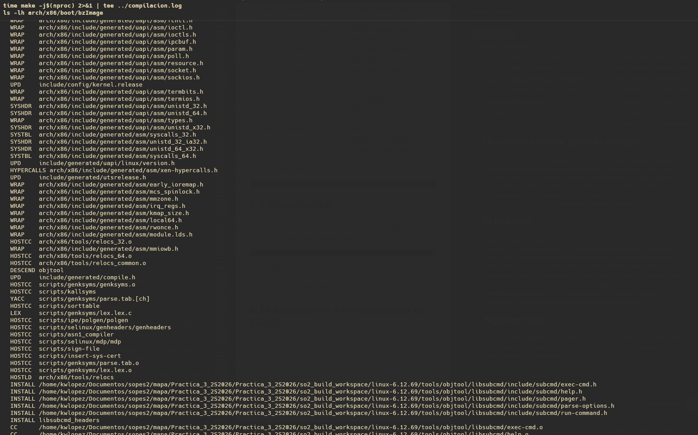

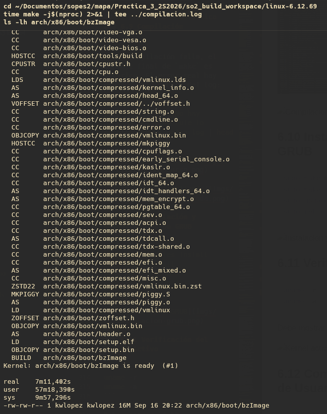

### 6.10 Instalación y Actualización de GRUB

```bash
sudo make modules_install
sudo make install
sudo update-grub
sudo reboot
```

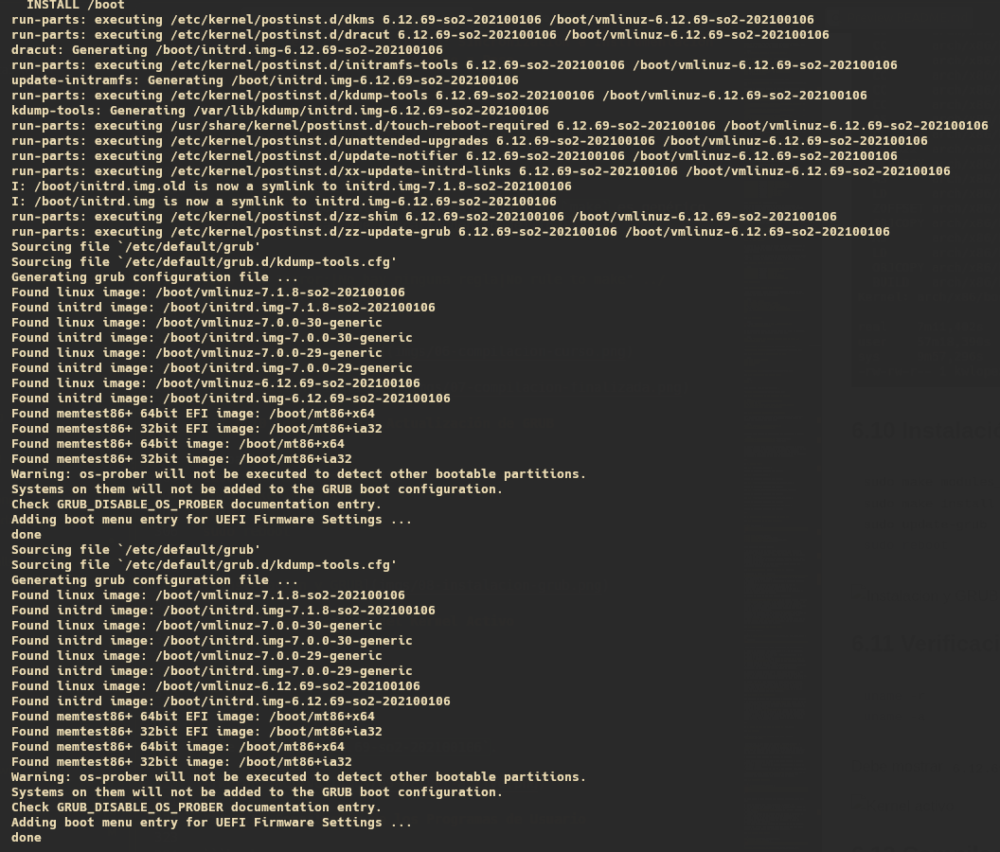

### 6.11 Verificación del Kernel Activo

```bash
uname -r
uname -a
```

Debe mostrar `6.12.69-so2-202100106`.

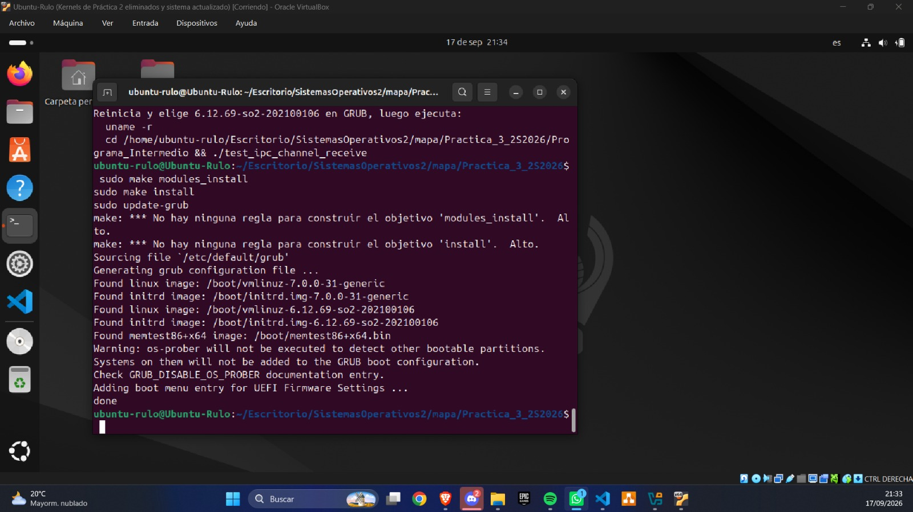

### 6.12 Compilación de los Programas de Usuario

```bash
cd Practica_3_2S2026/Programa_Intermedio
make clean && make
ls -l test_ipc_channel_send test_ipc_channel_receive test_start_log_watch test_stop_log_watch
```

### 6.13 Script de Preparación Automatizada

Todo el procedimiento anterior está automatizado en `practica3.sh`, diseñado para ejecutarse en cualquier máquina basada en Debian sin modificar una sola ruta.

```bash
chmod +x Practica_3_2S2026/practica3.sh
./Practica_3_2S2026/practica3.sh
```

Opciones para repetir la demostración sin recompilar el kernel:

```bash
./Practica_3_2S2026/practica3.sh --solo-programas
./Practica_3_2S2026/practica3.sh --solo-logs
```

El script ejecuta diez fases: dependencias, limpieza de kernels previos, descarga y verificación de la versión, aplicación de los archivos modificados con registro idempotente de syscalls, configuración con detección automática de GPU, compilación, instalación, firma para Secure Boot, compilación de los programas de usuario y generación de los logs de demostración.

---

## 7. Mecanismo de Sincronización del Canal IPC

### 7.1 Estructura de la cola compartida

```c
struct ipc_message {
	struct list_head list;
	char data[IPC_MSG_MAX_LEN];
};

static LIST_HEAD(ipc_queue);
static DEFINE_MUTEX(ipc_queue_lock);
static DECLARE_WAIT_QUEUE_HEAD(ipc_queue_wq);
static unsigned int ipc_queue_count;
```

Tres elementos trabajan juntos:

- **`ipc_queue`** es la cola FIFO, construida con las listas doblemente enlazadas del kernel. `list_add_tail()` inserta al final y `list_first_entry()` extrae del inicio, lo que garantiza el orden de llegada.
- **`ipc_queue_lock`** protege la sección crítica. Sin él, dos emisores concurrentes en núcleos distintos podrían corromper los punteros de la lista.
- **`ipc_queue_wq`** es la cola de espera donde duermen los receptores mientras no haya mensajes.

### 7.2 Justificación: `mutex` en lugar de `spinlock`

| Criterio | `mutex` | `spinlock` |
|---|---|---|
| ¿Puede dormir dentro de la sección crítica? | Sí | No, provoca `BUG: scheduling while atomic` |
| Contexto de uso | Proceso | Interrupción o secciones atómicas muy cortas |
| Comportamiento cuando está ocupado | Cede la CPU al planificador | Gira en un bucle consumiendo CPU |
| Coste con secciones críticas largas | Bajo | Muy alto |
| Uso en sistemas monoprocesador | Funcional | Se convierte en operación nula, riesgo de bloqueo |

Se eligió **`mutex`** por tres razones concretas:

1. **La sección crítica puede dormir.** El emisor ejecuta `kmalloc(sizeof(*nodo), GFP_KERNEL)` y el receptor ejecuta `kfree()`. La bandera `GFP_KERNEL` permite explícitamente que el asignador duerma si necesita liberar páginas. Dormir con un spinlock tomado deja el candado retenido indefinidamente mientras otro núcleo gira en vacío: un *deadlock*.
2. **El código corre siempre en contexto de proceso.** Ambas syscalls son invocadas por un programa de usuario, nunca desde un manejador de interrupciones. El spinlock está diseñado para contexto atómico, donde no es posible ceder la CPU.
3. **El receptor debe poder bloquearse.** El diseño exige que el proceso duerma hasta que llegue un mensaje. Eso es incompatible con la naturaleza atómica del spinlock.

### 7.3 Bloqueo pasivo sin espera activa

El receptor ejecuta:

```c
espera = wait_event_interruptible(ipc_queue_wq, ipc_queue_count > 0);
if (espera)
	return -ERESTARTSYS;
```

`wait_event_interruptible` hace lo siguiente de forma atómica:

1. Evalúa la condición `ipc_queue_count > 0`. Si es verdadera, retorna inmediatamente sin dormir.
2. Si es falsa, marca la tarea como `TASK_INTERRUPTIBLE` y la inscribe en la cola de espera.
3. Llama a `schedule()`, lo que **saca al proceso de la cola de ejecución del planificador**. A partir de ese momento el proceso no recibe tiempo de CPU en absoluto.
4. Cuando el emisor ejecuta `wake_up_interruptible(&ipc_queue_wq)`, la tarea vuelve a `TASK_RUNNING` y el planificador la reprograma. La condición se reevalúa antes de continuar.

Un polling o espera activa sería `while (cola_vacia()) ;`, que mantiene al proceso en estado `R` consumiendo el 100% de un núcleo. La diferencia se comprueba empíricamente en la sección 9.4: el receptor bloqueado aparece en estado `S` con `%CPU = 0.0`.

El bucle `for (;;)` que envuelve al `wait_event_interruptible` **no es espera activa**: solo existe para el caso de múltiples receptores compitiendo. Cuando llega un mensaje se despiertan todos, pero solo uno logra extraerlo; los demás encuentran la cola vacía y **vuelven a dormirse pasivamente**. En el camino común el bucle ejecuta una sola iteración.

### 7.4 Orden de las operaciones

Dos detalles del orden son deliberados y previenen fallos reales:

- **`wake_up_interruptible()` se llama fuera del `mutex`.** Si se llamara dentro, el receptor despertaría solo para bloquearse de inmediato en el candado que el emisor aún retiene, provocando un cambio de contexto inútil.
- **`copy_to_user()` se llama fuera del `mutex`.** Esta función puede provocar un fallo de página si la memoria del usuario está paginada a disco, lo que duerme al proceso. Dormir reteniendo el candado bloquearía a todos los emisores. Por eso el mensaje se copia primero a una variable local en pila y el nodo se libera antes de tocar el espacio de usuario.

---

## 8. Ciclo de Vida del Hilo de Kernel en `log_watch`

### 8.1 Creación

```c
entrada->hilo = kthread_run(log_watch_hilo, entrada, "log_watch_%d", id);
```

`kthread_run` es una macro que combina `kthread_create()` y `wake_up_process()`: crea el hilo **y lo pone a correr inmediatamente**. Recibe la función a ejecutar, el puntero de datos que se le pasará como argumento, y el nombre que aparecerá en `ps`. El `watch_id` se asigna bajo `log_watch_lock` para que dos procesos concurrentes nunca reciban el mismo identificador.

A diferencia de un proceso de usuario, el kthread:

- Vive permanentemente en Ring 0 y no tiene espacio de usuario asociado (`task->mm == NULL`).
- No tiene proceso padre en el sentido tradicional; su padre es `kthreadd` (PID 2).
- Aparece entre corchetes en `ps -ef`, por ejemplo `[log_watch_1]`.
- **Sobrevive a la terminación del proceso que lo creó**, que es precisamente lo que exige el enunciado: el monitoreo debe continuar sin intervención del proceso que lo inició.

### 8.2 Ejecución periódica

```c
while (!kthread_should_stop()) {
	for (i = 0; i < entrada->cantidad; i++)
		log_watch_revisar_archivo(entrada, &entrada->archivos[i]);
	...
}
```

En cada ronda el hilo recorre los archivos vigilados. Para cada uno:

1. Abre el archivo con `filp_open(ruta, O_RDONLY, 0)`.
2. Si el archivo fue truncado o rotado (`i_size_read()` menor al `offset` guardado), reinicia el `offset` a 0.
3. Lee **solo el contenido nuevo** desde el `offset` guardado con `kernel_read()`.
4. Trunca el buffer en el último salto de línea y retrocede el `offset` hasta ahí, de modo que una línea incompleta no se procese a medias y se lea completa en la siguiente ronda.
5. Divide el contenido en líneas con `strsep()` y busca la palabra clave con `strstr()`.
6. Por cada coincidencia escribe una entrada en el log central.

Guardar un `offset` por archivo es lo que evita que cada ronda vuelva a reportar todas las líneas ya procesadas.

### 8.3 Espera entre rondas

```c
set_current_state(TASK_INTERRUPTIBLE);
if (kthread_should_stop()) {
	set_current_state(TASK_RUNNING);
	break;
}
schedule_timeout(msecs_to_jiffies(LOG_WATCH_INTERVAL_MS));
```

El hilo duerme 3 segundos sin consumir CPU. `schedule_timeout` con estado `TASK_INTERRUPTIBLE` permite que `kthread_stop()` lo despierte antes de que venza el temporizador, en lugar de tener que esperar los 3 segundos completos.

### 8.4 Comprobación de detención

`kthread_should_stop()` se consulta **dos veces por vuelta**: en la condición del `while` y justo antes de dormir. La segunda comprobación es la importante: sin ella existe una ventana en la que el hilo decide dormirse justo después de que `kthread_stop()` fijó la bandera, y la detención tardaría un ciclo completo de 3 segundos.

### 8.5 Terminación segura

```c
mutex_lock(&log_watch_lock);
list_for_each_entry(entrada, &log_watch_list, list) {
	if (entrada->id == id_monitoreo) {
		encontrada = entrada;
		list_del(&entrada->list);
		break;
	}
}
mutex_unlock(&log_watch_lock);

if (!encontrada)
	return -ESRCH;

kthread_stop(encontrada->hilo);
log_watch_liberar_entrada(encontrada);
```

El orden es crítico:

1. **Bajo el mutex** se busca la entrada y se saca de la lista. Esto hace la operación idempotente: una segunda llamada con el mismo ID ya no la encuentra y devuelve `-ESRCH`, que es exactamente lo que exige el enunciado.
2. **Se suelta el mutex antes de llamar a `kthread_stop()`.** Esta función activa la bandera de parada, despierta al hilo y **bloquea hasta que la función del hilo retorna**. Si se llamara reteniendo el candado, cualquier otro proceso que intentara iniciar o detener un monitoreo quedaría congelado durante esa espera.
3. **Después de que el hilo terminó** se liberan las rutas con `kfree()` y la estructura completa. Liberar antes de que el hilo termine causaría un *use-after-free*: el hilo podría estar leyendo `entrada->archivos[i].ruta` en ese preciso instante.

---

## 9. Registro de Evidencias

### 9.1 Receptor bloqueado en espera

```bash
cd Practica_3_2S2026/Programa_Intermedio
./test_ipc_channel_receive
```

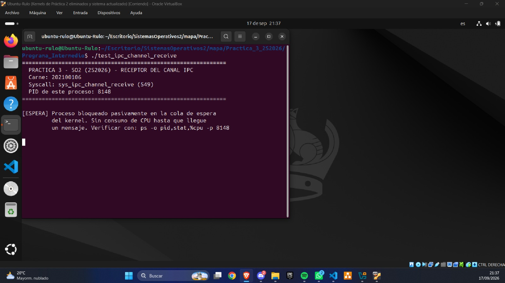

### 9.2 Emisor enviando mensajes

```bash
./test_ipc_channel_send
```

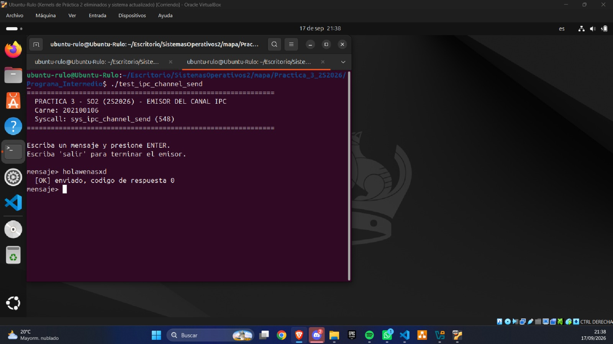

### 9.3 Receptor desbloqueado imprimiendo el mensaje


### 9.4 Evidencia de bloqueo pasivo (0% de CPU)

```bash
ps -o pid,stat,%cpu,comm -C test_ipc_channel_receive
top -b -n 1 | grep test_ipc_chan
```

El estado debe ser `S` (sleeping, interrumpible) y `%CPU` igual a `0.0`, lo que demuestra la ausencia de espera activa.

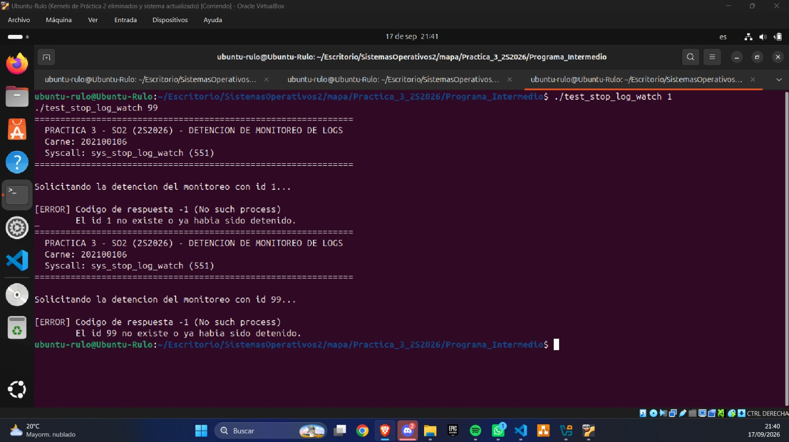

### 9.5 Inicio del monitoreo de logs

```bash
mkdir -p ~/so2_logs
: > ~/so2_logs/app1.log
: > ~/so2_logs/app2.log
: > ~/so2_logs/log_centralizado.txt

./test_start_log_watch ERROR ~/so2_logs/log_centralizado.txt \
    ~/so2_logs/app1.log ~/so2_logs/app2.log
```

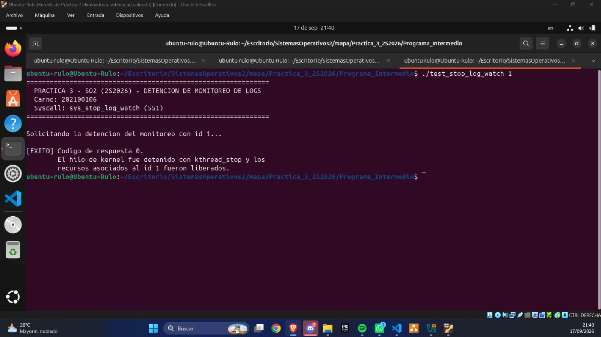

### 9.6 Hilo de kernel activo en segundo plano

```bash
ps -ef | grep log_watch
ps -o pid,stat,comm -C log_watch_1
```

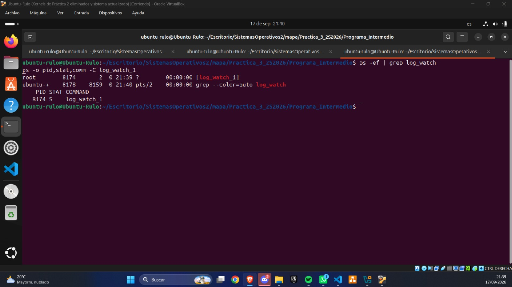

### 9.7 Detección de la palabra clave y log centralizado

```bash
echo "INFO servicio iniciado"            >> ~/so2_logs/app1.log
echo "ERROR conexion rechazada"          >> ~/so2_logs/app1.log
echo "WARN memoria alta"                 >> ~/so2_logs/app2.log
echo "ERROR timeout en base de datos"    >> ~/so2_logs/app2.log
sleep 5
cat ~/so2_logs/log_centralizado.txt
```

Cada entrada contiene los tres campos exigidos: ruta del archivo de origen, palabra clave detectada y contenido de la línea.

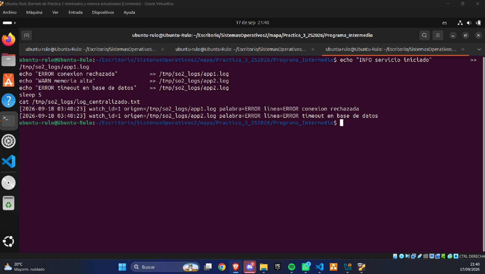

### 9.8 Detención del monitoreo

```bash
./test_stop_log_watch 1
```


### 9.9 Manejo de error con ID inexistente o ya detenido

```bash
./test_stop_log_watch 1
./test_stop_log_watch 99
```

Ambas llamadas deben devolver `-ESRCH`.


### 9.10 Trazas del kernel

```bash
sudo dmesg | grep -E "ipc_channel|log_watch" | tail -30
```

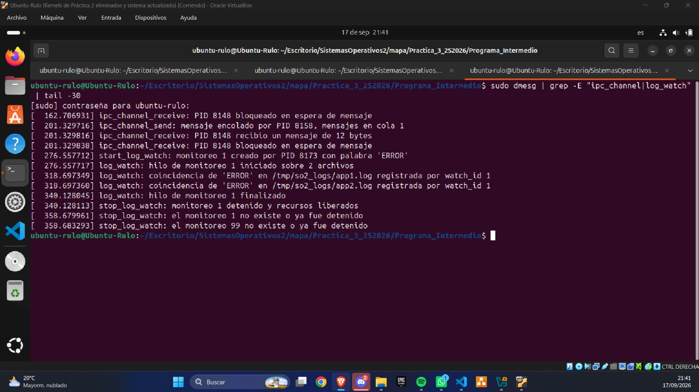

---

## 10. Reporte de Errores Encontrados

### Error 1: El kernel no encuentra `ipc_channel.o` al compilar

**Descripción del problema:**

Después de unos 25 minutos de compilación, `make` se detuvo con un error genérico en el Makefile principal y no se generó `arch/x86/boot/bzImage`. El mensaje final no indicaba qué había fallado; el error real estaba varios miles de líneas antes, dentro de `compilacion.log`.

Al revisar las rutas se descubrió que la compilación se había hecho en un árbol anidado, `Practica_3_2S2026/Practica_3_2S2026/so2_build_workspace/linux-6.12.69`. Ese árbol tenía agregadas las líneas `obj-y += ipc_channel.o` y `obj-y += log_watch.o` en `kernel/Makefile`, pero los archivos `ipc_channel.c` y `log_watch.c` nunca llegaron a él.

**Mensaje obtenido:**

Mensaje final de la compilación:

```text
make[1]: *** [.../so2_build_workspace/linux-6.12.69/Makefile:1945: .] Error 2
make: *** [Makefile:224: __sub-make] Error 2

real    24m53,085s
user    233m30,657s
sys     40m58,805s
ls: no se puede acceder a 'arch/x86/boot/bzImage': No existe el archivo o directorio
```

Error real, localizado con `grep` dentro del log:

```bash
grep -nE "error:|No hay ninguna regla|Error 2" ../compilacion.log | head
```

```text
make[3]: *** No hay ninguna regla para construir el objetivo 'kernel/ipc_channel.o', necesario para 'kernel/built-in.a'.  Alto.
make[2]: *** [scripts/Makefile.build:466: kernel] Error 2
```

**Fuente técnica consultada:**

- Documentación oficial de Kbuild, sección *Goal definitions* (`obj-y`): <https://www.kernel.org/doc/html/latest/kbuild/makefiles.html>. Explica que cada objeto listado en `obj-y` se construye a partir de un archivo fuente con el mismo nombre en ese directorio; si el `.c` no existe, no hay regla para producir el `.o`.
- Manual de GNU Make, sección *Error Messages*: <https://www.gnu.org/software/make/manual/html_node/Error-Messages.html>. Describe el significado de `No rule to make target` (en español, `No hay ninguna regla para construir el objetivo`).

**Código antes de la solución:**

Los comandos de descarga se ejecutaron estando ya dentro de `Practica_3_2S2026`, por lo que el `mkdir` creó una segunda carpeta con el mismo nombre. Desde ese árbol, la ruta relativa `../../linux-6.12.69/` no apuntaba al overlay y el `cp` falló, mientras que los `echo` hacia el Makefile sí funcionaron:

```bash
mkdir -p Practica_3_2S2026/so2_build_workspace
cd Practica_3_2S2026/so2_build_workspace
tar -xf linux-6.12.69.tar.xz
cd linux-6.12.69

cp ../../linux-6.12.69/kernel/ipc_channel.c kernel/ipc_channel.c
cp ../../linux-6.12.69/kernel/log_watch.c kernel/log_watch.c
echo "obj-y += ipc_channel.o" >> kernel/Makefile
echo "obj-y += log_watch.o"   >> kernel/Makefile
```

**Código después de la solución:**

Se fija el punto de partida con una ruta completa, se confirma la ubicación con `pwd` y se verifica que los archivos existan antes de compilar:

```bash
cd ~/Documentos/sopes2/mapa/Practica_3_2S2026
mkdir -p so2_build_workspace
cd so2_build_workspace
tar -xf linux-6.12.69.tar.xz
cd linux-6.12.69
pwd

cp ../../linux-6.12.69/kernel/ipc_channel.c kernel/ipc_channel.c
cp ../../linux-6.12.69/kernel/log_watch.c kernel/log_watch.c
ls -l kernel/ipc_channel.c kernel/log_watch.c
```

En el script `practica3.sh` se agregó además una validación que detiene la ejecución antes de compilar si alguno de los dos archivos falta:

```bash
for fuente in kernel/ipc_channel.c kernel/log_watch.c; do
    if [ ! -s "$fuente" ]; then
        err "El archivo ${fuente} no llego al arbol de compilacion o esta vacio."
        exit 1
    fi
done
```

**Explicación de la causa:**

Una ruta relativa depende del directorio desde donde se ejecuta. Al empezar en el lugar equivocado, la carpeta de trabajo quedó anidada y la copia de los archivos fuente apuntó a una ruta inexistente. Como la copia falló pero la edición del Makefile no, el kernel quedó pidiendo dos archivos que no tenía, y el error solo apareció al llegar a compilar el directorio `kernel/`, muchos minutos después.

La lección práctica es verificar el estado del árbol antes de iniciar una compilación larga, y buscar el error real dentro del log en lugar de confiar en el último mensaje de `make`.

---

### Error 2: La compilación incluía más de 6000 módulos innecesarios

**Descripción del problema:**

En el mismo intento fallido del Error 1, la compilación llevaba casi 25 minutos y seguía construyendo controladores para hardware que la máquina no tiene. Entre ellos estaban los de `drivers/comedi/` (tarjetas de adquisición de datos de National Instruments) y `drivers/iio/` (sensores industriales de luz, presión y convertidores analógico-digitales).

La configuración se había tomado del `.config` de Ubuntu, que está pensado para arrancar en cualquier computadora y por eso activa casi todos los controladores como módulos. Faltó el paso `localmodconfig`, que recorta esa lista a lo que la máquina realmente usa.

**Mensaje obtenido:**

La salida de la compilación mostraba miles de módulos ajenos al equipo:

```text
  CC [M]  drivers/comedi/drivers/s626.o
  CC [M]  drivers/iio/light/opt4001.o
  CC [M]  drivers/iio/pressure/ms5637.o
  CC [M]  drivers/comedi/drivers/ni_daq_700.o
  CC [M]  drivers/iio/adc/ti-adc081c.o
  CC [M]  drivers/comedi/drivers/ni_routing/ni_device_routes/pci-6070e.o
```

Al comparar los módulos activos en la configuración contra los que el sistema tenía cargados:

```bash
grep -c '=m$' .config
lsmod | tail -n +2 | wc -l
grep '^CONFIG_COMEDI=' .config
```

```text
6306
100
CONFIG_COMEDI=m
```

**Fuente técnica consultada:**

- Documentación oficial del kernel, *The Linux kernel user's and administrator's guide*, sección de configuración: <https://www.kernel.org/doc/html/latest/admin-guide/README.html>. Describe `make localmodconfig` como la opción que crea una configuración a partir de la actual y de los módulos cargados (`lsmod`), desactivando los que no se usan.
- Ayuda integrada del sistema de configuración del kernel:

```bash
make help | grep -A1 localmodconfig
```

**Código antes de la solución:**

La configuración se aplicaba sin la reducción:

```bash
cp /boot/config-$(uname -r) .config
make olddefconfig

scripts/config --disable SYSTEM_TRUSTED_KEYS
scripts/config --disable SYSTEM_REVOCATION_KEYS
scripts/config --disable DEBUG_INFO
scripts/config --enable  DEBUG_INFO_NONE
scripts/config --disable RUST

make olddefconfig
time make -j$(nproc) 2>&1 | tee ../compilacion.log
```

**Código después de la solución:**

Se agrega `localmodconfig` usando la lista de módulos cargados, y se compara el conteo antes y después:

```bash
lsmod > /tmp/modulos-activos.txt
grep -c '=m$' .config

yes '' | make LSMOD=/tmp/modulos-activos.txt localmodconfig

grep -c '=m$' .config
```

```text
6306
104
```

En `practica3.sh` se agregó una validación que detiene el script si la reducción no se aplicó, en lugar de dejar correr una compilación de horas:

```bash
MODULOS_DESPUES=$(grep -c '=m$' .config || true)
if [ "$MODULOS_DESPUES" -gt $((MODULOS_CARGADOS * 4 + 200)) ]; then
    err "localmodconfig no surtio efecto: ${MODULOS_DESPUES} modulos para ${MODULOS_CARGADOS} cargados."
    exit 1
fi
```

**Explicación de la causa:**

La configuración de una distribución está hecha para funcionar en miles de computadoras distintas, así que incluye casi todo. Compilarla completa es posible, pero toma muchísimo más tiempo. `localmodconfig` revisa qué módulos está usando la máquina en ese momento y apaga el resto. Por eso hay que ejecutarlo con todo el hardware conectado: lo que no esté cargado no se compilará.

---

### Error 3: Se activaban los controladores de AMD en una máquina con tarjeta NVIDIA

**Descripción del problema:**

Al revisar la configuración final antes de compilar se encontró que `DRM_AMDGPU` y `DRM_RADEON`, los controladores de video para tarjetas AMD, estaban activados como parte fija del kernel (`=y`). La máquina solo tiene una tarjeta NVIDIA. `amdgpu` es de los controladores más grandes del kernel, así que añadía tiempo de compilación y tamaño a la imagen sin ninguna utilidad.

La detección de la tarjeta de video se hace con `lspci` y un filtro de `grep`. El filtro buscaba la palabra `ATI` (el nombre de la antigua marca de tarjetas de AMD) sin exigir que fuera una palabra completa, y con la opción `-i` no distingue mayúsculas de minúsculas. La salida de `lspci` siempre contiene la frase `VGA compatible controller`, y `compatible` contiene las letras `ati`.

**Mensaje obtenido:**

No hubo mensaje de error: la configuración se aplicó en silencio. El problema apareció al revisar el `.config`:

```bash
lspci | grep -iE "VGA|3D controller"
grep -E '^CONFIG_DRM_(AMDGPU|RADEON|NOUVEAU)=' .config
```

```text
2b:00.0 VGA compatible controller: NVIDIA Corporation TU104 [GeForce RTX 2080 SUPER] (rev a1)
CONFIG_DRM_AMDGPU=y
CONFIG_DRM_RADEON=y
CONFIG_DRM_NOUVEAU=y
```

Prueba aislada del filtro, donde se ve la coincidencia dentro de `compatible`:

```bash
echo 'VGA compatible controller: NVIDIA Corporation' | grep -oiE "\bAMD\b|ATI|Radeon"
```

```text
ati
```

**Fuente técnica consultada:**

- Manual de GNU grep, sección *Regular Expressions*, apartado sobre el operador `\b` (límite de palabra): <https://www.gnu.org/software/grep/manual/grep.html>.
- Página de manual local:

```bash
man grep
```

**Código antes de la solución:**

```bash
GPU_DETECTADA=$(lspci | grep -iE "VGA|3D controller" || true)
if echo "$GPU_DETECTADA" | grep -qiE "\bAMD\b|ATI|Radeon"; then
    scripts/config --enable DRM_AMDGPU
    scripts/config --enable DRM_RADEON
fi
```

**Código después de la solución:**

Se agrega `\b` alrededor de `ATI` para que solo coincida como palabra completa, igual que ya se hacía con `AMD`:

```bash
GPU_DETECTADA=$(lspci | grep -iE "VGA|3D controller" || true)
if echo "$GPU_DETECTADA" | grep -qiE "\bAMD\b|\bATI\b|Radeon"; then
    scripts/config --enable DRM_AMDGPU
    scripts/config --enable DRM_RADEON
fi
```

Y se desactivan en la configuración ya generada:

```bash
scripts/config --disable DRM_AMDGPU
scripts/config --disable DRM_RADEON
make olddefconfig
grep -c '=m$' .config
```

```text
88
```

**Explicación de la causa:**

Una búsqueda de texto encuentra las letras donde sea que aparezcan, incluso en medio de otra palabra. Buscar `ATI` sin más también encuentra `compATIble`, y como esa palabra aparece en la descripción de cualquier tarjeta de video, la condición se cumplía siempre, fuera cual fuera la marca. Marcar los límites de palabra con `\b` hace que solo cuente `ATI` cuando aparece sola. Este error venía heredado de los scripts de las prácticas anteriores y había pasado desapercibido porque no produce ningún fallo visible; solo hace la compilación más lenta.

---

## 11. Análisis Técnico

### 11.1 Ring 0 vs Ring 3 y transferencia segura de memoria

La arquitectura x86-64 separa la ejecución en anillos de privilegio. En **Ring 3** las aplicaciones no pueden acceder a estructuras del núcleo ni ejecutar instrucciones privilegiadas. En **Ring 0** el kernel tiene acceso total, y cualquier fallo se convierte en un kernel panic que detiene el sistema completo.

Un puntero recibido desde espacio de usuario es un valor **no confiable**. Podría ser nulo, apuntar a memoria no mapeada, o apuntar deliberadamente a una dirección del propio kernel para sobrescribirla. Por eso el kernel nunca desreferencia esos punteros directamente y usa:

- `copy_from_user()` / `copy_to_user()` para bloques de memoria de tamaño conocido.
- `strncpy_from_user()` para cadenas con longitud máxima, cuando el destino ya está reservado.
- `strndup_user()` para cadenas cuya longitud no se conoce de antemano; reserva la memoria en el kernel y copia en un solo paso.

En `sys_start_log_watch` el parámetro `rutas` es un **arreglo de punteros de usuario**, lo que exige una doble copia: primero el arreglo con `copy_from_user()`, y luego cada cadena apuntada con `strndup_user()`. Copiar solo el arreglo dejaría punteros de usuario que el kthread intentaría desreferenciar más tarde, cuando el espacio de direcciones del proceso creador probablemente ya no exista.

### 11.2 Colas de espera del kernel

Una *wait queue* es una lista de tareas dormidas asociada a una condición. El kernel las usa para todo lo que implique esperar un evento: E/S de disco, llegada de paquetes de red, disponibilidad de datos en un pipe. La implementación de este canal IPC reproduce exactamente el mismo mecanismo que usa un pipe real de Linux.

El par `wait_event_interruptible` / `wake_up_interruptible` resuelve además una condición de carrera sutil: la inscripción en la cola y la evaluación de la condición ocurren de forma atómica, evitando el escenario en que el emisor despierta la cola justo entre la comprobación y el `schedule()`, lo que dejaría al receptor dormido para siempre.

El sufijo `interruptible` significa que una señal (como `Ctrl+C`) puede despertar al proceso. En ese caso la syscall retorna `-ERESTARTSYS`, valor que el kernel intercepta para reiniciar la llamada automáticamente o propagar `EINTR` al programa, según cómo esté configurado el manejador de señales.

### 11.3 Secciones críticas y condiciones de carrera

Una condición de carrera ocurre cuando el resultado depende del orden de ejecución de operaciones concurrentes. En esta práctica hay dos estructuras compartidas expuestas a ese riesgo:

- **La cola FIFO del canal IPC:** dos emisores en núcleos distintos ejecutando `list_add_tail()` simultáneamente pueden entrelazar sus escrituras de punteros y corromper la lista de forma irreparable.
- **La lista de monitoreos activos:** un proceso iniciando un monitoreo mientras otro lo detiene puede recorrer una lista que está siendo modificada, o asignar un `watch_id` duplicado.

Ambas se protegen con un `mutex`. La regla general es que toda estructura de datos alcanzable desde más de un hilo de ejecución necesita un candado, y que el candado debe mantenerse el menor tiempo posible: en este código las operaciones lentas (asignación de memoria, copia a espacio de usuario, detención de hilos) quedan deliberadamente fuera de la sección crítica.

### 11.4 Hilos de kernel frente a procesos de usuario

| Característica | Proceso de usuario | Hilo de kernel |
|---|---|---|
| Espacio de direcciones (`task->mm`) | Propio | `NULL` |
| Anillo de ejecución | Ring 3, entra a Ring 0 vía syscalls | Siempre Ring 0 |
| Creación | `fork()` / `clone()` | `kthread_run()` / `kthread_create()` |
| Padre | Otro proceso de usuario | `kthreadd` (PID 2) |
| Visualización en `ps` | Nombre del ejecutable | Nombre entre corchetes |
| Terminación | `exit()`, señales | `kthread_stop()` cooperativo |
| Acceso a memoria de usuario | Directo a la suya | Requiere copia explícita |

La diferencia más importante para esta práctica es la **terminación cooperativa**. A un proceso de usuario se lo puede matar con `SIGKILL` en cualquier instante. A un kthread no: `kthread_stop()` solamente activa una bandera y espera. El hilo debe consultar `kthread_should_stop()` y retornar por su cuenta. Un hilo que nunca consulte esa bandera colgaría el sistema, porque `kthread_stop()` esperaría indefinidamente.

### 11.5 E/S de archivos desde el kernel sin `set_fs()`

Históricamente, leer archivos desde el kernel se hacía con el truco de `set_fs(KERNEL_DS)`, que engañaba temporalmente a las funciones de validación para que aceptaran punteros de kernel. Ese mecanismo fue **eliminado del kernel a partir de la versión 5.10** por ser una fuente recurrente de vulnerabilidades: cualquier error en el flujo de restauración dejaba abierta la validación de punteros.

El reemplazo moderno son `kernel_read()` y `kernel_write()`, que reciben explícitamente un puntero de kernel y un `loff_t *pos` con la posición. En kernel 6.12 intentar usar `set_fs()` produce directamente un error de compilación por función no declarada.

El log central se abre con la bandera `O_APPEND`, lo que hace que el subsistema VFS reposicione la escritura al final del archivo de forma atómica en cada llamada. Sin esa bandera, cada detección sobrescribiría el archivo desde el inicio.

---

## 12. Conclusiones y Lecciones Aprendidas

1. **Construir estas herramientas desde cero ayuda a entender las que ya existen.** Después de programar un canal de mensajes y un vigilante de archivos dentro del kernel, mecanismos como los pipes o `inotify` dejan de ser cajas negras: por dentro resuelven los mismos problemas de esperar, compartir datos y coordinarse.

2. **Esperar bien es tan importante como hacer el trabajo.** Un proceso que espera un mensaje no necesita estar preguntando todo el tiempo si ya llegó; puede dormirse y dejar que el sistema lo despierte. Así no gasta procesador mientras espera, y eso se pudo comprobar viendo que el receptor bloqueado usaba 0% de CPU.

3. **Cuando varios procesos comparten algo, hay que ordenar el acceso.** Si dos programas modifican la misma cola al mismo tiempo, la pueden dañar. El candado (`mutex`) hace que entren de uno en uno, y hay que soltarlo lo antes posible para no hacer esperar a los demás.

4. **Un hilo del kernel trabaja por su cuenta, pero se detiene de forma ordenada.** El monitoreo siguió funcionando aunque el programa que lo inició ya había terminado. Para apagarlo no se le obliga a parar: se le avisa y él mismo termina lo que estaba haciendo antes de salir, lo que evita dejar recursos a medias.

5. **En el kernel los errores cuestan caro, así que conviene verificar antes de avanzar.** Una compilación puede tardar muchos minutos y fallar al final por un detalle que se pudo revisar al inicio, como un archivo que no se copió. Revisar rutas, archivos y configuración antes de compilar ahorra mucho tiempo.
