# Informe Técnico — Práctica 4: Integración de Syscalls

**Sistema de Monitoreo y Seguridad con Dashboard en Tiempo Real**  
**Nombre:** Keneth Lopez  
**Carné:** 202100106  
**Curso:** Sistemas Operativos 2 — 2S2026  
**Facultad de Ingeniería, Universidad de San Carlos de Guatemala**  

---

## 1. Introducción

En las Prácticas 2 y 3 se construyeron mecanismos del kernel de Linux de forma aislada:
- **Práctica 2:** Inspección de procesos bajo demanda (`sys_get_process_info` y `sys_get_processes_state`).
- **Práctica 3:** Comunicación segura entre procesos con sincronización pasiva (`sys_ipc_channel_send` / `sys_ipc_channel_receive`) y monitoreo de eventos en archivos con hilos de kernel autónomos (`sys_start_log_watch` / `sys_stop_log_watch`).

Las herramientas reales de instrumentación, observabilidad y seguridad (tales como agentes EDR o APMs de nivel de producción) nunca dependen de un único mecanismo: coordinan múltiples fuentes de información del kernel y del sistema de archivos virtual (`/proc`), las estructuran y las presentan a través de paneles visuales para la toma de decisiones.

En esta **Práctica 4**, se integran las seis llamadas al sistema en un único kernel **Linux 6.12.69 LTS**, coordinadas por un **daemon orquestador en lenguaje C** que expone la información hacia un **Dashboard Web en Tiempo Real**. El núcleo arquitectónico de la práctica radica en el rediseño del canal IPC: **sustituir el sondeo activo (polling ciego) por un modelo estricto de notificación *Event-Driven* entre kernel y espacio de usuario**.

---

## 2. Objetivos

### Objetivo General
Diseñar, implementar e integrar un sistema completo de instrumentación y monitoreo del sistema operativo que coordine seis llamadas al sistema personalizadas, métricas de memoria desde `/proc/meminfo` y escaneo de procesos, exponiendo los datos en tiempo real hacia un dashboard web mediante Server-Sent Events (SSE).

### Objetivos Específicos
1. Consolidar y renumerar las llamadas al sistema de P2 y P3 en la tabla `syscall_64.tbl` del kernel Linux 6.12.69 LTS sin colisiones de números.
2. Rediseñar el hilo de kernel `log_watch` para actuar como productor directo del canal IPC mediante la función interna `ipc_channel_enqueue_kernel()`, eliminando el sondeo del daemon hacia el kernel para enterarse de los eventos.
3. Construir un daemon multihilo en C que orqueste la recepción de eventos por IPC, la recolección de métricas de memoria y procesos, y la serialización canónica a formato JSON.
4. Implementar un servidor HTTP embebido en C capaz de mantener conexiones persistentes bajo el protocolo Server-Sent Events (SSE) para entrega instantánea de eventos sin requerir WebSockets pesados.
5. Desarrollar un dashboard web interactivo con cinco visualizaciones obligatorias (desglose de memoria, historial de swap/memoria física, tabla de procesos, consulta puntual por PID y panel de eventos de seguridad reactivo).
6. Aislar el entorno de ejecución dentro de una máquina virtual (KVM/QEMU) para garantizar estabilidad y neutralidad de controladores gráficos respecto al hardware host.

---

## 3. Entorno de Trabajo y Virtualización

Para evitar los conflictos habituales con controladores de video privativos (NVIDIA) al arrancar kernels modificados, la práctica se estructuró bajo un entorno de virtualización nativo con **KVM (Kernel-based Virtual Machine)** y **QEMU**:

| Componente | Entorno Host | Máquina Virtual de Pruebas (VM) |
|---|---|---|
| **Sistema Operativo** | Linux Mint / Ubuntu x86_64 | Ubuntu 26.04.1 LTS x86_64 |
| **Hipervisor** | KVM (`kvm_amd`) + Virt-Manager 5.1.0 | N/A (Entorno huésped) |
| **Kernel en Ejecución** | Linux genérico host | **Linux 6.12.69-so2-202100106** |
| **Arquitectura de CPU** | x86_64 (12 núcleos disponibles) | x86_64 (4 vCPUs asignados, 3.2 GB de RAM visibles) |
| **Controlador de Gráficos** | NVIDIA Propietario (Host) | QXL paravirtual (sin driver privativo) |
| **Compilador y Herramientas** | GCC 13.x, GNU Make, GDB, Strace | GCC 15.2.0, GNU Make, Libpthread |
| **Almacenamiento** | N/A | Disco de sistema de 20 GB + disco de 20 GB dedicado a la compilación |
| **Arranque e initramfs** | N/A | BIOS (sin Secure Boot), GRUB 2.14, initramfs generado con `dracut` |

```bash
# En la máquina virtual
uname -a
lsb_release -a
gcc --version

# En el host
virsh --version
qemu-system-x86_64 --version
```

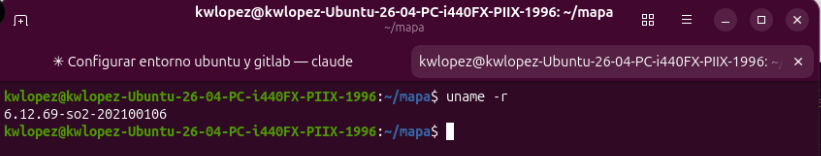

---

## 4. Estructura del Repositorio

El repositorio está organizado conforme a las directrices de entrega de la cátedra:

```text
Practica_4_2S2026/
├── linux-6.12.69/                             # Overlay con modificaciones del kernel
│   ├── arch/x86/entry/syscalls/
│   │   └── syscall_64.tbl                     # Registro de syscalls 548 a 553
│   ├── include/linux/
│   │   ├── ipc_channel.h                      # Cabecera compartida en kernel
│   │   └── syscalls.h                         # Prototipos y declaraciones de structs
│   └── kernel/
│       ├── Makefile                           # Inclusión de objetos al build
│       ├── ipc_channel.c                      # IPC y función enqueue interna
│       ├── log_watch.c                        # Vigilancia y emisor de eventos
│       └── mi_syscall.c                       # Métricas de procesos (P2 portado)
├── daemon/                                    # Daemon orquestador en C (Backend)
│   ├── Makefile                               # Reglas de compilación
│   ├── comun.h                                # Números de syscall, structs y estado compartido
│   ├── main.c                                 # Opciones, señales, arranque y apagado limpio
│   ├── metricas.c                             # Hilo periódico: syscall 553, /proc/meminfo y /proc
│   ├── eventos.c                              # Hilo bloqueado en syscall 549 y parseo de EVT|...
│   ├── http.c                                 # Servidor HTTP con poll(), SSE y archivos estáticos
│   ├── json.c                                 # Búfer dinámico y serialización a JSON
│   └── daemon_monitor                         # Ejecutable compilado
├── frontend/                                  # Dashboard Web en tiempo real
│   ├── index.html                             # Estructura del panel
│   ├── css/
│   │   └── styles.css                         # Interfaz moderna (tema oscuro)
│   └── js/
│       ├── app.js                             # Consumo REST y EventSource (SSE)
│       └── charts.js                          # Gráficos de memoria en SVG nativo
├── imgs/                                      # Evidencias y capturas de pantalla
│   └── arquitectura.png                       # Diagrama exportado de arquitectura
├── arquitectura.drawio                         # Diagrama de arquitectura editable (Draw.io)
├── steering/                                  # Especificación y requerimientos SDD
│   ├── enunciado.md                           # Enunciado y rúbrica oficial
│   └── ESPECIFICACION.md                      # Documento de diseño técnico (SDD)
├── test_fase1.c                               # Validador integral de las 6 syscalls
├── pruebas_integracion.sh                      # Pruebas de integración de extremo a extremo
├── preparar_kernel.sh                         # Overlay, configuración, compilación y verificación del kernel
├── instalar_kernel.sh                         # Instalación en /boot, firma para Secure Boot y GRUB
├── demo.sh                                    # Asistente interactivo de demostración en vivo
├── GUIA_PRESENTACION.md                       # Guía de defensa, calificación y despliegue
└── README.md                                  # Este informe técnico
```

---

## 5. Arquitectura del Sistema Integrado

El sistema funciona en tres capas desacopladas, comunicadas de extremo a extremo:

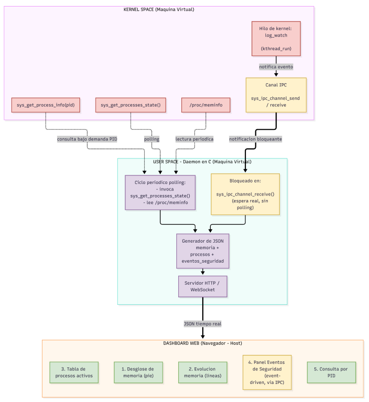

> [!NOTE]
> El modelo de componentes y flujo de datos de la arquitectura se encuentra disponible en formato editable en [arquitectura.drawio](arquitectura.drawio).

---

## 6. Mapa y Rol de Syscalls Reutilizadas

Todas las llamadas al sistema fueron consolidadas en el árbol x86_64 bajo los números 548 al 553:

| Nº | Syscall | Archivo Fuente | Origen | Parámetros | Retorno | Rol en el Sistema |
|---|---|---|---|---|---|---|
| **548** | `sys_ipc_channel_send` | `kernel/ipc_channel.c` | P3 | `const char *mensaje` | `0` / Error | Envío de mensajes de texto hacia la cola FIFO compartida. |
| **549** | `sys_ipc_channel_receive` | `kernel/ipc_channel.c` | P3 | `char *buffer` | `0` / Error | Bloqueo del hilo de eventos del daemon sin consumo de ciclos de reloj. |
| **550** | `sys_start_log_watch` | `kernel/log_watch.c` | P3 | `char **rutas, int cant, char *central, char *palabra` | `watch_id > 0` | Inicialización de la vigilancia en segundo plano por el hilo de kernel. |
| **551** | `sys_stop_log_watch` | `kernel/log_watch.c` | P3 | `int id_monitoreo` | `0` / Error | Terminación limpia del hilo de kernel al cerrar el daemon (`SIGINT`). |
| **552** | `sys_get_process_info` | `kernel/mi_syscall.c` | P2 | `pid_t pid, struct process_info *info` | `0` / Error | Consulta puntual bajo demanda de un PID desde el frontend. |
| **553** | `sys_get_processes_state` | `kernel/mi_syscall.c` | P2 | `struct processes_state *state` | `0` / Error | Conteo agregado a nivel kernel de procesos *Running*, *Sleeping* y *Zombie*. |

### Estructuras de Datos de las Syscalls

```c
/* Métricas de un proceso específico (Syscall 552) */
struct process_info {
    char name[16];
    pid_t pid;
    unsigned long long runtime_ns;
    unsigned long memory_kb;
};

/* Resumen global del estado de procesos (Syscall 553) */
struct processes_state {
    unsigned int total;
    unsigned int running;
    unsigned int sleeping;
    unsigned int zombie;
};
```

---

## 7. Rediseño del Mecanismo IPC y Notificación *Event-Driven*

### 7.1 El Problema del Polling Tradicional
En arquitecturas ingenuas de observabilidad, el espacio de usuario consulta al kernel en un ciclo infinito cada pocas fracciones de segundo:

```text
[Daemon] ¿Hay novedades? -> [Kernel] No.
[Daemon] ¿Hay novedades? -> [Kernel] No.  (Consumo constante de CPU e interrupciones)
```

Este enfoque degrada la batería en dispositivos móviles, satura el planificador de tareas y genera latencia innecesaria en la detección de amenazas de seguridad.

### 7.2 Solución Arquitectónica: Productor en Kernel y Consumidor en Usuario
En esta práctica se desacopla la producción del consumo:
1. **Encolado en Espacio de Kernel:** El hilo `log_watch` detecta una palabra clave (ej. `"FAIL"`, `"ROOT"`, `"ERROR"`) y llama a `ipc_channel_enqueue_kernel()`. Esta función reserva memoria con `kmalloc(..., GFP_KERNEL)`, inserta el nodo en `ipc_queue` y ejecuta `wake_up_interruptible(&ipc_queue_wq)`.
2. **Bloqueo Pasivo en Espacio de Usuario:** El hilo de eventos del daemon invoca `sys_ipc_channel_receive()`, el cual se suspende dentro de la cola de espera del kernel (`wait_event_interruptible`). El planificador de Linux pone el hilo en estado `TASK_INTERRUPTIBLE` (`S`), consumiendo exactamente **0.0% de CPU**.
3. **Despertar y Transmisión Instantánea:** Al momento exacto en que ocurre el evento, el planificador despierta al daemon, este extrae el mensaje de la cola mediante `copy_to_user`, lo transforma a JSON y lo envía al navegador por el stream SSE.

```text
Formato del mensaje IPC en kernel:
EVT|<timestamp_epoch>|<palabra_clave>|<ruta_archivo>|<linea_detectada>
```

### 7.3 Alcance del Modelo *Event-Driven*
El tramo sin sondeo es el que exige el enunciado: **kernel → daemon → navegador**. El daemon nunca pregunta si hay novedades; duerme hasta que el kernel lo despierta. El hilo de kernel `log_watch`, en cambio, sí revisa los archivos vigilados de forma periódica (cada 3 segundos, `LOG_WATCH_INTERVAL_MS`), porque un archivo de texto no genera por sí mismo una notificación. En consecuencia, una línea nueva puede tardar hasta 3 segundos en ser detectada, pero desde ese instante su entrega al dashboard es inmediata.

Además de consumir eventos, el daemon utiliza `sys_ipc_channel_send` (548) para su propio apagado: al recibir `SIGINT` o `SIGTERM` encola el mensaje de control `CTL|STOP`, que despierta al hilo bloqueado en `sys_ipc_channel_receive` y le permite terminar sin condiciones de carrera.

---

## 8. Guía de Compilación, Instalación y Puesta en Marcha

Las rutas asumen el repositorio clonado en `~/mapa` y la rama `202100106`:

```bash
git clone -b 202100106 --single-branch git@gitlab.com:ingenieria.usac/sistemas/so2/mapa.git ~/mapa
```

### 8.1 Preparación Automática (`preparar_kernel.sh`)

Para llevar la práctica a otra máquina, el camino oficial es ejecutar **`preparar_kernel.sh`** directamente en esa máquina. Como la configuración se reduce con `localmodconfig` a los módulos del hardware específico donde se compila, este script detecta los dispositivos reales de esa máquina (NVMe, red, controladores gráficos), compila, llama a `instalar_kernel.sh` y deja el sistema listo para reiniciar.

```bash
cd ~/mapa && git pull origin 202100106
cd Practica_4_2S2026
./preparar_kernel.sh
sudo reboot
```

El script realiza, en orden:
1. Instala las dependencias que falten (sin `initramfs-tools` si el sistema usa `dracut`).
2. Reutiliza el árbol `Practica_3_2S2026/so2_build_workspace/linux-6.12.69` si existe; si no, descarga las fuentes.
3. Sincroniza el overlay de esta práctica sobre el árbol y comprueba las 6 syscalls y los 3 objetos.
4. Conserva la `.config` existente (ya ajustada al hardware de esa máquina) o la genera desde el kernel en ejecución.
5. Compila. Como la tabla de syscalls cambia respecto a la Práctica 3, se recompila casi todo el kernel.
6. Verifica en `System.map` las 6 syscalls y `ipc_channel_enqueue_kernel`.
7. Recompila `daemon_monitor` y `test_fase1` para la glibc de esa máquina.
8. Ejecuta `instalar_kernel.sh`: módulos, imagen en `/boot`, módulos DKMS, firma con MOK si Secure Boot está activo y actualización de GRUB.

Con `./preparar_kernel.sh --sin-instalar` se detiene tras el paso 7. Después de reiniciar en `6.12.69-so2-202100106`, la demostración se conduce con `./demo.sh`.

Las secciones 8.2 a 8.5 describen los mismos pasos de forma manual.

### 8.2 Compilación Manual del Kernel Modificado

**Dependencias.** En Ubuntu 26.04 no debe instalarse `initramfs-tools`, porque reemplazaría a `dracut`, que es el generador de initramfs del sistema:

```bash
sudo apt install -y build-essential libncurses-dev flex bison libssl-dev libelf-dev \
    bc zstd cpio kmod rsync gawk
```

**Fuentes y overlay.** El árbol de compilación se ubica donde lo espera `instalar_kernel.sh`. La carpeta `so2_build_workspace/` está en `.gitignore`, por lo que debe crearse en cada máquina:

```bash
mkdir -p ~/mapa/Practica_3_2S2026/so2_build_workspace
cd ~/mapa/Practica_3_2S2026/so2_build_workspace
wget https://cdn.kernel.org/pub/linux/kernel/v6.x/linux-6.12.69.tar.xz
tar -xf linux-6.12.69.tar.xz
cd linux-6.12.69
cp -r ~/mapa/Practica_4_2S2026/linux-6.12.69/. .
```

El overlay únicamente agrega líneas al kernel original: las seis syscalls en `syscall_64.tbl`, tres objetos en `kernel/Makefile` y los prototipos en `syscalls.h`.

**Configuración.** Se parte de la configuración del kernel en ejecución y se reduce a los módulos realmente cargados (de 6306 a 71 en la VM de pruebas), sin símbolos de depuración:

```bash
cp /boot/config-$(uname -r) .config
make olddefconfig
lsmod > ../modulos-activos.txt
yes '' | make LSMOD=../modulos-activos.txt localmodconfig
scripts/config --set-str SYSTEM_TRUSTED_KEYS "" --set-str SYSTEM_REVOCATION_KEYS "" \
    --disable DEBUG_INFO --disable DEBUG_INFO_DWARF5 \
    --disable DEBUG_INFO_DWARF_TOOLCHAIN_DEFAULT --disable DEBUG_INFO_BTF \
    --enable DEBUG_INFO_NONE --disable RUST \
    --set-str LOCALVERSION "-so2-202100106" --disable LOCALVERSION_AUTO \
    --enable EXT4_FS --enable BLK_DEV_INITRD --enable ATA_PIIX \
    --enable SATA_AHCI --enable BLK_DEV_SD
make olddefconfig
```

**Compilación.** Se compila el objetivo por defecto (imagen y módulos), ya que el instalador ejecuta `modules_install`:

```bash
make -j$(nproc)
grep -E ' __x64_sys_(ipc_channel_(send|receive)|(start|stop)_log_watch|get_process(_info|es_state))$' System.map
```

Con esta configuración el árbol compilado ocupa cerca de 3 GB y la compilación tomó alrededor de 15 minutos con 4 núcleos. Si el disco del sistema no tiene espacio, el árbol puede residir en otro disco y enlazarse:

```bash
ln -s /ruta/al/disco/so2 ~/mapa/Practica_3_2S2026/so2_build_workspace
```

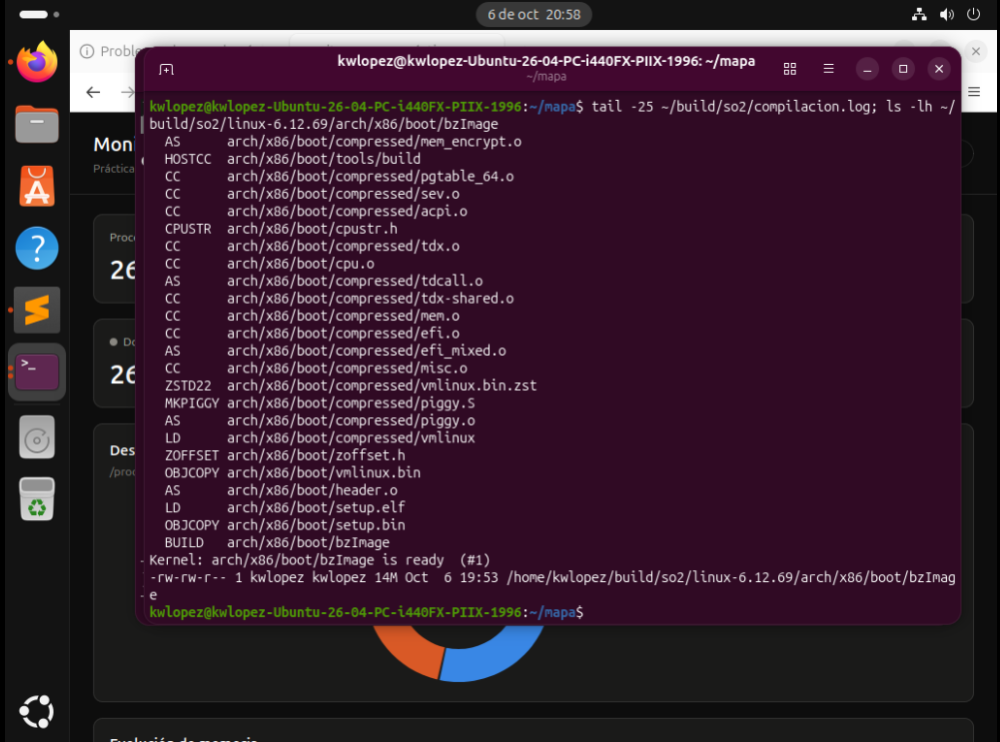

### 8.3 Instalación del Kernel en la Máquina de Pruebas

El script instala los módulos, copia `vmlinuz` a `/boot` (el initramfs lo generan los hooks de `/etc/kernel/postinst.d`, con `dracut` o `initramfs-tools` según el sistema), firma el kernel con una clave MOK si Secure Boot está activo y actualiza GRUB:

```bash
cd ~/mapa/Practica_4_2S2026
./instalar_kernel.sh
sudo reboot
```

En el menú de GRUB se elige *Opciones avanzadas* → `6.12.69-so2-202100106`. El kernel original de la distribución permanece instalado como respaldo.

### 8.4 Validación de Syscalls (`test_fase1`)

Tras reiniciar en el kernel `6.12.69-so2-202100106`:

```bash
uname -r
cd ~/mapa/Practica_4_2S2026
gcc -O2 -Wall test_fase1.c -o test_fase1
./test_fase1
```

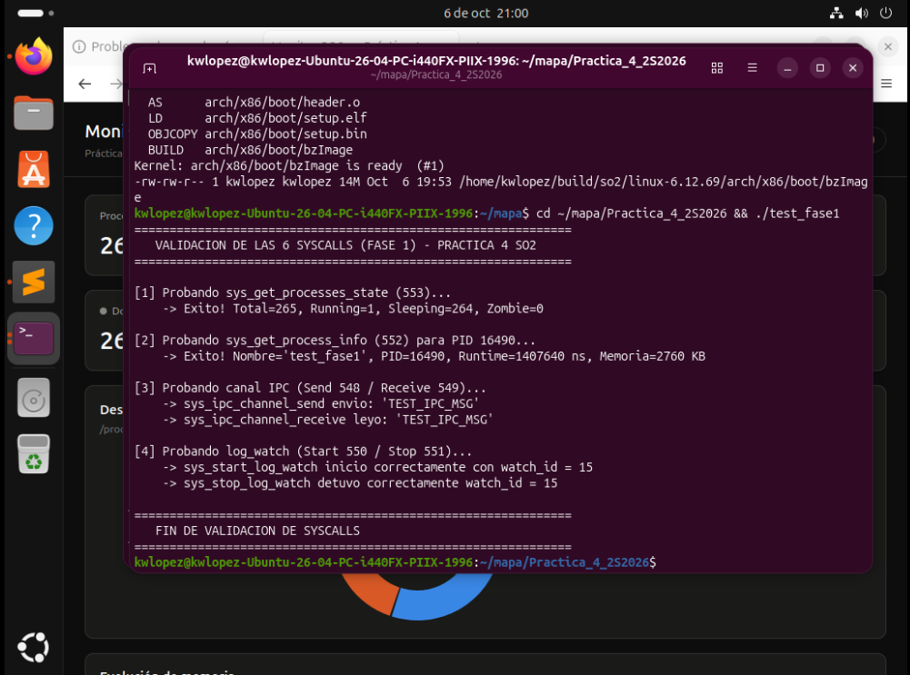

### 8.5 Compilación y Ejecución del Daemon

```bash
cd ~/mapa/Practica_4_2S2026/daemon
make
: > ~/so2_logs/auth.log; : > ~/so2_logs/app.log
./daemon_monitor
```

El daemon **no requiere `sudo`**; ejecutarlo como root cambiaría `~` por `/root` y los logs quedarían fuera del directorio del usuario. Sin argumentos escucha en el puerto 8080 y vigila las palabras `ERROR` y `FAIL` en `~/so2_logs/auth.log` y `~/so2_logs/app.log`, creando los archivos si no existen.

| Opción | Descripción | Valor por defecto |
|---|---|---|
| `-p puerto` | Puerto HTTP | `8080` |
| `-i segundos` | Intervalo de recolección de métricas | `2` |
| `-k palabra` | Palabra clave a vigilar; repetible (un `log_watch` por palabra) | `ERROR`, `FAIL` |
| `-c archivo` | Log centralizado | `~/so2_logs/log_centralizado.txt` |
| `-w carpeta` | Carpeta del dashboard | `../frontend` |
| `-d` | Ejecución en segundo plano; la salida va a `~/so2_logs/daemon_monitor.out` | — |
| `log1 ... log8` | Archivos a vigilar (argumentos posicionales) | `auth.log`, `app.log` |

Los logs se vacían antes de iniciar porque `log_watch` lee cada archivo desde el principio: las líneas antiguas con la palabra clave se reportarían como eventos nuevos en cada arranque. El daemon se detiene con `Ctrl+C` o `kill -TERM`, y en ambos casos invoca `sys_stop_log_watch` antes de salir.

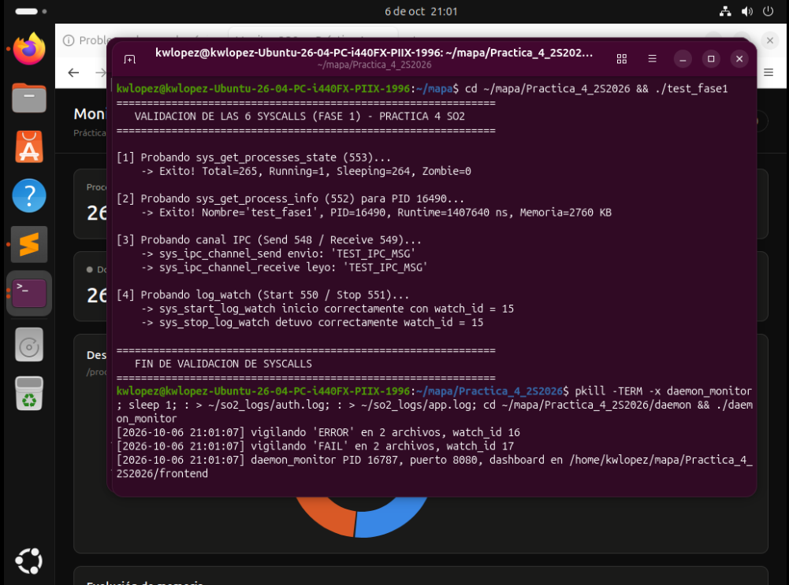

### 8.6 Acceso al Dashboard Web

Abra un navegador web e ingrese a:
```text
http://localhost:8080
```
(O la dirección IP de la VM si el navegador se ejecuta desde el Host; se obtiene con `ip -br addr`).

El daemon sirve el dashboard desde `frontend/`, por lo que no hay pasos adicionales entre capas. El dashboard no usa librerías externas: los gráficos se dibujan en SVG nativo (`js/charts.js`) y funciona sin conexión a Internet. Si los archivos se sirven desde otro origen, la dirección del daemon se indica con `?api=http://IP_DE_LA_VM:8080`.

### 8.7 Endpoints del Daemon

| Endpoint | Fuente de datos | Respuesta |
|---|---|---|
| `GET /api/estado` | `sys_get_processes_state`, `/proc/meminfo`, `/proc/[pid]`, eventos recibidos | Snapshot JSON completo |
| `GET /api/proceso?pid=N` | `sys_get_process_info` | Detalle del proceso; `404` si no existe, `400` si el PID es inválido |
| `GET /api/eventos` | Canal IPC (`sys_ipc_channel_receive`) | Stream SSE (`text/event-stream`), un mensaje por evento |
| `GET /` | Carpeta `frontend/` | Archivos estáticos del dashboard |

Snapshot de `/api/estado` (memoria en kB, igual que `/proc/meminfo`; se conservan los últimos 100 eventos):

```json
{
  "memoria_usada": 1950016,
  "memoria_libre": 1442624,
  "memoria_cache": 1125836,
  "swap_usada": 0,
  "resumen_procesos": { "total": 239, "running": 1, "sleeping": 238, "zombie": 0 },
  "procesos": [
    { "nombre": "systemd", "pid": 1, "estado": "S" }
  ],
  "eventos_seguridad": [
    {
      "id": 1,
      "archivo_origen": "/home/kwlopez/so2_logs/auth.log",
      "palabra_detectada": "FAIL",
      "contenido": "login FAIL para root",
      "timestamp": "2026-10-06 20:08:54"
    }
  ]
}
```

El campo `id` es un consecutivo que permite al dashboard no duplicar un evento que llegue tanto en la carga inicial como por el stream SSE. Consulta por PID:

```bash
curl 'http://localhost:8080/api/proceso?pid=1'
```
```json
{"pid":1,"nombre":"systemd","runtime_ns":1125796188,"memory_kb":25348}
```

---

## 9. Validación Experimental y Pruebas en Vivo

### 9.1 Vista General del Dashboard
El dashboard consolida métricas de memoria, procesos y alertas en una sola interfaz reactiva:

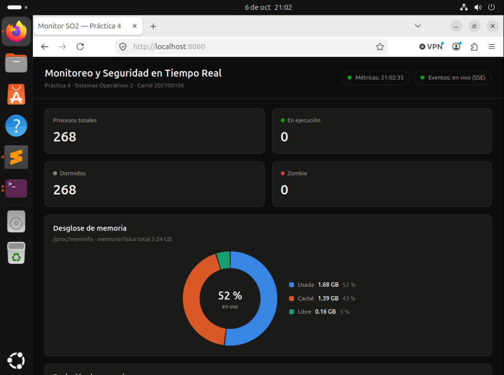

### 9.2 Métricas de Memoria y Swap (`/proc/meminfo`)
- **Gráfico de Pie (Dona):** Distribución proporcional de memoria usada, caché/buffers y libre. Como `MemAvailable` ya incluye la caché recuperable, el gráfico separa la porción libre en *Caché* y *Libre (sin contar caché)* para que las tres partes sumen la memoria física total.
- **Gráfico de Líneas:** Evolución temporal de memoria física en uso vs. espacio de swap consumido.

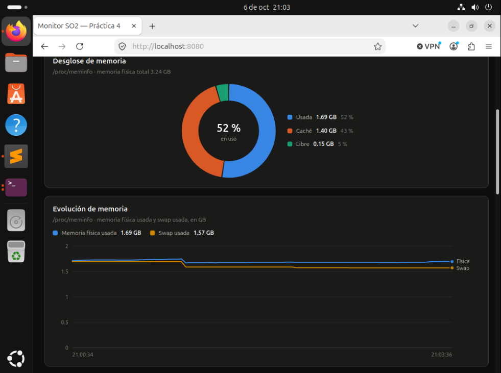

### 9.3 Tabla de Procesos y Conteo de Estados
El dashboard presenta dos componentes complementarios:
1. **Tarjetas de Resumen:** Alimentadas por `sys_get_processes_state` (Total, Running, Sleeping, Zombie).
2. **Tabla Detallada:** Lista desplazable de procesos activos con PID, nombre de ejecutable y estado de planificación; se filtra por nombre, PID o estado y se ordena por cualquier columna.

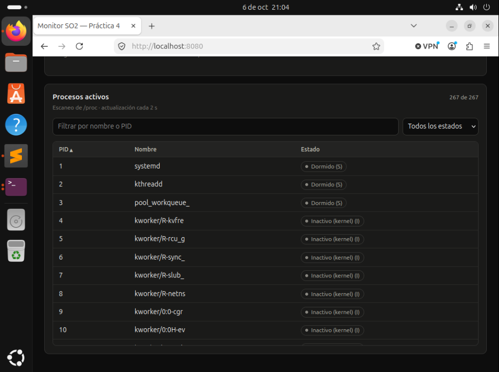

### 9.4 Consulta Puntual por PID (`sys_get_process_info`)
Al ingresar un PID específico en el formulario de búsqueda, o al hacer clic en una fila de la tabla de procesos, el frontend consulta `/api/proceso?pid=N` y muestra el tiempo de CPU en milisegundos (convertido desde `sum_exec_runtime`, en nanosegundos) y la memoria virtual mapeada en kilobytes (`total_vm`). Un PID inexistente muestra el error devuelto por el kernel (`ESRCH`).

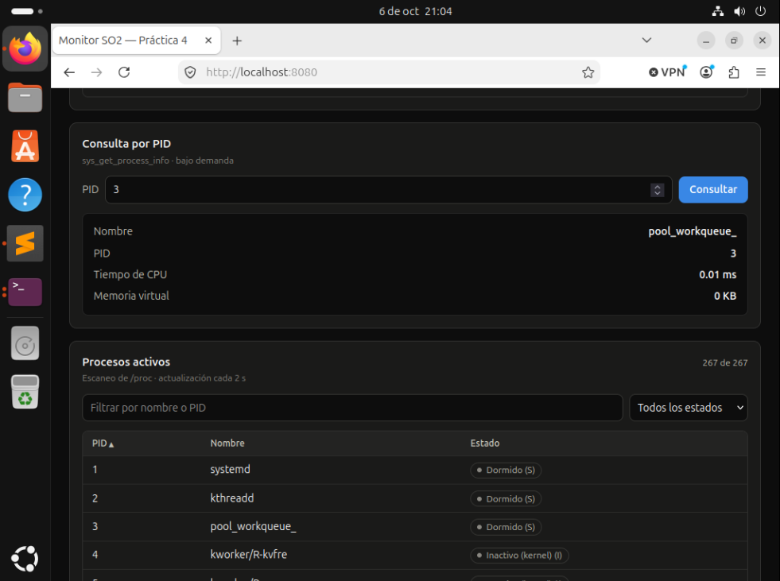

### 9.5 Prueba de Inyección de Alertas de Seguridad (SSE en Tiempo Real)
Se inyecta una cadena con la palabra clave vigilada en uno de los archivos monitoreados:

```bash
echo "[$(date)] ERROR intento no autorizado detectado en puerto 22" >> ~/so2_logs/auth.log
```

**Resultado:**
- El hilo `log_watch` detecta la línea en su siguiente revisión del archivo (a lo sumo 3 segundos después).
- Escribe el evento en `log_centralizado.txt`.
- Encola el mensaje en el canal IPC.
- El daemon despierta de `sys_ipc_channel_receive` en ese mismo instante.
- El frontend recibe el evento vía `EventSource('/api/eventos')` e inserta la fila en la tabla con resaltado visual, **sin necesidad de refrescar la página**.

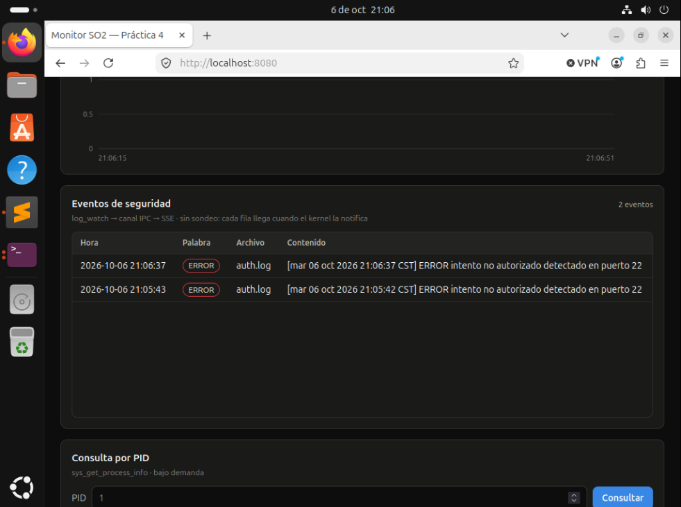

### 9.6 Consumo de CPU en Reposo (Cero Polling)
El daemon tiene tres hilos. Mientras no se emiten alertas, el hilo de eventos permanece dormido dentro de la syscall (`wchan` = `ipc_channel_receive`), en estado `S` y con **0.0% de CPU**. El hilo principal espera en `poll()` y el de métricas despierta cada 2 segundos, por lo que el proceso completo registra un consumo marginal (0.2% medido) que corresponde a esa recolección periódica y no al panel de eventos:

```bash
ps -L -o tid,stat,%cpu,wchan:32,comm -p $(pgrep -x daemon_monitor)
```

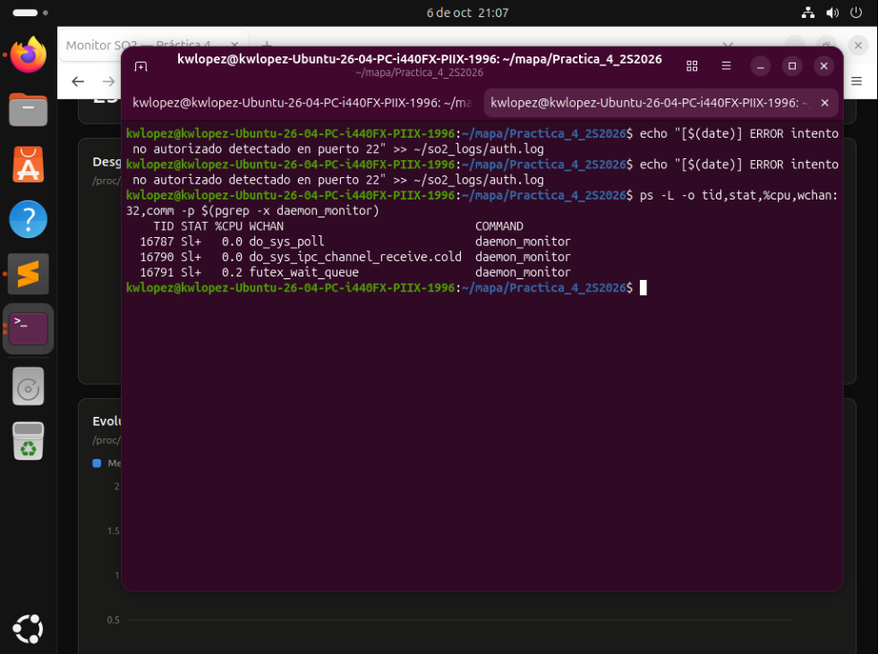

### 9.7 Pruebas de Integración Automatizadas
El script `pruebas_integracion.sh` recorre toda la cadena sin intervención manual. Levanta su propio daemon en el puerto 8099, con logs aislados en `~/so2_logs/pruebas/` y la palabra clave `INTRUSO`, y al terminar lo detiene. Como el canal IPC del kernel es único, exige que no haya otro `daemon_monitor` activo:

```bash
cd ~/mapa/Practica_4_2S2026
pkill -TERM -x daemon_monitor
./pruebas_integracion.sh
```

| Fase | Qué comprueba |
|---|---|
| 1. Arranque | El daemon responde y `sys_start_log_watch` crea un hilo de kernel `log_watch_N`. |
| 2. Snapshot | Los cuatro valores de memoria coinciden con `/proc/meminfo`; el total de `sys_get_processes_state` y la tabla coinciden con `/proc`; `running + sleeping + zombie = total`. |
| 3. Consulta por PID | `sys_get_process_info` devuelve el nombre correcto; `404` para un PID inexistente y `400` para uno inválido o ausente. |
| 4. Extremo a extremo | Una línea escrita en un log llega por SSE a un cliente que solo escucha, con `archivo_origen`, `palabra_detectada` y `contenido` correctos; queda en el log centralizado y en `/api/estado`; una línea sin la palabra no genera evento. |
| 5. Ráfaga | 20 líneas consecutivas producen 20 eventos, sin pérdidas y en orden. |
| 6. Reposo | Durante 10 s el hilo bloqueado en `sys_ipc_channel_receive` consume 0 tics de CPU y registra 0 cambios de contexto, en estado `S`. |
| 7. Resiliencia | `POST`, rutas con `..`, recursos inexistentes, una petición sin formato HTTP, un cliente SSE cortado con `kill -9` y 30 peticiones simultáneas no tumban al daemon. |
| 8. Apagado | Con `SIGTERM` el daemon sale con código 0, `sys_stop_log_watch` elimina el hilo de kernel y el puerto queda libre. |

Resultado en la máquina virtual de pruebas (dos ejecuciones consecutivas):

```text
38 PRUEBAS APROBADAS, 0 FALLIDAS
```

Dos mediciones de esas ejecuciones respaldan el diseño:
- **Latencia de extremo a extremo:** 2.4 s entre la escritura de la línea y su llegada por SSE. Ese tiempo corresponde al intervalo de 3 s con que `log_watch` revisa los archivos; el daemon no añade espera propia.
- **Cero cambios de contexto en reposo:** que el hilo de eventos no haya sido planificado ni una sola vez en 10 s demuestra que no existe sondeo disfrazado: el hilo solo se ejecuta cuando el kernel lo despierta. El proceso completo registró 0.30 % de CPU, atribuible al hilo de métricas.

La reacción del navegador (inserción de la fila sin recargar la página) se evidencia en la captura de la sección 9.5.

---

## 10. Reporte de Errores Encontrados y Soluciones Técnicas

A continuación se documentan cuatro incidencias resueltas durante el desarrollo de la práctica: tres propias de la integración y una del entorno de virtualización del host:

---

### Error 1: Conflicto de Numeración en `syscall_64.tbl` y Portabilidad entre Kernels

#### Descripción del Error
En la Práctica 2, las syscalls `get_process_info` y `get_processes_state` se habían registrado bajo los números `548` y `549` en un kernel 7.1.8. En la Práctica 3, esos mismos números se asignaron a `ipc_channel_send` e `ipc_channel_receive` en el kernel 6.12.69. Al intentar unificar los archivos en un solo árbol, se producía una colisión directa de números en la tabla x86_64, provocando fallos en la compilación con mensajes de símbolo duplicado.

#### Causa Raíz
Los scripts de las prácticas anteriores asignaban números de syscall a partir de la primera ranura libre (`548`) de forma aislada, sin prever la integración conjunta en la Práctica 4.

#### Fuentes Consultadas
- Love, R. (2010). *Linux Kernel Development* (3rd ed.). Novell Press. Capítulo 5: System Calls.
- Documentación oficial del kernel: `Documentation/process/adding-syscalls.rst`.

#### Código Antes (Conflicto en `syscall_64.tbl`)
```text
548	common	ipc_channel_send	sys_ipc_channel_send
549	common	ipc_channel_receive	sys_ipc_channel_receive
548	common	get_process_info	sys_get_process_info      <-- COLISIÓN
549	common	get_processes_state	sys_get_processes_state   <-- COLISIÓN
```

#### Código Después (Solución con Renumeración Canónica)
```text
548	common	ipc_channel_send	sys_ipc_channel_send
549	common	ipc_channel_receive	sys_ipc_channel_receive
550	common	start_log_watch		sys_start_log_watch
551	common	stop_log_watch		sys_stop_log_watch
552	common	get_process_info	sys_get_process_info
553	common	get_processes_state	sys_get_processes_state
```
Se actualizaron concurrentemente los encabezados en `include/linux/syscalls.h` y las definiciones en el programa de espacio de usuario.

---

### Error 2: Discrepancia Estructural entre `sys_get_processes_state` y la Tabla de Procesos

#### Descripción del Error
El enunciado solicita una tabla visual de procesos con `{ nombre, PID, estado }` y cita como fuente a `sys_get_processes_state`. Sin embargo, la implementación original de dicha syscall en la Práctica 2 solo retornaba cuatro números enteros (`total`, `running`, `sleeping`, `zombie`), sin proporcionar arreglos de nombres ni identificadores de procesos. Intentar poblar la tabla exclusivamente desde la syscall resultaba imposible sin romper la firma aprobada en P2.

#### Causa Raíz
La syscall de P2 fue diseñada para métricas globales agregadas, mientras que una tabla completa requiere recorrer la lista de tareas del sistema, lo cual generaría problemas de desbordamiento de búfer si se intentara copiar una lista de 400 procesos por medio de una estructura fija pequeña.

#### Fuentes Consultadas
- Kerrisk, M. (2010). *The Linux Programming Interface*. No Starch Press. Capítulo 12: The `/proc` File System.
- Manual de Linux: `man 5 proc`.

#### Código Antes (Intento erróneo en C)
```c
/* Imposible obtener lista individual desde la syscall */
struct processes_state kstate;
syscall(553, &kstate);
// kstate solo tiene .total, .running, .sleeping, .zombie. No hay nombres ni PIDs.
```

#### Código Después (Solución Arquitectónica Híbrida)
Se adoptó una arquitectura en dos niveles:
1. `sys_get_processes_state` se invoca periódicamente para poblar las **tarjetas de resumen** de métricas verificadas por kernel (cumpliendo con la rúbrica).
2. Para la tabla detallada, el daemon realiza un escaneo de directorios numéricos en `/proc` (`daemon/metricas.c`). El nombre se toma de `comm` y el estado es el carácter que sigue al último `)` de `stat`, ya que el nombre del proceso puede contener espacios y paréntesis:
```c
static int leer_proceso(const char *pid, struct proceso *p)
{
	char ruta[288];
	char stat[512];
	char *cierre;
	size_t leidos;
	FILE *f;

	snprintf(ruta, sizeof(ruta), "/proc/%s/comm", pid);
	f = fopen(ruta, "r");
	if (!f)
		return -1;
	if (!fgets(p->nombre, sizeof(p->nombre), f)) {
		fclose(f);
		return -1;
	}
	fclose(f);
	p->nombre[strcspn(p->nombre, "\n")] = '\0';

	snprintf(ruta, sizeof(ruta), "/proc/%s/stat", pid);
	f = fopen(ruta, "r");
	if (!f)
		return -1;
	leidos = fread(stat, 1, sizeof(stat) - 1, f);
	fclose(f);
	stat[leidos] = '\0';

	cierre = strrchr(stat, ')');
	if (!cierre || cierre[1] != ' ' || !cierre[2])
		return -1;

	p->pid = (pid_t)atoi(pid);
	p->estado = cierre[2];
	return 0;
}
```
Un proceso que termina entre el `readdir` y la lectura simplemente se omite, sin interrumpir el escaneo.

---

### Error 3: El Instalador no Encontraba el Kernel y el Flujo de la Práctica 3 Omitía el Overlay de la Práctica 4

#### Descripción del Error
Al clonar el repositorio en una máquina virtual nueva y ejecutar `instalar_kernel.sh`, el script terminaba de inmediato:
```text
realpath: .../Practica_3_2S2026/so2_build_workspace/linux-6.12.69: No such file or directory
```
El script de la Práctica 3 (`practica3.sh`), que era el único que compilaba el kernel, tampoco servía para esta práctica.

#### Causa Raíz
Se combinaron tres factores:
1. `instalar_kernel.sh` solo instala un kernel ya compilado y lo busca en `so2_build_workspace/`, carpeta excluida por `.gitignore`; por lo tanto solo existía en la máquina donde se compiló originalmente.
2. `practica3.sh` copia únicamente `ipc_channel.c` y `log_watch.c` y registra las syscalls 548–551. No aplica `mi_syscall.c`, `ipc_channel.h` ni las syscalls 552–553, de modo que el kernel resultante no habría contenido la integración.
3. `practica3.sh` exige 25 GB libres e instala `initramfs-tools`; la VM tenía 4.5 GB libres y Ubuntu 26.04 genera el initramfs con `dracut`, al que ese paquete reemplazaría.

#### Fuentes Consultadas
- Documentación oficial del kernel: `Documentation/admin-guide/README.rst` (configuración con `localmodconfig` y compilación).
- Manual de Git: `man 5 gitignore` (un patrón terminado en `/` solo coincide con directorios).

#### Código Antes (Instalación sin árbol de compilación)
```bash
cd Practica_4_2S2026
./instalar_kernel.sh
# realpath: ../Practica_3_2S2026/so2_build_workspace/linux-6.12.69: No such file or directory
```

#### Código Después (Overlay completo y árbol enlazado)
```bash
# Árbol de compilación en un disco con espacio suficiente
cd /home/kwlopez/build/so2
tar -xf linux-6.12.69.tar.xz && cd linux-6.12.69

# Overlay completo de la Práctica 4 (las 6 syscalls), no solo el de la Práctica 3
cp -r ~/mapa/Practica_4_2S2026/linux-6.12.69/. .

# Configuración reducida y compilación (detalle en la sección 8.2)
make -j$(nproc)

# El instalador encuentra el árbol sin modificar el script
ln -s /home/kwlopez/build/so2 ~/mapa/Practica_3_2S2026/so2_build_workspace
```
El patrón `so2_build_workspace/` de `.gitignore` no cubre un enlace simbólico, por lo que el enlace se excluyó localmente en `.git/info/exclude` para no subirlo por accidente. La compilación reducida ocupó 2.7 GB en lugar de los 25 GB previstos, y las seis syscalls se verificaron en `System.map` antes de instalar.

---

### Error 4: Desactivación de `libvirtd` por Ausencia del Usuario `libvirt-qemu` (Entorno del Host)

#### Descripción del Error
Al configurar el entorno de virtualización en Ubuntu para aislar el kernel de la GPU NVIDIA del host, el servicio `libvirtd` no iniciaba, mostrando en el gestor gráfico de máquinas virtuales el error: *"No se pudo conectar al gestor: asegúrese de que el socket de libvirt esté activo"*.

#### Causa Raíz
Al revisar los registros con `journalctl -u libvirtd`, se descubrió:
```text
User record for user 'libvirt-qemu' was not found: No existe el archivo o el directorio
Argumento inválido: Falló la lectura de usuario 'libvirt-qemu'
Inicialización de controlador de estado QEMU falló
libvirtd.service: Deactivated successfully.
```
Durante la instalación por paquetes `apt`, el daemon intentó levantar antes de que el usuario de sistema `libvirt-qemu` fuera registrado en `/etc/passwd`. Systemd desactivó el servicio y no lo reintentó automáticamente.

#### Fuentes Consultadas
- Documentación de Ubuntu Server: *Virtualization with KVM/QEMU*.
- Documentación de Libvirt: *Daemon architecture & socket activation*.

#### Código Antes (Estado inactivo de systemd)
```bash
virt-manager &
# Error gráfico: Imposible conectar a qemu:///system
systemctl status libvirtd  # Reporta: inactive (dead)
```

#### Código Después (Activación y restauración de red virtual)
```bash
# Validar existencia de usuario y reiniciar daemon una vez presentes los registros
getent passwd libvirt-qemu
sudo systemctl restart libvirtd
sudo virsh net-start default 2>/dev/null || true
sudo virsh net-autostart default 2>/dev/null || true
```
Con el servicio activo y la red NAT inicializada, `virt-manager` conectó inmediatamente a `qemu:///system` sin solicitar credenciales adicionales.

---

## 11. Conclusiones y Lecciones Aprendidas

1. **La integración exige visión de arquitectura sobre la implementación aislada:** Desarrollar syscalls individuales es una tarea algorítmica; integrarlas en un sistema cohesivo requiere resolver colisiones de tablas, formatos de mensajes, límites de memoria y coordinación entre procesos en distintos niveles de privilegio.
2. **El modelo *Event-Driven* supera al sondeo entre kernel y espacio de usuario:** El uso de colas de espera (`wait queues`) y de la función `ipc_channel_enqueue_kernel` permitió que el daemon reaccione en el mismo instante en que el kernel encola un hallazgo, con su hilo de eventos en 0.0% de CPU mientras espera. La única latencia restante es el intervalo de 3 segundos con que `log_watch` revisa los archivos, que es independiente del canal de notificación.
3. **El protocolo Server-Sent Events (SSE) es la alternativa ideal para streaming unidireccional en C:** Implementar WebSockets en C puro introduce complejidad innecesaria (handshakes SHA-1, Base64, enmascaramiento de frames). SSE sobre HTTP plano permite entregar flujos en tiempo real con cero dependencias externas y consumo nativo en el navegador con `EventSource`.
4. **La virtualización protege la estabilidad del entorno de desarrollo:** Aislar el kernel dentro de una máquina virtual KVM previene problemas de compatibilidad gráfica con controladores propietarios como NVIDIA y permite iterar ciclos de compilación y prueba sin riesgo de comprometer el sistema operativo principal.
