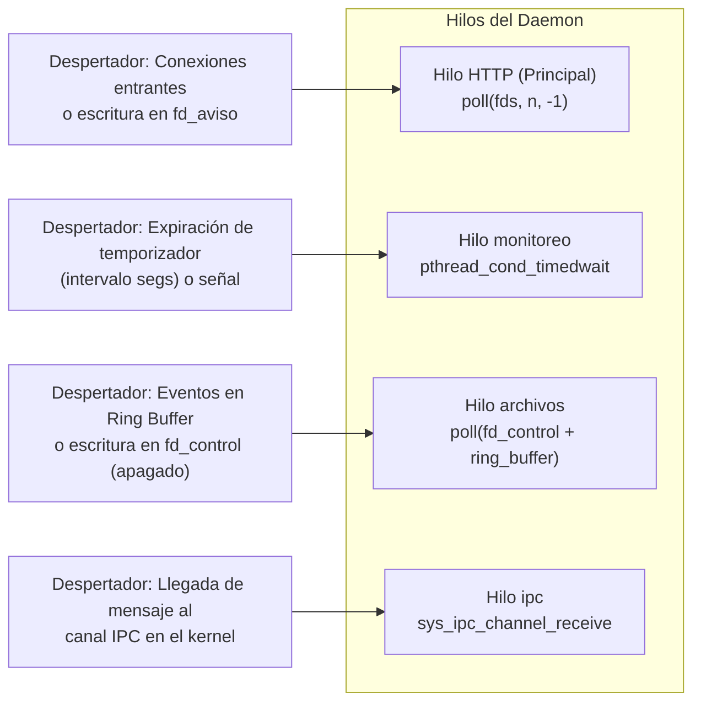
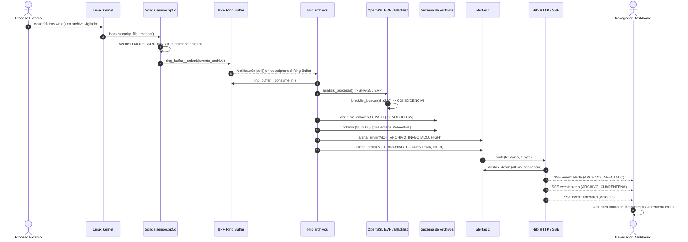
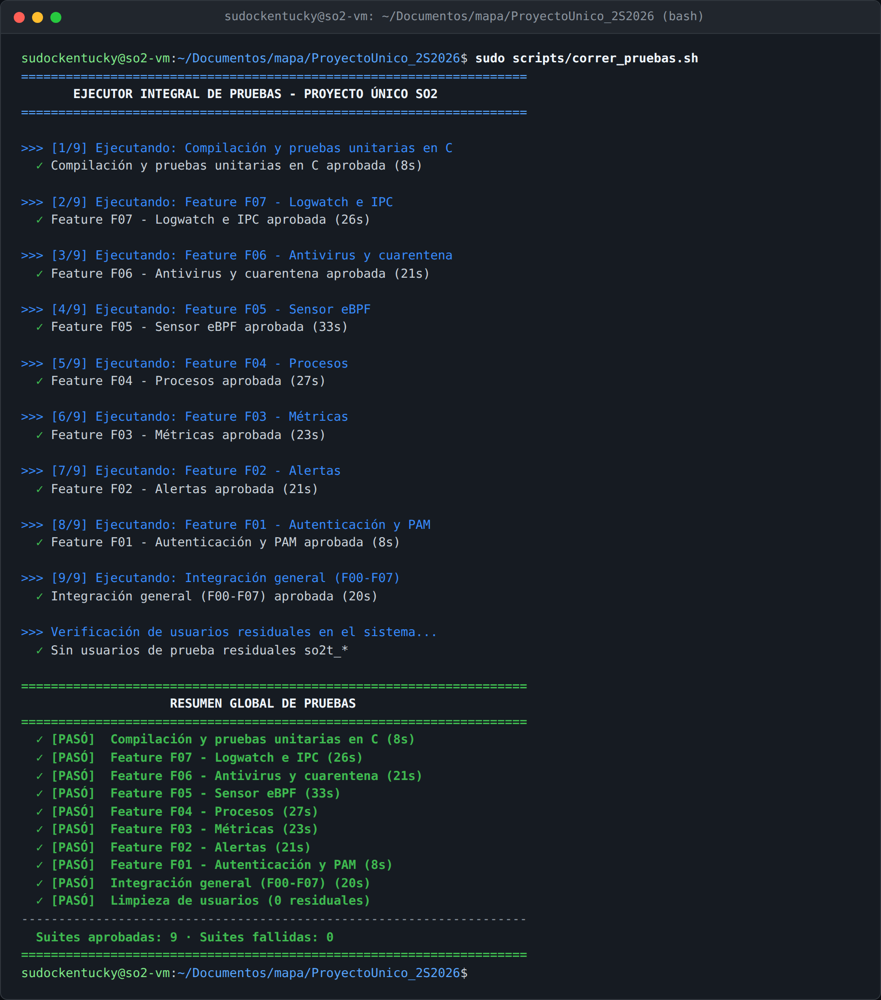

# Manual Técnico — Proyecto Único SO2

Sistema Integral de Monitoreo, Integridad, Antivirus y Auditoría de Logs en Linux (Kernel 6.12.69).

---

## Índice de Contenidos

1. [Introducción](#1-introducción)
2. [Arquitectura del Sistema](#2-arquitectura-del-sistema)
3. [Kernel y Llamadas al Sistema (Syscalls 548–553)](#3-kernel-y-llamadas-al-sistema-syscalls-548553)
4. [Sensor eBPF e Integridad de Archivos](#4-sensor-ebpf-e-integridad-de-archivos)
5. [Programa Intermedio (Daemon de Monitoreo)](#5-programa-intermedio-daemon-de-monitoreo)
   - 5.1 [Hilos y Mecanismos de Despertar](#51-hilos-y-mecanismos-de-despertar)
   - 5.2 [Sincronización y Modelo de Bloqueo](#52-sincronización-y-modelo-de-bloqueo)
   - 5.3 [Manejo de Errores y Apagado Ordenado](#53-manejo-de-errores-y-apagado-ordenado)
   - 5.4 [Configuración del Daemon (`daemon.conf`)](#54-configuración-del-daemon-daemonconf)
   - 5.5 [Autenticación PAM, Grupos, Sesiones y Permisos](#55-autenticación-pam-grupos-sesiones-y-permisos)
   - 5.6 [Motor de Alertas en Tiempo Real](#56-motor-de-alertas-en-tiempo-real)
   - 5.7 [Métricas y Monitoreo de Procesos](#57-métricas-y-monitoreo-de-procesos)
   - 5.8 [Análisis de Archivos, Antivirus y Cuarentena](#58-análisis-de-archivos-antivirus-y-cuarentena)
   - 5.9 [Logwatch y Canales IPC](#59-logwatch-y-canales-ipc)
6. [Conexión con el Frontend (API HTTP y Server-Sent Events)](#6-conexión-con-el-frontend-api-http-y-server-sent-events)
   - 6.1 [Tabla Completa de Endpoints REST](#61-tabla-completa-de-endpoints-rest)
   - 6.2 [Eventos Server-Sent Events (SSE)](#62-eventos-server-sent-events-sse)
   - 6.3 [Diagrama de Secuencia de Detección y Notificación](#63-diagrama-de-secuencia-de-detección-y-notificación)
7. [Dependencias del Sistema y Justificación Técnica](#7-dependencias-del-sistema-y-justificación-técnica)
8. [Decisiones de Seguridad](#8-decisiones-de-seguridad)
9. [Limitaciones Conocidas](#9-limitaciones-conocidas)
10. [Compilación, Despliegue y Pruebas Automatizadas](#10-compilación-despliegue-y-pruebas-automatizadas)

---

## 1. Introducción

El presente proyecto implementa una solución integral de observabilidad, seguridad perimetral, integridad de datos y control de accesos para entornos Linux, desarrollada sobre el kernel **Linux 6.12.69**.

El sistema integra componentes en tres capas de ejecución:
1. **Espacio de Kernel (`Kernel/`)**: adición de seis llamadas al sistema (`sys_ipc_channel_send`, `sys_ipc_channel_receive`, `sys_start_log_watch`, `sys_stop_log_watch`, `sys_get_process_info`, `sys_get_processes_state`), estructuras de IPC en memoria compartida del kernel, y un kthread autónomo de vigilancia de palabras clave en archivos de bitácora (`log_watch`).
2. **Sonda eBPF y Daemon C (`ProgramaIntermedio/`)**: un programa eBPF de instrumentación mediante tracepoints y kprobes compilado a bytecode con libbpf, y un daemon multihilo en C (`daemon_monitor`) que consume eventos de eBPF mediante un BPF Ring Buffer, audita firmas SHA-256 en tiempo real con OpenSSL EVP, aísla amenazas mediante `openat2` y permisos `0000`, expone una API REST y un canal Server-Sent Events (SSE) sobre HTTP/1.1 con epoll/poll, y valida credenciales locales mediante PAM.
3. **Frontend Dashboard (`Dashboard/`)**: interfaz web reactiva en HTML5, CSS moderno y JavaScript modular nativo (sin frameworks externos ni dependencias de empaquetado), que visualiza métricas del sistema, procesos activos, catálogo de alertas, integridad de archivos, firmas de antivirus y vigilancia de logs.

---

## 2. Arquitectura del Sistema

La arquitectura global distribuye responsabilidades de forma modular para desacoplar la captura de eventos a nivel de kernel, el procesamiento reactivo en espacio de usuario y la visualización en el navegador:

```mermaid
flowchart TD
    subgraph KernelSpace["Espacio de Kernel (Linux 6.12.69)"]
        SYS["Syscalls 548–553\n(IPC y Procesos)"]
        KW["kthread log_watch\n(Monitoreo periódico)"]
        IPC["Canal IPC en Kernel\n(Cola circular 128 msgs)"]
        EBPF["Sonda eBPF (sensor.bpf.o)\nTracepoints: openat/open/creat\nKprobes: fd_install / security_file_release"]
        MAPS["Mapas BPF\n(auxiliar, abiertos, pendientes)"]
        RING["BPF Ring Buffer\n(eventos: 256 KiB)"]
    end

    subgraph UserSpace["Espacio de Usuario: Daemon (daemon_monitor)"]
        H_ARCH["Hilo archivos\npoll(fd_control) + ring_buffer__consume_n"]
        H_IPC["Hilo ipc\nBloqueado en syscall 549 (ipc_channel_receive)"]
        H_MON["Hilo monitoreo\npthread_cond_timedwait (intervalo configurable)"]
        H_HTTP["Hilo principal / HTTP\npoll(sockets + fd_aviso) + SSE broadcast"]

        MOD_ANALISIS["analisis.c / blacklist.c\n(SHA-256 EVP + Aislamiento 0000)"]
        MOD_ALERTAS["alertas.c\n(Catálogo en memoria + Anillo de 200)"]
        MOD_METRICAS["metricas.c / procesos.c\n(/proc/meminfo, /proc/vmstat, /proc/[pid])"]
        MOD_LOGWATCH["logwatch.c / rutas.c\n(Registro máx 16 + openat2 symlink checks)"]
        MOD_AUTH["auth.c\n(Autenticación PAM + Tabla de 24 permisos)"]
    end

    subgraph FrontendSpace["Frontend: Dashboard Web"]
        UI_HTTP["Navegador Web: HTTP REST\nGET/POST/DELETE (Fetch API)"]
        UI_SSE["Navegador Web: EventSource\nCanal unidireccional /api/eventos"]
    end

    EBPF --> MAPS
    EBPF -->|Envío de eventos| RING
    RING -->|Lectura no bloqueante| H_ARCH
    H_ARCH --> MOD_ANALISIS
    MOD_ANALISIS --> MOD_ALERTAS

    KW -->|sys_ipc_channel_send| IPC
    IPC -->|sys_ipc_channel_receive| H_IPC
    H_IPC --> MOD_ALERTAS

    H_MON --> MOD_METRICAS
    MOD_METRICAS --> MOD_ALERTAS

    MOD_ALERTAS -->|fd_aviso (eventfd/pipe)| H_HTTP
    H_HTTP <-->|HTTP REST| UI_HTTP
    H_HTTP -->|Stream SSE continuo| UI_SSE

    H_HTTP --> MOD_AUTH
    H_HTTP --> MOD_LOGWATCH
    MOD_LOGWATCH --> SYS
```

### Módulos del Daemon C (`ProgramaIntermedio/`)

| Archivo | Responsabilidad Principal | Hilos que lo Acceden |
|---|---|---|
| `main.c` | Inicialización, carga de `daemon.conf`, lanzamiento y `pthread_join` de hilos, manejo de señales (`SIGINT`, `SIGTERM`), registro en log (`registrar`). | Principal, `archivos`, `monitoreo`, `ipc` |
| `sensor.c` | Carga de `sensor.bpf.o` mediante libbpf, configuración de mapas BPF, arranque/parada del consumidor del ring buffer. | `archivos`, HTTP |
| `analisis.c` | Cálculo de hash SHA-256 con OpenSSL EVP, línea base de archivos, re-evaluación contra blacklist, ejecución de cuarentena preventiva (`0000`). | `archivos`, HTTP |
| `blacklist.c` | Parser y almacenamiento en memoria de firmas de malware (`blacklist.json`), búsqueda por hash SHA-256. | `archivos`, HTTP |
| `rutas.c` | Helper compartido de apertura segura `abrir_sin_enlaces` con `SYS_openat2` y banderas `RESOLVE_NO_SYMLINKS \| RESOLVE_NO_MAGICLINKS`. | `archivos`, HTTP |
| `logwatch.c` | Registro de hasta 16 instancias activas de logwatch, validación de rutas dentro de `<base>`, invocación a syscalls 550 y 551. | HTTP, Principal |
| `ipc.c` | Loop de consumo bloqueante sobre la syscall 549 (`sys_ipc_channel_receive`), emisión de alertas `MOT_PALABRA_EN_LOG`. | `ipc`, Principal |
| `alertas.c` | Catálogo de alertas, generación secuencial de identificadores, almacenamiento en búfer circular de 200 entradas, despacho hacia SSE via `fd_aviso`. | `archivos`, `monitoreo`, `ipc`, HTTP |
| `metricas.c` | Lectura de `/proc/meminfo` y `/proc/vmstat`, cálculo de derivadas temporales (CPU, RAM, swap, I/O), búfer histórico de 150 muestras. | `monitoreo`, HTTP |
| `procesos.c` | Escaneo de `/proc/[pid]/stat` y `/proc/[pid]/statm`, ordenamiento de Top 20 por RSS, guardas de seguridad para envío de señales (`kill`). | `monitoreo`, HTTP |
| `auth.c` | Validación de credenciales con PAM (`so2_auth`), resolución de roles según grupos (`admin_user`, `common_user`), gestión de sesiones (tokens hex de 64 caracteres) y tabla de permisos de endpoints. | HTTP |
| `http.c` | Servidor HTTP/1.1 basado en `poll`, multiplexación de conexiones de clientes, streaming SSE con `event:` e `id:`, serialización JSON. | HTTP (Principal) |
| `peticion.c` | Parser robusto de peticiones HTTP, extracción de métodos, rutas, query strings (`?clave=valor`), cabeceras y cookies de sesión. | HTTP |
| `config.c` | Parser de `daemon.conf` con validación de claves, expansión de `~` y valores por defecto. | Principal |
| `json.c` | Generación y formateo de respuestas JSON para métricas, procesos, alertas, archivos, cuarentena y logwatch utilizando `cJSON`. | HTTP |

---

## 3. Kernel y Llamadas al Sistema (Syscalls 548–553)

El proyecto extiende el kernel Linux mediante la adición de seis llamadas al sistema en la tabla `arch/x86/entry/syscalls/syscall_64.tbl`:

| Syscall | Nombre en Kernel | Firma en C | Origen | Llamada en el Daemon | Propósito |
|---|---|---|---|---|---|
| **548** | `sys_ipc_channel_send` | `long sys_ipc_channel_send(const char __user *msg, size_t len)` | Práctica 3 | `kthread log_watch` / tests | Deposita un mensaje formateado (`EVT\|...`) en la cola circular compartida de IPC del kernel. |
| **549** | `sys_ipc_channel_receive` | `long sys_ipc_channel_receive(char __user *buf, size_t max_len)` | Práctica 3 | `ipc.c` (`hilo_ipc`) | Espera de forma bloqueante y extrae el mensaje más antiguo de la cola IPC hacia espacio de usuario. |
| **550** | `sys_start_log_watch` | `long sys_start_log_watch(const char __user *const __user *paths, int count, const char __user *central, const char __user *word)` | Práctica 3 | `main.c`, `logwatch.c` | Crea y arranca un kthread `log_watch_<id>` para vigilar periódicamente la palabra clave en las rutas dadas. |
| **551** | `sys_stop_log_watch` | `long sys_stop_log_watch(int id)` | Práctica 3 | `main.c`, `logwatch.c` | Solicita la detención y liberación de recursos de un kthread de logwatch identificado por su `id`. |
| **552** | `sys_get_process_info` | `long sys_get_process_info(pid_t pid, struct process_info __user *info)` | Práctica 2 | `scripts/test_syscalls.c` | Consulta información y estado de un proceso específico por PID en espacio de kernel. |
| **553** | `sys_get_processes_state` | `long sys_get_processes_state(int state, struct process_summary __user *buf, size_t max_count)` | Práctica 2 | `scripts/test_syscalls.c` | Obtiene un resumen en lote de procesos que coinciden con un estado particular. |

### Archivos de `Kernel/` y su Ubicación Original en el Árbol Linux

| Archivo en `Kernel/` | Ruta Original en Linux 6.12.69 | Modificaciones Realizadas |
|---|---|---|
| `arch/x86/entry/syscalls/syscall_64.tbl` | `arch/x86/entry/syscalls/syscall_64.tbl` | Asignación de números 548 a 553 a las funciones `sys_*`. |
| `include/linux/syscalls.h` | `include/linux/syscalls.h` | Prototipos `asmlinkage long sys_*` con sus firmas formales. |
| `include/linux/ipc_channel.h` | `include/linux/ipc_channel.h` | Definición de estructuras de datos para el canal IPC (`IPC_MSG_MAX_LEN`, cola circular). |
| `kernel/Makefile` | `kernel/Makefile` | Inclusión de `ipc_channel.o`, `log_watch.o` y `mi_syscall.o` en la compilación del kernel. |
| `kernel/ipc_channel.c` | `kernel/ipc_channel.c` | Implementación del canal IPC en memoria, sincronizado con spinlocks y wait queues. |
| `kernel/log_watch.c` | `kernel/log_watch.c` | Lógica del kthread de vigilancia periódica y escaneo de cadenas en buffers de log. |
| `kernel/mi_syscall.c` | `kernel/mi_syscall.c` | Implementación de las syscalls 552 y 553 heredadas de la Práctica 2. |

### Límites Heredados y Protocolo IPC
- **Tamaño de mensaje (`IPC_MSG_MAX_LEN`)**: Cada mensaje IPC tiene una longitud máxima fija de 512 bytes.
- **Capacidad de la cola**: Búfer circular estático de **128** mensajes en espacio de kernel. Si la cola se satura, mensajes nuevos desplazan a los más antiguos o retornan error según la política del kernel.
- **Límite de archivos por logwatch (`LOG_WATCH_MAX_FILES`)**: Un kthread soporta entre 1 y **8** archivos vigilados simultáneos.
- **Intervalo de escaneo**: El kthread despierta cada **3 segundos** para inspeccionar nuevas líneas añadidas a los archivos de bitácora.
- **Formato de eventos**: El kthread deposita en el canal mensajes con el formato textual canónico:
  ```text
  EVT|<id_watch>|<nombre_archivo>|<linea_texto>
  ```

### Compilación y Verificación del Kernel
La preparación y compilación se realiza mediante `scripts/preparar_kernel.sh`, garantizando la presencia de las opciones eBPF/BTF exigidas por el enunciado:
- `CONFIG_BPF=y`
- `CONFIG_BPF_SYSCALL=y`
- `CONFIG_BPF_EVENTS=y`
- `CONFIG_DEBUG_INFO_BTF=y`
- `CONFIG_FTRACE_SYSCALLS=y`
- `CONFIG_KPROBES=y`

El script `scripts/instalar_kernel.sh` instala los módulos y la imagen vmlinuz mediante `make modules_install install`, actualizando GRUB. Tras reiniciar, `scripts/verificar_kernel.sh` valida la versión (`uname -r`), la presencia de `/sys/kernel/btf/vmlinux`, la configuración activa en `/boot/config-*` y la ejecución funcional de las seis syscalls compilando y ejecutando `test_syscalls`.

---

## 4. Sensor eBPF e Integridad de Archivos

El subsistema eBPF monitorea operaciones de entrada/salida sobre el directorio vigilado mediante la instrumentación segura de llamadas al sistema y transiciones de descriptores de archivos.

### Puntos de Instrumentación (Hooks)

1. **`tracepoint/syscalls/sys_enter_openat`**: Captura los parámetros `dfd`, `filename` y `flags`. Si la ruta coincide con el prefijo vigilado y el proceso no es el propio daemon, almacena la intención en el mapa hash `pendientes` indexado por `pid_tgid`.
2. **`tracepoint/syscalls/sys_enter_open`**: Intercepta llamadas legadas a `open()`, normalizando la captura de ruta hacia `pendientes`.
3. **`tracepoint/syscalls/sys_enter_creat`**: Intercepta `creat(pathname, mode)`, forzando la bandera implícita `O_CREAT | O_WRONLY | O_TRUNC`.
4. **`tracepoint/syscalls/sys_exit_openat`**, **`sys_exit_open`**, **`sys_exit_creat`**: Inspeccionan el valor de retorno. Si es un descriptor válido (`ret >= 0`), preservan temporalmente los metadatos para la siguiente etapa de vinculación.
5. **`kprobe/fd_install`**: Se ejecuta inmediatamente cuando el kernel asocia el descriptor de archivo entero (`fd`) con la estructura en memoria `struct file *`. Registra la relación en el mapa `abiertos` (`(u64)file` → `struct evento_archivo`), permitiendo rastrear el ciclo de vida del archivo con independencia de su nombre o descriptores duplicados (`dup`).
6. **`kprobe/security_file_release`**: Hook ejecutado cuando la última referencia a `struct file *` se cierra (cierre definitivo del archivo). Si el archivo fue abierto con banderas de escritura o su modo interno contiene `FMODE_WRITTEN` (lo que certifica que ocurrieron operaciones de escritura efectivas), extrae la ruta del mapa `abiertos`, construye un `struct evento_archivo` y lo deposita en el BPF Ring Buffer `eventos`.

### Tabla de Mapas eBPF

| Mapa | Tipo (`bpf_map_type`) | Clave | Valor | Capacidad | Propósito |
|---|---|---|---|---|---|
| `config_sensor` | `BPF_MAP_TYPE_ARRAY` | `__u32` (0) | `struct config_sensor` | 1 | Almacena el estado activo (`1`/`0`), el prefijo de la ruta vigilada y su longitud exacta para filtrado en kernel. |
| `pid_daemon` | `BPF_MAP_TYPE_ARRAY` | `__u32` (0) | `__u32` (TGID) | 1 | Contiene el PID del proceso daemon para descartar de forma transparente sus propias aperturas y lecturas de inspección. |
| `auxiliar` | `BPF_MAP_TYPE_PERCPU_ARRAY` | `__u32` (0) | `struct evento_archivo` | 1 por CPU | Área de memoria intermedia por CPU para armar eventos evitando exceder el límite de 512 bytes del stack del verificador eBPF. |
| `pendientes` | `BPF_MAP_TYPE_HASH` | `__u64` (`pid_tgid`) | `struct evento_archivo` | 1024 | Almacena transitoriamente la ruta y banderas entre `sys_enter_*` y `sys_exit_*`. |
| `abiertos` | `BPF_MAP_TYPE_LRU_HASH` | `__u64` (`(u64)file`) | `struct evento_archivo` | 8192 | Tabla LRU que preserva el contexto del archivo abierto hasta su liberación en `security_file_release`. |
| `eventos` | `BPF_MAP_TYPE_RINGBUF` | N/A | Stream de bytes | 256 KiB | BPF Ring Buffer de alta concurrencia que entrega eventos estructurados al hilo `archivos` en espacio de usuario. |

### Estructura `struct evento_archivo` (`ProgramaIntermedio/ebpf/sensor.h`)

```c
struct evento_archivo {
	unsigned int pid;
	unsigned int flags;
	char proceso[16];
	char ruta[256];
};
```

### Reglas de Filtrado y Verificación
- **Prefijo estricto**: La macro `ruta_en_directorio` (`filtro_ruta.h`) verifica que la ruta comience con `<directorio_vigilado>/` y que no contenga barras separadoras adicionales en el nombre del archivo, descartando cualquier subcarpeta o archivo en rutas externas.
- **Compilación de la Sonda**:
  El `Makefile` de `ProgramaIntermedio/ebpf/` realiza los siguientes pasos deterministas:
  1. Extrae las definiciones de tipos del kernel en ejecución: `bpftool btf dump file /sys/kernel/btf/vmlinux format c > vmlinux.h`.
  2. Compila el código C del sensor a objeto BPF con Clang: `clang -g -O2 -target bpf -D__TARGET_ARCH_x86 -I. -c sensor.bpf.c -o sensor.bpf.o`.
  3. Elimina información de depuración no requerida: `llvm-strip -g sensor.bpf.o`.
  4. Genera el skeleton C enlazable por libbpf: `bpftool gen skeleton sensor.bpf.o name sensor_bpf > sensor.skel.h`.
- **Integración con libbpf**: `sensor.c` gestiona el ciclo de vida mediante `sensor_bpf__open_and_load()`, `sensor_bpf__attach()`, `ring_buffer__new()` y `sensor_bpf__destroy()`.

---

## 5. Programa Intermedio (Daemon de Monitoreo)

El programa `daemon_monitor` es un proceso daemon escrito en C que orquesta la recolección, auditoría, análisis criptográfico y despacho de eventos en tiempo real.

### 5.1 Hilos y Mecanismos de Despertar

El daemon opera mediante cuatro hilos concurrentes que evitan el consumo innecesario de ciclos de CPU (cero polling):



1. **Hilo HTTP / Principal (`main.c` / `http.c`)**: Monitorea sockets de clientes y el descriptor `fd_aviso` mediante `poll()`. Permanece suspendido hasta que llega una petición web entrante o hasta que un hilo emite una alerta o actualización y escribe un byte en `fd_aviso` para despertar el despacho SSE.
2. **Hilo `monitoreo` (`metricas.c`)**: Controlado por `pthread_cond_timedwait()` sobre `lock_espera`. Despierta exactamente cada `intervalo` segundos (configurable en `daemon.conf`) para muestrear `/proc/meminfo`, `/proc/vmstat` y calcular derivadas, o inmediatamente si recibe la señal de parada.
3. **Hilo `archivos` (`sensor.c` / `analisis.c`)**: Ejecuta un bucle con `poll()` sobre el descriptor de control `fd_control` y el descriptor de notificación del ring buffer devuelto por `ring_buffer__epoll_fd()`. Al detectar actividad, drena los eventos invocando `ring_buffer__consume_n()` sin bloqueo activo.
4. **Hilo `ipc` (`ipc.c`)**: Bloqueado de forma síncrona en la syscall 549 (`sys_ipc_channel_receive`). El kernel suspende el hilo hasta que un kthread deposita un evento `EVT|...`, momento en el cual despierta, parsea la línea y genera la alerta correspondiente.

### 5.2 Sincronización y Modelo de Bloqueo

Todos los recursos compartidos están protegidos por mutexes individuales de granularidad fina. Para prevenir interbloqueos (*deadlocks*), se impone un orden estricto de adquisición:

$$\text{lock\_sensor} \longrightarrow \text{lock\_archivos}$$

Los demás mutexes actúan como **locks hoja**: nunca se adquiere un segundo mutex mientras se retiene un lock hoja, y **nunca se ejecuta una llamada al sistema bloqueante o de E/S reteniendo un mutex**.

| Mutex | Ubicación | Recurso que Protege | Tipo / Nivel |
|---|---|---|---|
| `lock_alertas` | `alertas.c` | Búfer circular de 200 alertas recientes, contador de secuencia global `secuencia_alerta`. | Hoja |
| `lock_metricas` | `metricas.c` | Historial de 150 muestras, última muestra calculada, contador de muestras. | Hoja |
| `lock_espera` | `metricas.c` | Variable de condición `cond_espera` para el temporizador del hilo de monitoreo. | Hoja |
| `lock_procesos` | `procesos.c` | Búfer de los Top 20 procesos escaneados y cálculo de memoria. | Hoja |
| `lock_sesiones` | `auth.c` | Tabla de sesiones activas (máximo 64), marcas temporales de expiración. | Hoja |
| `lock_registro` | `main.c` | Serialización de escrituras concurrentes a `stdout` / `daemon.log` en la función `registrar`. | Hoja |
| `lock_sensor` | `sensor.c` | Estado de activación de la sonda BPF, recarga de ruta vigilada en mapa de configuración. | Primer nivel en jerarquía |
| `lock_archivos` | `analisis.c` | Listado de 256 archivos analizados, catálogo de amenazas detectadas y registros de cuarentena. | Segundo nivel (adquirido tras `lock_sensor` si aplica) |
| `lock_blacklist` | `blacklist.c` | Estructura en memoria de firmas de malware cargadas desde `blacklist.json`. | Hoja |
| `lock_logwatch` | `logwatch.c` | Registro de instancias de logwatch activas (hasta 16) y directorio base. | Hoja (syscalls 550/551 fuera del lock) |
| `estado.lock` | `comun.h` | Banderas globales de habilitación de monitoreo (`monitoreo_metricas`, `monitoreo_procesos`, `monitoreo_archivos`). | Hoja |

### 5.3 Manejo de Errores y Apagado Ordenado

- **Respuestas JSON consistentes**: Todas las rutas de error de la API HTTP devuelven un código HTTP acorde (`400`, `401`, `403`, `404`, `409`, `411`, `413`, `431`, `500`) y un cuerpo JSON estructurado `{"error":"<mensaje>"}`.
- **Códigos específicos de protocolo**:
  - `411 Length Required`: Si una petición con cuerpo no provee `Content-Length`.
  - `413 Payload Too Large`: Si el cuerpo de `blacklist.json` o login excede los límites permitidos.
  - `431 Request Header Fields Too Large`: Si las cabeceras HTTP superan el búfer admitido.
- **Resiliencia ante fallos**: Si la sonda eBPF no está disponible o el kernel carece de BTF, el daemon arranca en modo degradado informando `sensor eBPF no disponible` en `/api/estado` sin abortar el proceso. Si la base de firmas `blacklist.json` no existe al inicio, arranca con base vacía y permite su carga posterior desde el dashboard.
- **Apagado Ordenado (*Graceful Shutdown*)**:
  Al capturar `SIGINT` o `SIGTERM`, el hilo principal activa la bandera `ejecutando = 0` y ejecuta la siguiente secuencia determinista:
  1. Escribe en `fd_control` para despertar y finalizar el bucle del hilo `archivos`.
  2. Invoca `pthread_cond_broadcast(&cond_espera)` para despertar y finalizar el hilo `monitoreo`.
  3. Despierta el canal IPC inyectando un mensaje de terminación o cerrando descriptores.
  4. Realiza `pthread_join` de los tres hilos de soporte (`monitoreo`, `archivos`, `ipc`).
  5. Llama a `logwatch_finalizar_todos()`, deteniendo ordenadamente cada kthread del kernel mediante `sys_stop_log_watch`.
  6. Llama a `sensor_finalizar()`, liberando la sonda BPF y los mapas en el kernel.
  7. Llama a `blacklist_finalizar()` y `analisis_finalizar()`, liberando toda la memoria dinámica antes de salir con código 0.

### 5.4 Configuración del Daemon (`daemon.conf`)

El archivo de configuración sigue el formato `clave = valor`. Las claves reconocidas, tipos y valores por defecto son:

| Clave | Tipo | Valor por Defecto | Validación y Restricciones |
|---|---|---|---|
| `puerto` | Entero | `8080` | Rango válido: 1 a 65535. Si es inválido, conserva valor por defecto. |
| `intervalo` | Entero | `2` | Segundos entre muestras de métricas. Rango válido: 1 a 60 segundos. |
| `dashboard` | Ruta | `../Dashboard` | Ruta al directorio con recursos estáticos del frontend. Expande `~` a `$HOME`. |
| `blacklist` | Ruta | `blacklist.json` | Ruta al archivo JSON con base de firmas de malware. |
| `log_central` | Ruta | `~/so2_logs/log_centralizado.txt` | Archivo central donde los kthreads de logwatch consolidan líneas coincidentes. |
| `ruta_vigilada` | Ruta | `~/so2_vigilado` | Directorio auditado en tiempo real por el sensor eBPF. |
| `log_rutas` | Lista | `~/so2_logs/auth.log, ~/so2_logs/app.log` | Rutas iniciales a vigilar por el logwatch de arranque (hasta 8 rutas separadas por coma). |
| `log_palabras` | Lista | `ERROR, FAIL` | Palabras clave iniciales a buscar por el logwatch (hasta 8 palabras). |

### 5.5 Autenticación PAM, Grupos, Sesiones y Permisos

- **PAM (`so2_auth`)**: La autenticación delega la validación de contraseñas al subsistema PAM mediante el servicio `so2_auth` configurado en `/etc/pam.d/so2_auth` con `pam_unix.so`.
- **Grupos y Roles del Sistema**:
  - `admin_user`: Usuario administrador con privilegios completos (kill de procesos, configuración de rutas, cuarentena manual, subida de firmas, gestión de logwatch).
  - `common_user`: Usuario operador con acceso de sólo lectura a métricas, procesos, alertas, archivos y amenazas.
  - Usuario sin grupo asignado: Se rechaza la sesión con `401 Unauthorized` (`Usuario no pertenece a ningun grupo autorizado`).
- **Sesiones**: Tokens aleatorios de 64 caracteres hexadecimales (256 bits criptográficos) generados mediante lectura de `/dev/urandom`. Se transmiten en la cookie `so2_session` con atributos `HttpOnly; SameSite=Strict; Path=/`.
- **Expiración**: Las sesiones expiran tras **1800 segundos (30 minutos)** de inactividad. Cada consulta autenticada renueva el vencimiento automáticamente. Capacidad máxima de 64 sesiones concurrentes con política FIFO para sesiones obsoletas.

### 5.6 Motor de Alertas en Tiempo Real

El módulo `alertas.c` gestiona un catálogo estricto de eventos con severidades y tipos inmutables:

| Motivo (`motivo`) | Tipo (`tipo`) | Severidad (`severidad`) | Descripción del Desencadenante |
|---|---|---|---|
| `CPU_ALTO` | `cpu` | `HIGH` | Uso de CPU excede el umbral del 85%. |
| `MEM_ALTO` | `memoria` | `HIGH` | Uso de memoria RAM excede el 85%. |
| `SWAP_ALTO` | `swap` | `MEDIUM` | Uso de espacio Swap excede el 50%. |
| `IO_ESPERA_ALTO` | `io` | `MEDIUM` | Porcentaje de tiempo de espera de I/O excede el 20%. |
| `PROCESO_MEM_ALTO` | `procesos` | `MEDIUM` | Un proceso individual consume más del 30% de la memoria física. |
| `PROCESO_KILL` | `procesos` | `LOW` | Notificación informativa de terminación exitosa de un proceso por el admin. |
| `ARCHIVO_INFECTADO` | `archivos` | `HIGH` | Detección de coincidencia SHA-256 de un archivo vigilado contra la blacklist. |
| `ARCHIVO_CUARENTENA` | `archivos` | `HIGH` | Aplicación exitosa de aislamiento de permisos `0000` sobre un archivo infectado. |
| `REVISION_FIRMAS` | `firmas` | `LOW` | Actualización o recarga exitosa de la base de firmas `blacklist.json`. |
| `PALABRA_EN_LOG` | `logs` | `MEDIUM` | Detección de palabra clave vigilada en una bitácora a través del canal IPC. |

Las alertas se almacenan en un búfer circular de **200 entradas**. Al sobrepasar la capacidad, las alertas nuevas descartan a las más antiguas preservando la continuidad de la secuencia global.

### 5.7 Métricas y Monitoreo de Procesos

- **Métricas (`metricas.c`)**: Lee `/proc/meminfo` (`MemTotal`, `MemFree`, `MemAvailable`, `Buffers`, `Cached`, `SwapTotal`, `SwapFree`) y `/proc/vmstat` (`pgpgin`, `pgpgout`, `pswpin`, `pswpout`). Calcula deltas temporales respecto a la muestra previa para computar el porcentaje de uso de CPU, saturación de RAM, saturación de Swap y tasas de I/O (lectura/escritura en KiB/s).
- **Procesos (`procesos.c`)**: Itera las carpetas `/proc/[pid]`. Lee `/proc/[pid]/stat` para obtener nombre y estado (`R`, `S`, `D`, `Z`, `T`), y `/proc/[pid]/statm` para obtener el Resident Set Size (`RSS`) en páginas de memoria (multiplicadas por `sysconf(_SC_PAGESIZE)`).
- **Top 20**: Ordena la lista de procesos por RSS descendente (mayor consumo de memoria primero), aplicando desempate por PID ascendente.
- **Guardas de Seguridad en `kill`**: El daemon rechaza de forma determinista la terminación de procesos si:
  1. El PID es menor o igual a 1 (protege al init/systemd).
  2. El PID corresponde al propio `daemon_monitor`.
  3. El PID corresponde al padre del daemon.
  4. El PID corresponde a hilos del kernel (`RSS == 0` o hilo sin espacio de usuario).
  5. El proceso no existe (`ESRCH` → responde `404`).
  6. La señal solicitada es distinta de `SIGTERM` (15) o `SIGKILL` (9).

### 5.8 Análisis de Archivos, Antivirus y Cuarentena

- **Cálculo de Hash SHA-256**: Realizado en `analisis.c` utilizando la API de alto nivel de OpenSSL EVP (`EVP_MD_CTX_new()`, `EVP_DigestInit_ex()`, `EVP_DigestUpdate()`, `EVP_DigestFinal_ex()`) leyendo en bloques de 64 KiB para soportar archivos de cualquier tamaño sin saturar la memoria.
- **Línea Base y Re-evaluación**:
  - Al arrancar o cambiar la ruta vigilada, `analisis_linea_base()` realiza un barrido inicial de los archivos regulares existentes, calculando sus hashes y asignando el estado inicial `ARCHIVO_BENIGNO` o `ARCHIVO_INFECTADO`.
  - Al cargar una nueva base de firmas vía `POST /api/blacklist`, `analisis_reevaluar()` audita nuevamente el listado en memoria: si un archivo previamente benigno coincide con una firma añadida, se marca como infectado, se aísla preventivamente y se emiten alertas `HIGH`. Si una firma fue eliminada, el archivo revierte su estado a benigno sin alterar permisos preexistentes.
- **Cuarentena Automática**: Si el sensor eBPF detecta la escritura de un archivo cuyo hash figura en la blacklist, el daemon ejecuta de inmediato un aislamiento preventivo:
  1. Abre el archivo de forma segura mediante `abrir_sin_enlaces(ruta, O_PATH | O_NOFOLLOW | O_CLOEXEC, 0)`.
  2. Obtiene los permisos anteriores mediante `fstat()`.
  3. Despoja todos los permisos aplicando `fchmod(fd, 0000)`, impidiendo cualquier lectura, escritura o ejecución posterior por usuarios no privilegiados.
  4. Registra la amenaza en el panel de Cuarentena y emite las alertas `ARCHIVO_INFECTADO` y `ARCHIVO_CUARENTENA`.
- **Cuarentena Manual**: Expuesta en `POST /api/cuarentena` exclusivamente para administradores. Aplica el mismo mecanismo de aislamiento `0000` pero únicamente sobre archivos que ya formen parte del listado de archivos analizados.
- **Formato de `blacklist.json`**:
  ```json
  {
    "nombre": "Base de firmas SO2",
    "version": 1,
    "firmas": [
      {
        "sha256": "8b5904e17bb98626a449e99313d77d5f49335f73a783c8b0800c3f1a8d9d3660",
        "nombre": "SO2.Demo.Troyano",
        "descripcion": "Firma de demostracion para pruebas de cuarentena"
      }
    ]
  }
  ```

### 5.9 Logwatch y Canales IPC

- **Registro en Memoria**: `logwatch.c` mantiene hasta 16 instancias de logwatch activas, protegiendo la estructura mediante `lock_logwatch`. Cada entrada almacena su `id`, `palabra`, `central`, lista de `rutas`, `origen` (`configuracion` o `dashboard`), `usuario` y marca de tiempo `creado`.
- **Regla de Rutas Estricta**: Todas las rutas (central y vigiladas) deben ubicarse directamente dentro del directorio base de logs: `<base>/<archivo>`. Se rechazan nombres con `/` intermedio, subcarpetas, nombres `.` o `..`, y cualquier enlace simbólico en la ruta o en el directorio base (mediante `openat2` con `RESOLVE_NO_SYMLINKS`).
- **Prevención de Ciclos**: Se valida que un archivo central no figure entre sus propias rutas vigiladas, y que no colisione de forma cruzada con ningún logwatch activo (un log central nunca puede ser vigilado, lo que generaría un bucle infinito de eventos en el kernel).

---

## 6. Conexión con el Frontend (API HTTP y Server-Sent Events)

### 6.1 Tabla Completa de Endpoints REST

La API del daemon implementa exactamente las 24 rutas del descriptor de seguridad en `auth.c`:

| Método | Ruta | Rol Mínimo | Cuerpo de la Petición | Código 200 / Éxito | Códigos de Error |
|---|---|---|---|---|---|
| `POST` | `/api/login` | Ninguno | `{"usuario":"...","password":"..."}` | `200` `{"usuario":"...","rol":"..."}` + Cookie | `400` Cuerpo inválido, `401` Credenciales incorrectas |
| `POST` | `/api/logout` | Ninguno | Vacío | `200` `{"mensaje":"Sesion cerrada"}` | `401` Sin sesión |
| `GET` | `/api/sesion` | `common_user` | Vacío | `200` `{"usuario":"...","rol":"..."}` | `401` No autenticado |
| `GET` | `/api/estado` | `common_user` | Vacío | `200` `{"uptime":...,"monitoreo":{...}}` | `401` No autenticado |
| `GET` | `/api/eventos` | `common_user` | Vacío (conexión SSE) | `200` `text/event-stream` indefinido | `401` No autenticado |
| `GET` | `/api/alertas` | `common_user` | Vacío | `200` `{"alertas":[...]}` | `401` No autenticado |
| `GET` | `/api/metricas` | `common_user` | Vacío | `200` `{"muestras":[...]}` | `401` No autenticado |
| `GET` | `/api/monitoreo` | `common_user` | Vacío | `200` `{"metricas":1,"procesos":1,"archivos":1}` | `401` No autenticado |
| `POST` | `/api/monitoreo/metricas` | `admin_user` | `{"activo":true\|false}` | `200` `{"activo":...}` | `400` Formato inválido, `403` No admin |
| `GET` | `/api/proceso` | `admin_user` | Vacío (`?pid=N`) | `200` `{"pid":N,"nombre":"...","rss":...}` | `400` PID inválido, `404` No existe, `403` No admin |
| `GET` | `/api/procesos` | `common_user` | Vacío | `200` `{"procesos":[...]}` | `401` No autenticado |
| `POST` | `/api/monitoreo/procesos` | `admin_user` | `{"activo":true\|false}` | `200` `{"activo":...}` | `400` Formato inválido, `403` No admin |
| `POST` | `/api/proceso/kill` | `admin_user` | `{"pid":N,"senal":15\|9}` | `200` `{"mensaje":"Proceso finalizado"}` | `400` Guarda de seguridad violada, `404` No existe |
| `GET` | `/api/archivos` | `common_user` | Vacío | `200` `{"ruta":"...","archivos":[...]}` | `401` No autenticado |
| `POST` | `/api/monitoreo/archivos` | `admin_user` | `{"activo":true\|false}` | `200` `{"activo":...}` | `400` Formato inválido, `403` No admin |
| `POST` | `/api/ruta` | `admin_user` | `{"ruta":"/nueva/ruta"}` | `200` `{"ruta":"..."}` | `400` Ruta inexistente/inválida, `403` No admin |
| `GET` | `/api/blacklist` | `admin_user` | Vacío | `200` `{"nombre":"...","version":1,"firmas":[...]}` | `403` No admin |
| `POST` | `/api/blacklist` | `admin_user` | JSON con estructura de firmas | `200` `{"mensaje":"Base actualizada","firmas":N}` | `400` JSON corrupto, `413` Excede 1 MiB |
| `GET` | `/api/amenazas` | `common_user` | Vacío | `200` `{"amenazas":[...]}` | `401` No autenticado |
| `GET` | `/api/cuarentena` | `admin_user` | Vacío | `200` `{"cuarentenas":[...]}` | `403` No admin |
| `POST` | `/api/cuarentena` | `admin_user` | `{"ruta":"/ruta/archivo"}` | `200` `{"mensaje":"Archivo en cuarentena"}` | `400` No listado/enlace, `409` Ya en cuarentena |
| `GET` | `/api/logwatch` | `admin_user` | Vacío | `200` `{"base":"...","logwatch":[...]}` | `403` No admin |
| `POST` | `/api/logwatch` | `admin_user` | `{"palabra":"...","central":"...","rutas":[...]}` | `200` `{"id":N,"palabra":"...",...}` | `400` Rutas inválidas, `409` Límite 16 o ciclo |
| `DELETE` | `/api/logwatch` | `admin_user` | Vacío (`?id=N`) | `200` `{"id":N,"finalizado":true}` | `400` ID inválido, `404` No existe |

### 6.2 Eventos Server-Sent Events (SSE)

El canal `/api/eventos` mantiene un flujo continuo de eventos hacia los clientes web suscritos. Cada mensaje incluye un identificador único incremental (`id:`), el nombre del evento (`event:`) y la carga útil en formato JSON (`data:`).

#### 1. Evento `alerta`
Disparado en tiempo real ante cualquier evento del motor de alertas:
```text
id: 142
event: alerta
data: {"id":142,"fecha":"2026-10-22 19:15:30","motivo":"ARCHIVO_INFECTADO","tipo":"archivos","severidad":"HIGH","descripcion":"Archivo infectado detectado: muestra.bin (firma: SO2.Demo.Troyano)"}
```

#### 2. Evento `metricas`
Emitido en cada ciclo del hilo de monitoreo con las métricas más recientes:
```text
id: 143
event: metricas
data: {"cpu_uso":24.5,"mem_total":16384,"mem_usada":4096,"mem_porcentaje":25.0,"swap_total":4096,"swap_usada":0,"swap_porcentaje":0.0,"io_espera":1.2,"io_lectura_kibs":128.0,"io_escritura_kibs":512.0}
```

#### 3. Evento `procesos`
Transmite el Top 20 de procesos ordenados por consumo de memoria:
```text
id: 144
event: procesos
data: [{"pid":1024,"nombre":"daemon_monitor","estado":"S","rss":18432,"porcentaje_memoria":0.11},{"pid":820,"nombre":"systemd","estado":"S","rss":12288,"porcentaje_memoria":0.07}]
```

#### 4. Evento `monitoreo`
Notifica cambios en el interruptor de los subsistemas de recolección:
```text
id: 145
event: monitoreo
data: {"tipo":"archivos","activo":true}
```

#### 5. Evento `archivo`
Emitido cuando el sensor eBPF detecta un cambio o creación de un archivo individual:
```text
id: 146
event: archivo
data: {"ruta":"/home/usuario/so2_vigilado/documento.txt","sha256":"e3b0c44298fc1c149afbf4c8996fb92427ae41e4649b934ca495991b7852b855","estado":"benigno","cuarentena":false,"tamano":1024,"modificado":"2026-10-22 19:18:00"}
```

#### 6. Evento `archivos`
Emitido al redefinir la línea base o cambiar el directorio vigilado con el conjunto completo de archivos:
```text
id: 147
event: archivos
data: {"ruta":"/home/usuario/so2_vigilado","total":2,"elementos":[{"ruta":"/home/usuario/so2_vigilado/a.txt","sha256":"...","estado":"benigno","cuarentena":false},{"ruta":"/home/usuario/so2_vigilado/b.txt","sha256":"...","estado":"benigno","cuarentena":false}]}
```

#### 7. Evento `amenaza`
Notifica la detección inmediata de una amenaza para alimentar el panel de incidentes:
```text
id: 148
event: amenaza
data: {"ruta":"/home/usuario/so2_vigilado/virus.bin","sha256":"8b5904e17bb98626a449e99313d77d5f49335f73a783c8b0800c3f1a8d9d3660","firma":"SO2.Demo.Troyano","fecha":"2026-10-22 19:20:00","cuarentena":true}
```

### 6.3 Diagrama de Secuencia de Detección y Notificación

El siguiente diagrama ilustra el flujo integral desde la escritura en el sistema de archivos hasta la actualización reactiva en el dashboard:



---

## 7. Dependencias del Sistema y Justificación Técnica

| Componente / Biblioteca | Licencia | Justificación Técnica de Selección |
|---|---|---|
| **libbpf** | LGPL-2.1 / BSD-2-Clause | Biblioteca estándar oficial del kernel Linux para carga de programas eBPF, abstracción de skeletons generados por `bpftool`, manipulación de mapas y consumo eficiente de Ring Buffers. |
| **OpenSSL (libcrypto / EVP)** | Apache-2.0 | Provee implementaciones criptográficas de SHA-256 aceleradas por hardware (instrucciones Intel SHA / AVX), garantizando auditorías de integridad de archivos sin impacto en el rendimiento. |
| **Linux-PAM (libpam)** | BSD-3-Clause / GPL | Estándar de la industria para autenticación desacoplada en sistemas UNIX. Permite validar contraseñas seguras contra `/etc/shadow` respetando políticas del sistema operativo sin manipular hashes manualmente. |
| **cJSON (Vendorizado)** | MIT | Parser y generador JSON ultra liviano en C ANSI vendorizado directamente en `ProgramaIntermedio/lib/cJSON.c` y `cJSON.h`. Elimina dependencias externas de librerías de terceros en el sistema y permite manipulación rápida de payloads. |
| **Vanilla Web Frontend** | N/A | El frontend (`Dashboard/`) prescinde de frameworks pesados (React, Angular, Vue) o empaquetadores (Webpack, Vite). Se construyó exclusivamente con HTML5 semántico, CSS moderno con CSS Grid y JavaScript ES6 modular nativo. Esto garantiza arranque instantáneo, mínimo consumo de memoria y compatibilidad total directa servida por el socket HTTP del daemon sin pasos de transpilación. |

---

## 8. Decisiones de Seguridad

El diseño de seguridad del sistema implementa defensas en profundidad para mitigar vectores de elevación de privilegios, manipulación de enlaces y fugas de información:

1. **Ejecución del daemon como `root`**: El daemon requiere privilegios de superusuario exclusivamente para interactuar con el subsistema eBPF (`bpf()` syscall y capacidades `CAP_BPF` / `CAP_NET_ADMIN`), registrar tracepoints en el kernel, autenticar usuarios mediante PAM leyendo `/etc/shadow`, y forzar aislamientos `fchmod(0000)` sobre archivos comprometidos con cualquier propietario.
2. **Mitigación de ataques de enlace simbólico mediante `openat2`**: Todas las aperturas de archivos en el sistema de análisis y en logwatch utilizan la llamada al sistema nativa `SYS_openat2` con las banderas de resolución `RESOLVE_NO_SYMLINKS | RESOLVE_NO_MAGICLINKS`. Esto instruye al kernel para que rechace de forma atómica (`ELOOP`) cualquier ruta donde el archivo destino o cualquier directorio intermedio en el prefijo sea un enlace simbólico, neutralizando vectores de ataque de reemplazo malicioso de directorios (`symlink races` / `TOCTOU`).
3. **Aislamiento preventivo con `fchmod` sobre descriptor**: La cuarentena no invoca `chmod(ruta, 0000)` por nombre de archivo (vulnerable a condiciones de carrera), sino que abre el archivo con `openat2` y banderas `O_PATH | O_NOFOLLOW` y ejecuta `fchmod(fd, 0000)` sobre el descriptor verificado.
4. **Cuarentena manual acotada a archivos auditados**: La API `POST /api/cuarentena` no permite suministrar rutas arbitrarias del sistema operativo: valida estrictamente que la ruta solicitada forme parte del listado de archivos analizados en el directorio vigilado, previniendo que un administrador inhabilite accidental o maliciosamente archivos críticos del sistema como `/etc/passwd`.
5. **Límite de memoria en subida de firmas (1 MiB)**: El endpoint `POST /api/blacklist` impone un límite estricto de `MAX_CUERPO_BLACKLIST = 1048576` bytes (1 MiB) y un máximo de 5000 firmas. Si la petición excede este límite o carece de `Content-Length`, el daemon responde inmediatamente con `413 Payload Too Large` o `411 Length Required`, protegiendo al proceso contra ataques de denegación de servicio por agotamiento de memoria (*OOM*).
6. **Aislamiento de rutas en Logwatch**: Los kthreads de vigilancia de bitácoras solo aceptan archivos ubicados estrictamente dentro del directorio base de logs (`<base>/<archivo>`). La configuración de rutas se valida contra caracteres de control (`< 0x20`), tuberías (`|`) y referencias a directorios padre (`..`), evitando la lectura o alteración de archivos fuera del ámbito previsto.
7. **Guardas de seguridad en terminación de procesos (`kill`)**: El endpoint `POST /api/proceso/kill` cuenta con salvaguardas programáticas que impiden finalizar al proceso init (PID 1), al propio daemon, al proceso padre o a kthreads del kernel.
8. **Protección absoluta de credenciales en logs**: Las contraseñas ingresadas en `/api/login` nunca son registradas en la bitácora del daemon (`daemon.log`), ni en buffers compartidos o volcados de memoria, asegurando cumplimiento de estándares de privacidad.

---

## 9. Limitaciones Conocidas

De conformidad con los requisitos del proyecto y decisiones de diseño aceptadas, el sistema presenta las siguientes limitaciones documentadas:

1. **Limitaciones del Sensor eBPF (F05 R1.6)**:
   - **Rutas relativas y `dirfd`**: La sonda eBPF intercepta rutas absolutas pasadas en las llamadas al sistema. Aperturas realizadas mediante descriptores de directorio relativos (`openat(dirfd, "relativo", ...)`) donde la ruta completa no se suministra directamente como cadena no son resueltas por el filtro de cadenas del kernel.
   - **Renombrado o movimiento (`rename`/`mv`)**: El sensor instrumenta eventos de apertura y cierre con escritura (`security_file_release`). Mover un archivo ya existente mediante la syscall `rename()` no dispara el hook de apertura/cierre de escritura sobre el directorio vigilado.
   - **Mapeo en memoria (`mmap`)**: Modificaciones realizadas sobre archivos mediante proyecciones de memoria compartida escribible (`mmap` con `PROT_WRITE` y `MAP_SHARED`) sin llamadas explícitas a `write()` escapan al rastreo del flag `FMODE_WRITTEN` en el momento de release.
   - **Llamadas modernas asíncronas (`openat2` / `io_uring`)**: El sensor instrumenta `sys_enter_open`, `sys_enter_openat` y `sys_enter_creat`. Procesos que interactúen exclusivamente a través de los anillos de `io_uring` o mediante `openat2` directo no activan los tracepoints de `openat`.
2. **Limitaciones Heredadas del Kernel de Práctica 3**:
   - **Ausencia de verificación de permisos en syscalls 548–551**: Por decisión de diseño del usuario (2026-10-21), las syscalls `sys_start_log_watch`, `sys_stop_log_watch`, `sys_ipc_channel_send` y `sys_ipc_channel_receive` no implementan verificaciones de privilegios (`capable(CAP_SYS_ADMIN)`). Cualquier usuario local no privilegiado en la máquina puede invocar directamente las syscalls mediante un binario en C para crear/detener monitoreos o inyectar mensajes en el canal IPC.
   - **Apertura de rutas por nombre cada 3 segundos en el kthread**: El kthread `log_watch` reabre los archivos por ruta textual cada 3 segundos utilizando funciones internas del kernel que siguen enlaces simbólicos si el archivo fue sustituido posteriormente a la validación en espacio de usuario.
3. **Persistencia de Logwatch**: Los logwatches creados dinámicamente desde el frontend web residen exclusivamente en la memoria del daemon y en los kthreads en ejecución; al reiniciar el servicio `daemon_monitor`, solo se restauran los logwatches definidos en el archivo estático `daemon.conf`.

---

## 10. Compilación, Despliegue y Pruebas Automatizadas

### Compilación del Proyecto

Para compilar el programa intermedio, la sonda eBPF y la suite de pruebas unitarias:

```bash
# Compilación del daemon principal
make -C ProgramaIntermedio clean all

# Ejecución de pruebas unitarias en C (11 suites)
make -C ProgramaIntermedio pruebas
```

### Tabla de Suites de Pruebas Automatizadas (`scripts/correr_pruebas.sh`)

El ejecutor integral ejecuta las pruebas de integración en puertos aislados para garantizar cero interferencias:

| Suite | Script Ejecutado | Puerto | Componentes Validados |
|---|---|---|---|
| **F01** | `scripts/pruebas_auth.sh` | `8086` | Autenticación PAM, roles de grupos, expiración de sesiones (1800 s), cookies `HttpOnly`, control de acceso en endpoints. |
| **F02** | `scripts/pruebas_alertas.sh` | `8087` | Emisión de alertas, catálogo de motivos/severidades, búfer circular de 200, streaming SSE con `event: alerta` e `id:`. |
| **F03** | `scripts/pruebas_metricas.sh` | `8088` | Muestreo de `/proc/meminfo` y `/proc/vmstat`, cálculo de derivadas de CPU/RAM/Swap/IO, interruptor de monitoreo, SSE `metricas`. |
| **F04** | `scripts/pruebas_procesos.sh` | `8089` | Escaneo de `/proc`, ordenamiento Top 20 por RSS, consulta por PID, guardas de seguridad de `kill`, señales 15 y 9. |
| **F05** | `scripts/pruebas_sensor.sh` | `8090` | Carga de eBPF con libbpf, filtrado de rutas en kernel, exclusión de PID del daemon, Ring Buffer, SSE `archivo`. |
| **F07** | `scripts/pruebas_logwatch.sh` | `8092` | Validación de rutas con `openat2`, kthreads en kernel, canal IPC (syscall 549), reposo del hilo IPC, creación y finalización. |
| **F06** | `scripts/pruebas_antivirus.sh` | `8091` | Auditoría SHA-256 EVP, carga de `blacklist.json`, cuarentena automática `0000`, cuarentena manual, re-evaluación y alertas HIGH. |
| **Integración** | `scripts/pruebas_integracion.sh` | `8080` | Flujo de extremo a extremo con el daemon en configuración estándar de producción. |



### Scripts de Demostración Rápida
- `scripts/demo.sh`: Configura el entorno, inicia el daemon en segundo plano y genera eventos simulados para visualización en el dashboard web.
- `scripts/demo_antivirus.sh`: Inyecta muestras benignas y muestras de prueba de malware en el directorio vigilado para verificar la activación del sensor eBPF, el cálculo de hash, el aislamiento en cuarentena y la generación de alertas en vivo.
