# Manual de Usuario — Proyecto Único SO2

Guía de Operación y Administración del Dashboard de Monitoreo, Integridad, Antivirus y Logwatch.

---

## Índice de Contenidos

1. [Introducción y Requisitos del Sistema](#1-introducción-y-requisitos-del-sistema)
2. [Arranque Rápido y Preparación del Entorno](#2-arranque-rápido-y-preparación-del-entorno)
3. [Inicio y Cierre de Sesión](#3-inicio-y-cierre-de-sesión)
4. [Vista General del Dashboard (Panel de Administración)](#4-vista-general-del-dashboard-panel-de-administración)
5. [Panel de Métricas del Sistema](#5-panel-de-métricas-del-sistema)
6. [Centro de Alertas en Tiempo Real](#6-centro-de-alertas-en-tiempo-real)
7. [Monitoreo y Control de Procesos (Top 20 y Kill)](#7-monitoreo-y-control-de-procesos-top-20-y-kill)
8. [Auditoría de Integridad de Archivos](#8-auditoría-de-integridad-de-archivos)
9. [Módulo Antivirus, Firmas y Gestión de Cuarentena](#9-módulo-antivirus-firmas-y-gestión-de-cuarentena)
10. [Vigilancia de Bitácoras (Logwatch)](#10-vigilancia-de-bitácoras-logwatch)
11. [Vista del Operador (Usuario Común)](#11-vista-del-operador-usuario-común)
12. [Tabla Comparativa de Permisos por Rol](#12-tabla-comparativa-de-permisos-por-rol)
13. [Resolución de Problemas Frecuentes](#13-resolución-de-problemas-frecuentes)

---

## 1. Introducción y Requisitos del Sistema

El **Dashboard de Monitoreo SO2** es una interfaz web moderna, responsiva y en tiempo real que permite visualizar métricas de hardware, supervisar y controlar procesos del sistema operativo, auditar la integridad de archivos mediante sondas eBPF en el kernel, detectar amenazas mediante firmas criptográficas SHA-256 y vigilar palabras clave en múltiples archivos de bitácora concurrentes.

### Requisitos del Usuario
- **Navegador Web Compatible**: Cualquier navegador moderno con soporte estándar para Server-Sent Events (SSE) y CSS Grid: Mozilla Firefox, Google Chrome, Chromium, Microsoft Edge o Safari.
- **Acceso a la Red**: Conectividad HTTP al puerto del servicio (por defecto: `http://localhost:8080`).
- **Cuenta de Usuario Local en Linux**: Debe contar con un usuario creado en el sistema operativo perteneciente a uno de los dos grupos autorizados:
  - `admin_user`: Administrador con privilegios completos de gestión, control y mitigación.
  - `common_user`: Operador con permisos de supervisión y consulta de métricas y alertas.

---

## 2. Arranque Rápido y Preparación del Entorno

### Paso 1: Creación de Grupos y Cuentas de Demostración
El responsable de infraestructura o el administrador del equipo debe preparar los grupos PAM del sistema y dar de alta a los usuarios de prueba ejecutando el script provisto como superusuario:

```bash
cd ProyectoUnico_2S2026
sudo scripts/setup_usuarios.sh
```

Este script crea los grupos `admin_user` y `common_user` en el sistema, configura el servicio `/etc/pam.d/so2_auth` y genera cuentas de prueba locales para la demostración.

### Paso 2: Ejecución del Daemon de Monitoreo
El daemon debe ejecutarse con privilegios de `root` para interactuar con eBPF, PAM y las llamadas al sistema del kernel. Para iniciar el servicio:

```bash
# Ejecución en primer plano (para visualización directa de logs):
sudo ProgramaIntermedio/daemon_monitor -c ProgramaIntermedio/daemon.conf

# O ejecución en segundo plano (modo daemon):
sudo ProgramaIntermedio/daemon_monitor -c ProgramaIntermedio/daemon.conf -d
```

Una vez levantado el proceso, abra su navegador web e ingrese a la dirección:
```text
http://localhost:8080
```

---

## 3. Inicio y Cierre de Sesión

### Pantalla de Acceso
Al ingresar a la URL del sistema sin una sesión activa, el dashboard presenta automáticamente el formulario de autenticación:

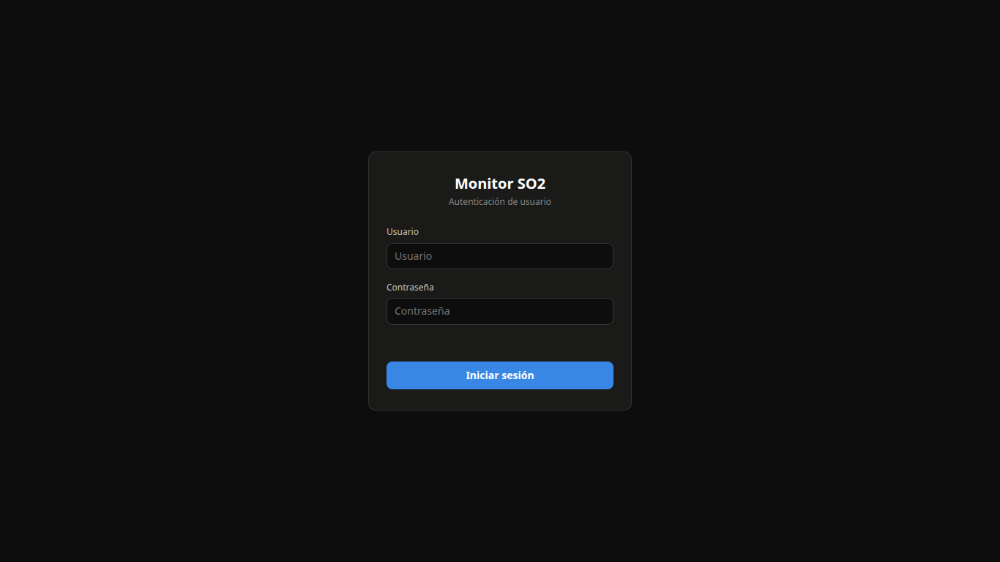

1. Ingrese su **Nombre de usuario** registrado en el sistema operativo.
2. Ingrese su **Contraseña** de UNIX.
3. Haga clic en el botón **Iniciar Sesión**.

### Validación de Grupos y Roles
El sistema valida sus credenciales contra el servicio PAM local. Si el usuario pertenece a `admin_user`, se habilita la interfaz completa de administración. Si pertenece a `common_user`, se muestra la vista restringida de operador.

Si un usuario del sistema operativo ingresa credenciales correctas pero **no pertenece a ningún grupo autorizado** (`admin_user` o `common_user`), el acceso es denegado de forma segura:

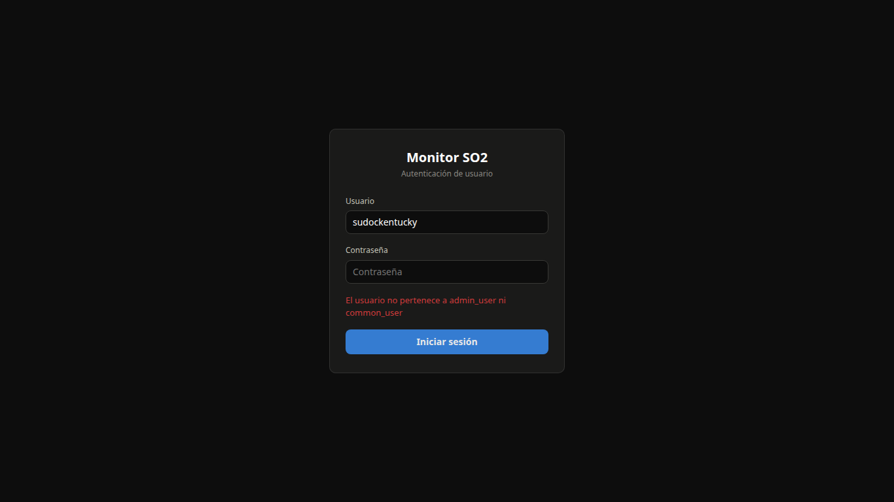

### Cierre de Sesión
Para terminar su turno de trabajo, haga clic en el botón **Cerrar Sesión** ubicado en la esquina superior derecha del encabezado. La cookie de sesión se destruirá de forma segura y será redirigido a la pantalla de login.

---

## 4. Vista General del Dashboard (Panel de Administración)

Al autenticarse con el rol de **Administrador** (`admin_user`), el sistema despliega el panel de control integral:

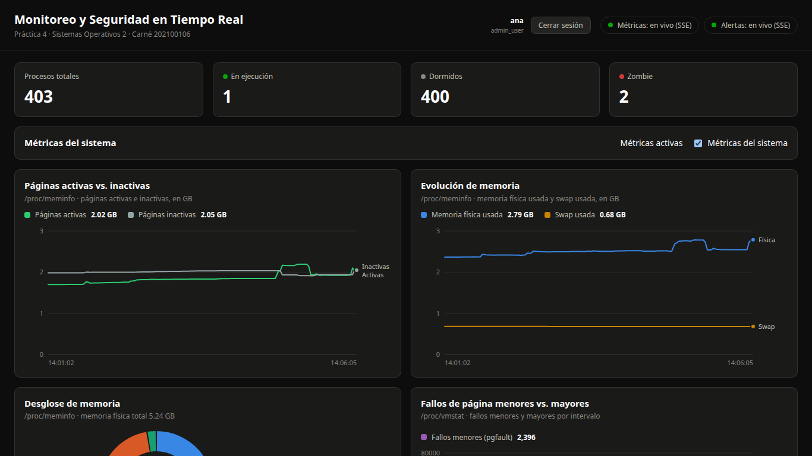

La interfaz se organiza en:
- **Encabezado superior**: Estado de conexión SSE en vivo (`En línea` / `Desconectado`), reloj del sistema, nombre de usuario y rol activo.
- **Tarjetas de Estado Rápido**: Indicadores numéricos instantáneos del uso de CPU, porcentaje de memoria RAM utilizada, alertas activas y conteo de amenazas neutralizadas.
- **Gráficas de Rendimiento**: Cuatro paneles interactivos con historial continuo.
- **Paneles de Control**: Tablas y formularios de Procesos, Alertas, Archivos, Antivirus, Cuarentena y Logwatch.

---

## 5. Panel de Métricas del Sistema

El módulo de métricas presenta cuatro gráficas dinámicas actualizadas en tiempo real cada 2 segundos mediante el canal SSE:

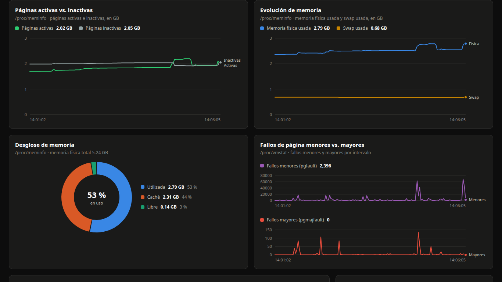

1. **Uso de CPU (%)**: Muestra la tasa porcentual de utilización de los núcleos de procesamiento.
2. **Uso de Memoria RAM (%)**: Representa el porcentaje de memoria física utilizada respecto al total disponible.
3. **Uso de Swap (%)**: Monitoriza la ocupación del espacio de intercambio. Si supera el 50%, se emite una alerta preventiva.
4. **Tasas de Entrada/Salida (I/O)**: Gráfica de lecturas y escrituras en disco expresadas en KiB/s y porcentaje de espera de I/O (`iowait`).

> **Nota para Administradores**: El interruptor **Monitoreo de Métricas** permite pausar la recolección de muestras sin detener el daemon.

---

## 6. Centro de Alertas en Tiempo Real

El panel de alertas lista los eventos anómalos o de seguridad detectados por el sistema, clasificados cronológicamente (las más recientes arriba) y codificados por colores según su severidad:

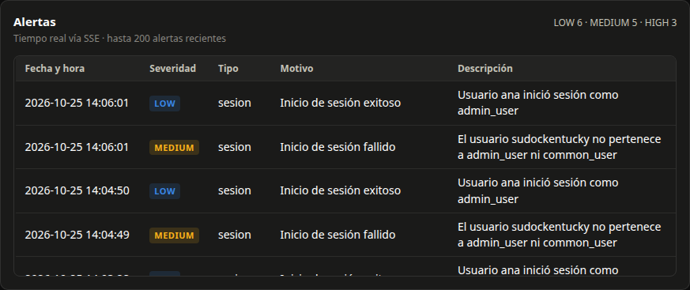

- **Severidad ALTA (`HIGH` - Borde Rojo)**: Situaciones críticas que demandan atención inmediata:
  - Detección de malware o archivo infectado (`ARCHIVO_INFECTADO`).
  - Aislamiento y cuarentena preventiva aplicada (`ARCHIVO_CUARENTENA`).
  - Consumo excesivo de CPU > 85% (`CPU_ALTO`).
  - Consumo crítico de memoria RAM > 85% (`MEM_ALTO`).
- **Severidad MEDIA (`MEDIUM` - Borde Amarillo)**: Advertencias de degradación o eventos de bitácoras:
  - Ocupación de Swap > 50% (`SWAP_ALTO`).
  - Espera de disco excesiva > 20% (`IO_ESPERA_ALTO`).
  - Proceso individual acaparando > 30% de memoria (`PROCESO_MEM_ALTO`).
  - Palabra clave sospechosa detectada en un log (`PALABRA_EN_LOG`).
- **Severidad BAJA (`LOW` - Borde Verde / Azul)**: Notificaciones informativas operativas:
  - Proceso finalizado exitosamente por el administrador (`PROCESO_KILL`).
  - Actualización de la base de firmas de antivirus (`REVISION_FIRMAS`).

---

## 7. Monitoreo y Control de Procesos (Top 20 y Kill)

### Tabla de Procesos Top 20
El sistema lista los 20 procesos que mayor memoria física residente (`RSS`) consumen en el equipo:

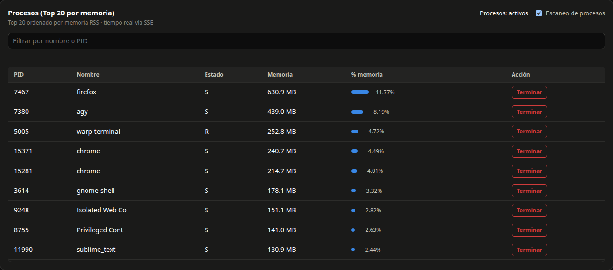

La tabla detalla: **PID**, **Nombre del ejecutable**, **Estado** (`S` durmiendo, `R` ejecutando, `D` espera no interrumpible, `Z` zombie), **Memoria RSS** (en MiB o KiB) y el **Porcentaje de RAM total** ocupado.

### Búsqueda Directa por PID
Para inspeccionar un proceso específico que no figure en el Top 20:
1. Ingrese el número de proceso en el campo **Buscar PID**.
2. Presione el botón **Consultar**.
3. El sistema consultará el estado actual en el kernel y mostrará su información detallada:

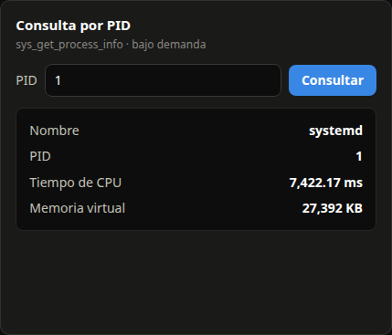

### Finalización Forzada de Procesos (`Kill`)
Exclusivo para administradores. Permite mitigar procesos fuera de control:
1. En la tabla de procesos o en el resultado de búsqueda, haga clic en el botón **Matar**.
2. Seleccione la señal deseada:
   - `SIGTERM (15)`: Solicitud de terminación controlada y limpia.
   - `SIGKILL (9)`: Terminación inmediata forzada por el kernel.
3. El sistema solicitará confirmación explícita para evitar errores operativos:

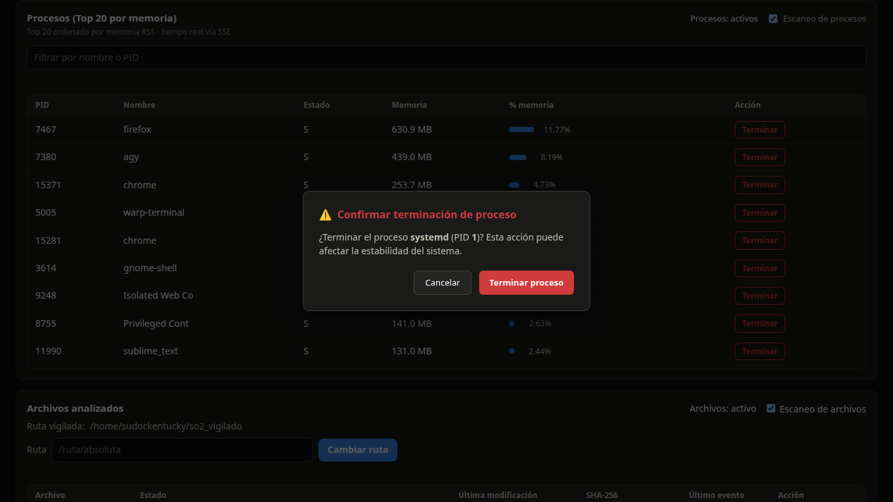

4. Tras confirmar, el daemon ejecuta la señal respetando las salvaguardas de seguridad (no permite matar al PID 1, al daemon ni a hilos del kernel).

---

## 8. Auditoría de Integridad de Archivos

Supervisa en tiempo real el directorio protegido mediante la sonda eBPF en el kernel:

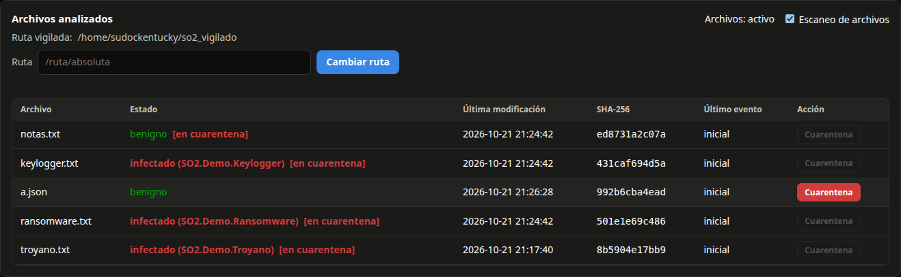

### Elementos de la Tabla
- **Ruta Absoluta**: Ubicación del archivo en el sistema de archivos.
- **Hash SHA-256**: Huella criptográfica única calculada al cerrarse operaciones de escritura.
- **Estado**:
  - `Benigno` (Verde): Archivo analizado sin coincidencias en la base de firmas.
  - `Infectado` (Rojo): Archivo cuyo hash coincide con una firma de malware conocida.
- **Cuarentena**: Indica si el archivo fue despojado de permisos (`0000`).

### Configuración del Directorio Vigilado
El administrador puede cambiar en caliente el directorio auditado o activar/desactivar el sensor:

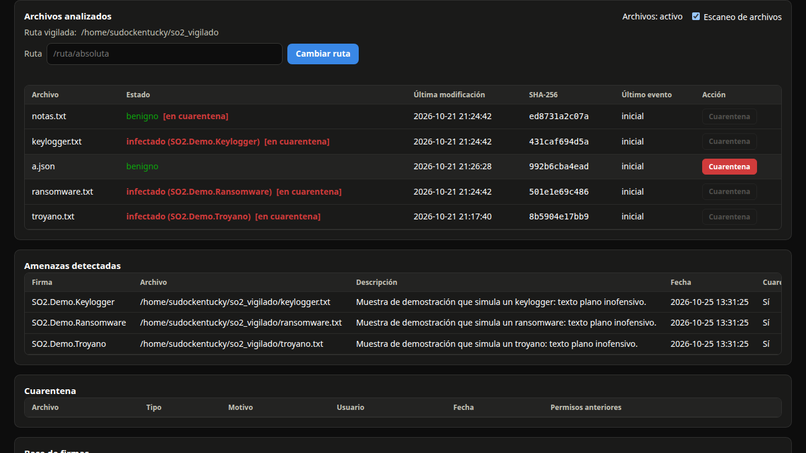

1. Ingrese la nueva ruta absoluta en el campo **Directorio vigilado**.
2. Haga clic en **Cambiar Ruta**.
3. El daemon recalculará de inmediato la línea base de los archivos presentes en la nueva ubicación.

---

## 9. Módulo Antivirus, Firmas y Gestión de Cuarentena

### Detección Automática de Amenazas
Cuando un proceso escribe un archivo malicioso dentro del directorio vigilado, el sensor eBPF captura la operación y el daemon calcula su hash SHA-256. Si coincide con una firma cargada, se dispara la cuarentena automática y se registra el incidente:

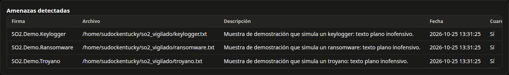

### Cuarentena Manual
Si el administrador identifica un archivo sospechoso en la tabla de archivos analizados, puede forzar su aislamiento inmediato:
1. Haga clic en el botón **Poner en Cuarentena** junto al archivo sospechoso.
2. Confirme la acción en el diálogo de seguridad:

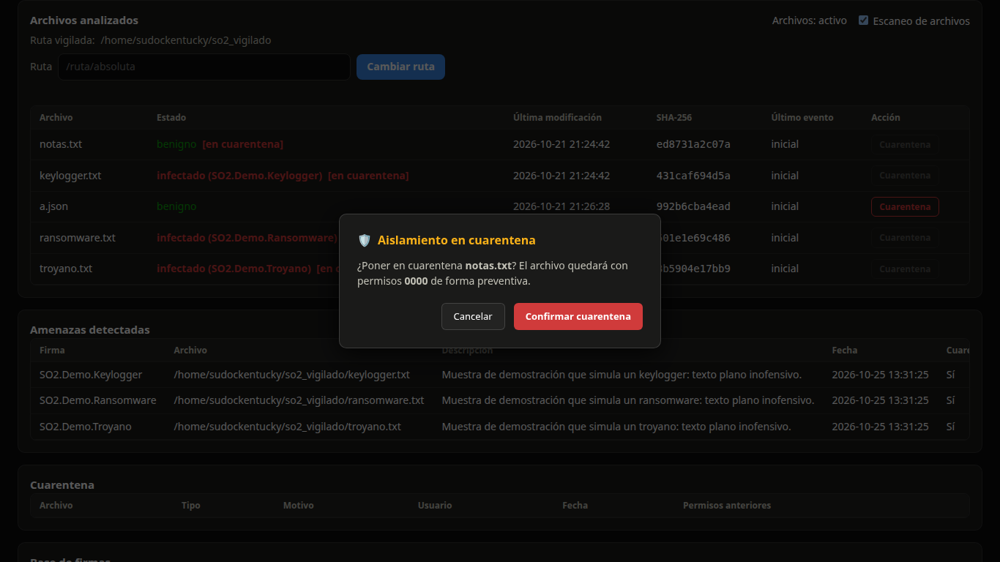

3. El archivo pasará a modo `0000` y figurará en el panel histórico de cuarentena:

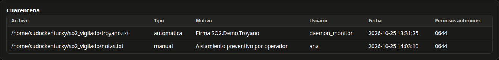

### Base de Firmas de Malware
Muestra el catálogo activo de firmas de detección de virus, troyanos y spyware:

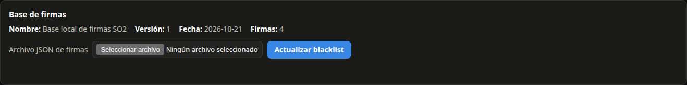

Para actualizar la base de firmas:
1. Haga clic en **Subir archivo JSON de firmas**.
2. Seleccione el archivo `blacklist.json` en su equipo.
3. El sistema validará la estructura y re-evaluará automáticamente todos los archivos vigilados.

Si el archivo no cumple con el formato requerido o contiene firmas corruptas, el sistema notificará el motivo del rechazo:

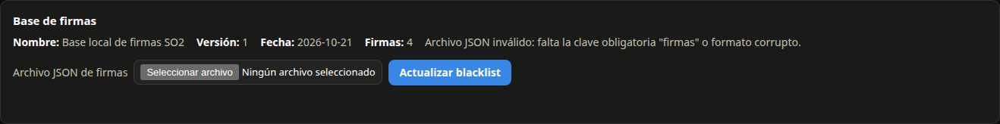

---

## 10. Vigilancia de Bitácoras (Logwatch)

Permite supervisar hasta 16 monitoreos concurrentes sobre archivos de registro de texto dentro del directorio base de logs:

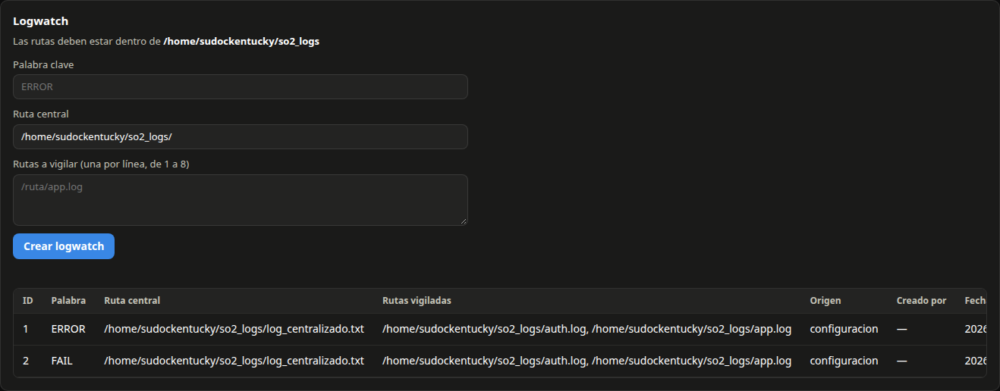

### Creación de una Nueva Vigilancia
1. Ingrese la **Palabra clave** a rastrear (hasta 63 caracteres sin barras verticales `|`).
2. Indique la **Ruta central** consolidada (prellenada con `<base>/`).
3. En el área de texto **Rutas a vigilar**, ingrese entre 1 y 8 rutas de archivos existentes (una por línea), todas dentro del directorio base de logs.
4. Presione **Crear Logwatch**.

Si alguna ruta especificada es un enlace simbólico, una subcarpeta o se encuentra fuera del directorio permitido, la operación será rechazada con un mensaje explicativo:

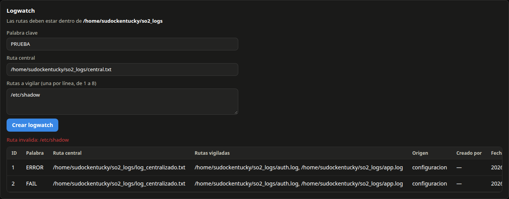

### Detección y Notificación
Cuando el kthread del kernel detecta una coincidencia de la palabra clave en cualquiera de las bitácoras vigiladas, copia la línea al archivo central y el daemon despacha una alerta de severidad `MEDIUM`:


### Finalización de Vigilancias
Para detener un monitoreo y dar de baja al kthread asociado en el kernel, el administrador simplemente hace clic en el botón **Finalizar** en la fila respectiva de la tabla de Logwatch.

---

## 11. Vista del Operador (Usuario Común)

Los usuarios pertenecientes exclusivamente al grupo `common_user` tienen una interfaz adaptada para supervisión y monitoreo pasivo, sin acceso a controles destructivos o modificaciones de seguridad:

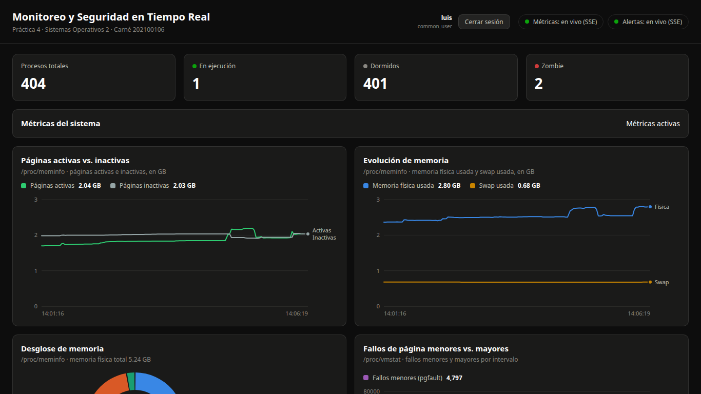

### Características de la Vista de Operador
- **Visibles**: Gráficas de métricas en tiempo real, Top 20 de procesos (sólo lectura), catálogo de alertas en vivo, listado de archivos analizados y panel de amenazas detectadas.
- **Ocultos o Bloqueados**:
  - No figuran los botones de **Matar** procesos ni la búsqueda con terminación.
  - No están disponibles los interruptores para desactivar subsistemas de monitoreo.
  - No figura el formulario para cambiar la ruta vigilada de archivos.
  - No figura la opción de aplicar cuarentena manual.
  - No figura el panel para subir o recargar firmas de antivirus (`blacklist.json`).
  - No figura el panel de administración ni creación de **Logwatch**.

---

## 12. Tabla Comparativa de Permisos por Rol

| Funcionalidad / Módulo del Sistema | Administrador (`admin_user`) | Operador Común (`common_user`) | Usuario No Autenticado |
|---|:---:|:---:|:---:|
| Inicio de sesión (`POST /api/login`) | Sí | Sí | Sí |
| Cierre de sesión (`POST /api/logout`) | Sí | Sí | Sí |
| Consulta de sesión activa (`GET /api/sesion`) | Sí | Sí | No (`401`) |
| Estado del daemon (`GET /api/estado`) | Sí | Sí | No (`401`) |
| Conexión al canal SSE (`GET /api/eventos`) | Sí | Sí | No (`401`) |
| Visualización de alertas (`GET /api/alertas`) | Sí | Sí | No (`401`) |
| Visualización de métricas (`GET /api/metricas`) | Sí | Sí | No (`401`) |
| Consultar estado de monitoreo (`GET /api/monitoreo`) | Sí | Sí | No (`401`) |
| Activar/Pausar métricas (`POST /api/monitoreo/metricas`) | Sí | No (`403`) | No (`401`) |
| Consulta puntual de PID (`GET /api/proceso`) | Sí | No (`403`) | No (`401`) |
| Top 20 de procesos (`GET /api/procesos`) | Sí | Sí | No (`401`) |
| Activar/Pausar procesos (`POST /api/monitoreo/procesos`) | Sí | No (`403`) | No (`401`) |
| Finalizar procesos (`POST /api/proceso/kill`) | Sí | No (`403`) | No (`401`) |
| Listado de archivos analizados (`GET /api/archivos`) | Sí | Sí | No (`401`) |
| Activar/Pausar archivos (`POST /api/monitoreo/archivos`) | Sí | No (`403`) | No (`401`) |
| Modificar ruta vigilada (`POST /api/ruta`) | Sí | No (`403`) | No (`401`) |
| Consultar base de firmas (`GET /api/blacklist`) | Sí | No (`403`) | No (`401`) |
| Actualizar firmas antivirus (`POST /api/blacklist`) | Sí | No (`403`) | No (`401`) |
| Listado de amenazas (`GET /api/amenazas`) | Sí | Sí | No (`401`) |
| Consultar registros de cuarentena (`GET /api/cuarentena`) | Sí | No (`403`) | No (`401`) |
| Poner archivo en cuarentena (`POST /api/cuarentena`) | Sí | No (`403`) | No (`401`) |
| Listado de Logwatch (`GET /api/logwatch`) | Sí | No (`403`) | No (`401`) |
| Crear nuevo Logwatch (`POST /api/logwatch`) | Sí | No (`403`) | No (`401`) |
| Finalizar Logwatch (`DELETE /api/logwatch`) | Sí | No (`403`) | No (`401`) |

---

## 13. Resolución de Problemas Frecuentes

### 1. El daemon no inicia: `Puerto ocupado` o `Address already in use`
- **Causa**: Otro proceso o una instancia previa de `daemon_monitor` está utilizando el puerto configurado (ej. 8080).
- **Solución**:
  1. Identifique el proceso que ocupa el puerto: `sudo ss -tulpn | grep 8080` o `sudo lsof -i :8080`.
  2. Finalice la instancia anterior: `sudo pkill -f daemon_monitor`.
  3. Alternativamente, edite `daemon.conf` y modifique la clave `puerto = 8085` para utilizar un puerto libre.

### 2. Mensaje en la interfaz: `sensor eBPF no disponible`
- **Causa**: El kernel en ejecución no tiene habilitado BTF (`/sys/kernel/btf/vmlinux`) o las opciones de instrumentación BPF requeridas, o el daemon no se ejecutó con `sudo`.
- **Solución**:
  1. Verifique que inició el daemon con privilegios de superusuario: `sudo ./daemon_monitor`.
  2. Verifique la versión del kernel: `uname -r` debe ser `6.12.69-so2-202100106`.
  3. Ejecute `scripts/verificar_kernel.sh` para comprobar la disponibilidad de `/sys/kernel/btf/vmlinux`.

### 3. Error al subir firmas: `Blacklist invalida` o `Payload Too Large`
- **Causa**: El archivo JSON no respeta el esquema formal (`nombre`, `version`, arreglo `firmas` con objetos `sha256`, `nombre`, `descripcion`) o el archivo supera el límite de 1 MiB.
- **Solución**:
  1. Verifique que los hashes SHA-256 tengan exactamente 64 caracteres hexadecimales en minúsculas.
  2. Asegúrese de que el archivo JSON esté bien formado utilizando `jq . archivo.json`.
  3. Si la base supera las 5000 firmas, divida el catálogo para ajustarse a los límites operativos.

### 4. Error al crear vigilancia: `Ruta invalida: ...` o `Ruta central invalida`
- **Causa**: La ruta ingresada contiene enlaces simbólicos, apunta a una subcarpeta, contiene caracteres ilegales (`|`, caracteres de control) o no se ubica dentro del directorio base de logs.
- **Solución**:
  1. Compruebe la ruta base informada en el encabezado del panel Logwatch (ej. `/home/usuario/so2_logs`).
  2. Verifique que los archivos vigilados residan directamente en ese directorio: `/home/usuario/so2_logs/archivo.log`.
  3. Compruebe que ni el archivo ni ninguna carpeta padre sea un symlink: `ls -ld <ruta>`.

### 5. Sesión cerrada inesperadamente: `Sesión expirada`
- **Causa**: La sesión web cuenta con un tiempo de vida máximo por inactividad de 30 minutos (1800 segundos).
- **Solución**:
  - Ingrese nuevamente sus credenciales en la pantalla de inicio de sesión. La renovación es automática mientras mantenga actividad continua en la interfaz.
