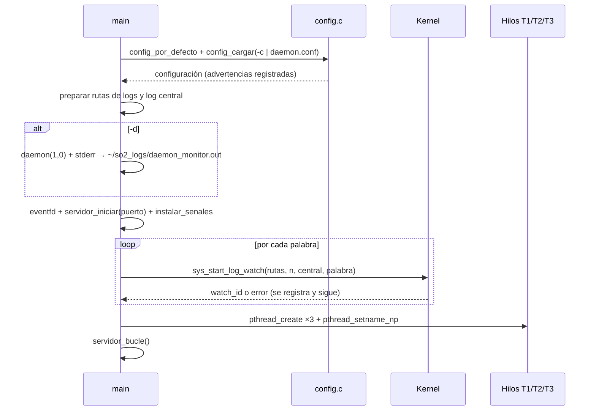
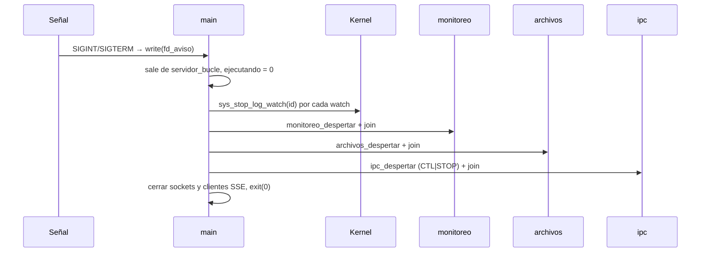

# F00 — Fundación desde P4 · Diseño

Requisitos: [`requirements.md`](requirements.md). Estructura destino: [`../../steering/structure.md`](../../steering/structure.md).

---

## 1. Visión general

La F00 es un **port con adaptaciones mínimas**. Se copia el código de P4 y solo se cambia lo que el proyecto exige:

| Cambio | Motivo | Requisito |
|---|---|---|
| Overlay en `Kernel/` | Nombre de carpeta exigido por el enunciado | R2 |
| Kernel con eBPF + BTF | El sensor (F05) necesita `/sys/kernel/btf/vmlinux` | R3 |
| `daemon.conf` en vez de flags | `log_watch` arranca "con los parámetros de su archivo de configuración" | R4 |
| Hilos `monitoreo` / `archivos` / `ipc` | Concurrencia obligatoria con esa división | R5 |
| Todo lo demás igual a P4 | Base estable para las features 01–07 | R7 |

## 2. Mapa de origen → destino

| Origen (P4, solo lectura) | Destino | Cambios |
|---|---|---|
| `linux-6.12.69/**` | `Kernel/**` | Ninguno (copia exacta). |
| `daemon/comun.h` | `ProgramaIntermedio/comun.h` | + `struct configuracion`, prototipos de `config.c` y de los hilos nuevos. |
| `daemon/main.c` | `ProgramaIntermedio/main.c` | `struct opciones`/`getopt` reemplazados por `-c/-d/-h` + `config_cargar()`; crea 3 hilos con nombre; apagado de 3 hilos. |
| — | `ProgramaIntermedio/config.c` | Nuevo: parser de `daemon.conf`. |
| `daemon/metricas.c` | `ProgramaIntermedio/metricas.c` | `hilo_metricas` → `hilo_monitoreo` (misma lógica). |
| `daemon/eventos.c` | `ProgramaIntermedio/ipc.c` | `hilo_eventos` → `hilo_ipc`, `eventos_despertar` → `ipc_despertar`. |
| — | `ProgramaIntermedio/sensor.c` | Nuevo: `hilo_archivos` en espera (stub para F05). |
| `daemon/http.c`, `daemon/json.c` | igual nombre | Ninguno, salvo includes. |
| `daemon/Makefile` | `ProgramaIntermedio/Makefile` | Fuentes nuevas, objetivo `pruebas`. |
| `frontend/**` | `Dashboard/**` | Ninguno. |
| `test_fase1.c` | `scripts/test_syscalls.c` | Solo renombre. |
| `preparar_kernel.sh` | `scripts/preparar_kernel.sh` | Overlay desde `Kernel/`, `SO2_WORKSPACE`, bloque eBPF/BTF, chequeo de `pahole`. |
| `instalar_kernel.sh` | `scripts/instalar_kernel.sh` | `SO2_WORKSPACE`, `INSTALL_MOD_STRIP=1`. |
| `pruebas_integracion.sh`, `demo.sh` | `scripts/` | Rutas nuevas y `-c`. |
| — | `scripts/verificar_kernel.sh` | Nuevo. |

> Los renombres de funciones se hacen con búsqueda exacta; no cambies la lógica interna de esas funciones en esta feature.

## 3. Kernel

### 3.1 Árbol de compilación

```bash
REPO_DIR="$(cd "${SCRIPT_DIR}/../.." && pwd)"
WORKSPACE_DIR="${SO2_WORKSPACE:-${REPO_DIR}/Practica_3_2S2026/so2_build_workspace}"
ARBOL="${WORKSPACE_DIR}/linux-${KERNEL_VERSION}"
OVERLAY="$(cd "${SCRIPT_DIR}/../Kernel" && pwd)"
```

`instalar_kernel.sh` usa exactamente las mismas tres líneas para encontrar el árbol.

### 3.2 Bloque eBPF/BTF

Se aplica **siempre**, después del bloque `if [ -f .config ] … fi` de P4 y antes del `LOCALVERSION`. En la rama "no hay `.config`" se eliminan los `--disable DEBUG_INFO*`/`--enable DEBUG_INFO_NONE` de P4.

```bash
OPCIONES_EBPF=(BPF BPF_SYSCALL BPF_EVENTS DEBUG_INFO_BTF FTRACE_SYSCALLS)

scripts/config \
    --enable BPF --enable BPF_SYSCALL --enable BPF_JIT \
    --enable PERF_EVENTS --enable KPROBES --enable KPROBE_EVENTS --enable BPF_EVENTS \
    --enable FTRACE --enable FTRACE_SYSCALLS \
    --disable DEBUG_INFO_NONE --enable DEBUG_INFO \
    --enable DEBUG_INFO_DWARF_TOOLCHAIN_DEFAULT \
    --disable DEBUG_INFO_REDUCED --disable DEBUG_INFO_SPLIT \
    --enable DEBUG_INFO_BTF --enable DEBUG_INFO_BTF_MODULES
make olddefconfig >/dev/null

for opcion in "${OPCIONES_EBPF[@]}"; do
    grep -q "^CONFIG_${opcion}=y$" .config || { err "CONFIG_${opcion} no quedo en =y"; exit 1; }
done
```

Notas:
- `DEBUG_INFO_BTF` depende de `DEBUG_INFO` (no reducido ni separado) y de `pahole ≥ 1.16`; por eso se fuerzan las dependencias y se verifica al final.
- `BPF_EVENTS` depende de `PERF_EVENTS` y de `KPROBE_EVENTS`/`UPROBE_EVENTS`.
- Cambiar estas opciones obliga a una recompilación casi completa; el script ya lo advierte.

### 3.3 Chequeo de `pahole` (fase de dependencias)

Se agrega `dwarves` a `DEPENDENCIAS`. Luego:

```bash
VERSION_PAHOLE=$(pahole --version 2>/dev/null | tr -dc '0-9.')
if [ -z "$VERSION_PAHOLE" ] || \
   [ "$(printf '%s\n1.16\n' "$VERSION_PAHOLE" | sort -V | head -1)" != "1.16" ]; then
    err "pahole >= 1.16 es necesario para CONFIG_DEBUG_INFO_BTF. Instala: sudo apt install dwarves"
    exit 1
fi
```

### 3.4 Instalación

`sudo make -C "$ARBOL" INSTALL_MOD_STRIP=1 modules_install`. Con `DEBUG_INFO=y` los módulos sin *strip* ocupan varios GB en `/lib/modules`.

### 3.5 `verificar_kernel.sh`

Comprueba en orden y acumula fallos (no se detiene en el primero):

1. `uname -r` = `6.12.69-so2-202100106`.
2. `test -r /sys/kernel/btf/vmlinux`.
3. Las 5 opciones `=y` en `/boot/config-$(uname -r)`.
4. Compila `scripts/test_syscalls.c` si el binario no existe y lo ejecuta; código distinto de 0 = fallo.

Imprime una línea `✓`/`✗` por chequeo y sale con 0 solo si no hubo fallos.

## 4. Daemon

### 4.1 Configuración (`config.c`)

```c
#define MAX_RUTAS_LOG		LOG_WATCH_MAX_FILES

struct configuracion {
	int puerto;
	int intervalo;
	char dashboard[PATH_MAX];
	char log_central[PATH_MAX];
	char log_rutas[MAX_RUTAS_LOG][PATH_MAX];
	int n_log_rutas;
	char log_palabras[MAX_PALABRAS][64];
	int n_log_palabras;
	char ruta_vigilada[PATH_MAX];
	char blacklist[PATH_MAX];
};

void config_por_defecto(struct configuracion *c, const char *dir_ejecutable);
int  config_cargar(struct configuracion *c, const char *archivo);
```

Reglas del parser:
- Línea por línea con `getline`; se quitan espacios al inicio/fin; se ignoran vacías y las que empiezan con `#`.
- Se separa en el primer `=`; clave y valor se recortan.
- Enteros con `strtol` y validación de rango; listas con `strtok_r` por `,` (recortando cada elemento, ignorando vacíos, máximo 8).
- Clave desconocida, valor fuera de rango o lista con más de 8 elementos → `registrar("daemon.conf:%d: …")` y se conserva el valor por defecto (o los primeros 8).
- `~` al inicio se expande con `$HOME`; si `SUDO_USER` está definido se usa el `HOME` de ese usuario (`getpwnam`) para que `sudo` no lleve las rutas a `/root`.
- Las rutas relativas se resuelven contra la carpeta del ejecutable. Las rutas de logs se preparan con la función `preparar_archivo()` de P4 (crea el archivo si no existe y devuelve la ruta canónica).

`config_cargar` no termina el proceso: devuelve `-1` y `main` decide (R4.2 / R4.3).

### 4.2 Línea de comandos

```text
Uso: daemon_monitor [-c archivo] [-d] [-h]
  -c archivo   Archivo de configuración (por defecto: daemon.conf junto al ejecutable)
  -d           Ejecutar en segundo plano
  -h           Mostrar esta ayuda
```

La carga de configuración y su validación ocurren **antes** de `daemon(1, 0)`, para que los errores fatales se vean en la terminal.

### 4.3 Hilos

| Hilo | Función | Nombre (`pthread_setname_np`) | Bloquea en | Cómo se despierta al apagar |
|---|---|---|---|---|
| principal | `servidor_bucle()` | (sin cambio) | `poll()` + `eventfd` de P4 | `fd_aviso` (manejador de señal de P4) |
| T1 | `hilo_monitoreo()` | `monitoreo` | `pthread_cond_timedwait` (P4) | `monitoreo_despertar()` |
| T2 | `hilo_archivos()` | `archivos` | `pthread_cond_wait` | `archivos_despertar()` |
| T3 | `hilo_ipc()` | `ipc` | `sys_ipc_channel_receive` | `ipc_despertar()` envía `CTL|STOP` (P4) |

`hilo_archivos` en esta feature:

```c
static pthread_mutex_t lock_archivos = PTHREAD_MUTEX_INITIALIZER;
static pthread_cond_t cond_archivos = PTHREAD_COND_INITIALIZER;

void *hilo_archivos(void *sin_uso)
{
	(void)sin_uso;
	pthread_mutex_lock(&lock_archivos);
	while (ejecutando)
		pthread_cond_wait(&cond_archivos, &lock_archivos);
	pthread_mutex_unlock(&lock_archivos);
	return NULL;
}

void archivos_despertar(void)
{
	pthread_mutex_lock(&lock_archivos);
	pthread_cond_broadcast(&cond_archivos);
	pthread_mutex_unlock(&lock_archivos);
}
```

Los hilos se crean con `SIGINT`/`SIGTERM` bloqueadas (como P4) para que las señales lleguen solo al hilo principal. `SIGPIPE` se ignora con `SIG_IGN` en `instalar_senales()`.

### 4.4 Secuencia de arranque



### 4.5 Secuencia de apagado



En el host `ipc_despertar` falla con `ENOSYS`, pero T3 ya terminó al recibir `ENOSYS` (comportamiento de P4), así que el `join` no se bloquea.

## 5. Manejo de errores

| Situación | Respuesta |
|---|---|
| `-c` apunta a archivo inexistente | Mensaje en stderr, `exit(1)` antes de daemonizar. |
| Sin `-c` y sin `daemon.conf` | Advertencia, valores por defecto. |
| Clave desconocida / valor inválido | Advertencia con número de línea, valor por defecto. |
| Ruta de log no se puede crear | Se registra y esa ruta no se vigila (P4). |
| Puerto ocupado | Mensaje y `exit(1)` (no hay servicio que ofrecer). |
| `pthread_create` falla | Se registra y el daemon sigue con los demás hilos. |
| Syscall con error / `ENOSYS` | Se registra; el daemon sigue sirviendo HTTP. |
| Cliente SSE cierra la conexión | `SIGPIPE` ignorada; el cliente se retira de la lista (P4). |

## 6. Estrategia de pruebas

### 6.1 En el host (sin kernel del curso)

| Prueba | Cómo | Requisito |
|---|---|---|
| Compilación limpia | `make -C ProgramaIntermedio clean all 2>&1 \| grep -c warning` → `0` | R7.4 |
| Parser de configuración | `ProgramaIntermedio/pruebas/test_config.c` (ver abajo) vía `make pruebas` | R4 |
| Overlay idéntico | `diff -r Practica_4_2S2026/linux-6.12.69 ProyectoUnico_2S2026/Kernel` | R2 |
| Sintaxis de scripts | `bash -n scripts/*.sh` | R3 |
| Hilos con nombre | Arrancar el daemon en un puerto libre y leer `/proc/<pid>/task/*/comm` → contiene `monitoreo`, `archivos`, `ipc` | R5.1 |
| Resiliencia `ENOSYS` | Con el daemon corriendo en el host: `curl /api/estado` → `200` con memoria > 0 | R6.3 |
| Apagado | `kill -TERM <pid>`; el proceso termina en < 5 s con código 0 | R6.1 |
| `-c` inexistente | `daemon_monitor -c /no/existe; echo $?` → `1` | R4.3 |

`test_config.c` enlaza `config.c` (y lo mínimo de `main.c` que necesite, p. ej. un `registrar` de prueba) y cubre:
1. Archivo con todas las claves válidas → valores leídos.
2. Comentarios, líneas vacías y espacios alrededor de `=`.
3. Clave desconocida → se ignora, el resto se lee.
4. `puerto = 70000` e `intervalo = 0` → valores por defecto.
5. `log_palabras` con 10 elementos → solo 8.
6. `~/x` → `$HOME/x`.
7. Archivo inexistente → `config_cargar` devuelve `-1`.

### 6.2 En la VM (kernel `6.12.69-so2-202100106`)

| Prueba | Cómo | Requisito |
|---|---|---|
| Kernel listo para eBPF | `scripts/verificar_kernel.sh` → código 0 | R3.7 |
| Paridad con P4 | `scripts/pruebas_integracion.sh` → todo en verde | R7.3 |
| CPU en reposo | `top -b -n 3 -d 1 -p $(pidof daemon_monitor)` → `0.0` fuera del muestreo | R5.7 |
| Apagado sin huérfanos | Tras `SIGTERM`, `ps -e \| grep -c log_watch` vuelve a 0 | R6.1 |
