## Universidad de San Carlos de Guatemala
## Facultad de Ingeniería
## Laboratorio Sistemas Operativos 2
## Sección A
## Auxiliar: Alan Rodrigo Pamal de León


### PRÁCTICA # 1

### Modificación de funciones del kernel
### Informe Técnico

| Nombre | Carnet |
|---|---|
| Raúl Emanuel Yat Cancinos | 202300722 |

---

## Tabla de Contenido

1. [Introducción](#introducción)
2. [Objetivos](#objetivos)
3. [Descripción del Problema](#descripción-del-problema)
4. [Metodología](#metodología)
   - 4.1 [Preparación del Entorno](#41-preparación-del-entorno)
   - 4.2 [Modificación del Código Fuente](#42-modificación-del-código-fuente)
   - 4.3 [Configuración y Compilación del Kernel](#43-configuración-y-compilación-del-kernel)
   - 4.4 [Instalación del Kernel](#44-instalación-del-kernel)
   - 4.5 [Verificación y Pruebas](#45-verificación-y-pruebas)
5. [Conclusiones](#conclusiones)
6. [Lecciones Aprendidas](#lecciones-aprendidas)
7. [Referencias](#referencias)

---

## Introducción

El presente informe documenta el proceso de modificación del kernel de Linux para implementar un contador global dentro de la llamada al sistema `sys_getpid()` y la creación de una nueva llamada al sistema `getpid_counter()`. Esta práctica tiene como objetivo comprender la estructura interna del kernel de Linux, su proceso de compilación y la interacción entre el espacio de usuario y el espacio de kernel.

El kernel de Linux actúa como intermediario entre el hardware y las aplicaciones de usuario. Comprender su funcionamiento interno es fundamental para el desarrollo de software de bajo nivel y la administración avanzada de sistemas. La modificación del kernel permite instrumentar el sistema operativo para monitorear comportamientos específicos, como en este caso, la frecuencia de uso de una llamada al sistema crítica.

---

## Objetivos

### Objetivo General

- Modificar el código fuente del kernel de Linux para implementar un contador global dentro de la llamada al sistema `sys_getpid()` y recompilar el núcleo funcionalmente.

### Objetivos Específicos

1. Localizar y modificar el archivo fuente donde reside `sys_getpid()` para implementar un mecanismo de conteo.
2. Crear una nueva llamada al sistema `getpid_counter()` que imprima el valor del contador mediante `printk`.
3. Registrar la nueva llamada al sistema en la tabla de syscalls.
4. Compilar e instalar el kernel modificado sin errores.
5. Verificar el funcionamiento mediante un programa de prueba en espacio de usuario y el comando `dmesg`.
6. Documentar todo el proceso en un informe técnico detallado.

---

## Descripción del Problema

El problema planteado consiste en la instrumentación del núcleo de Linux para monitorear la frecuencia de uso de la llamada al sistema `sys_getpid()`. Actualmente, esta llamada simplemente devuelve el PID del proceso actual sin dejar rastro de su frecuencia de uso.

El reto es intervenir el código fuente del kernel para implementar un mecanismo de monitoreo interno que registre de forma acumulativa cada invocación a esta función. La solución debe:

1. Ser estable y no comprometer la integridad del sistema.
2. Ser visible para el administrador a través de los buffers de mensaje del sistema (`dmesg`).
3. Ser accesible desde el espacio de usuario mediante una nueva llamada al sistema.

Este problema es relevante para entender la transición entre el espacio de usuario y el espacio de kernel, así como el impacto directo de la programación de sistemas en el comportamiento del hardware.

---

## Metodología

### 4.1 Preparación del Entorno

#### 4.1.1 Hardware

| Componente | Especificación |
|------------|----------------|
| Procesador | 4 núcleos asignados a la VM |
| Memoria RAM | 8 GB |
| Almacenamiento | 50 GB |

#### 4.1.2 Software

| Componente | Versión |
|------------|---------|
| Sistema Operativo | Ubuntu 24.04 LTS |
| Virtualizador | VirtualBox 7.0 |
| Versión del Kernel | 6.12.103 |

#### 4.1.3 Instalación de Dependencias

```bash
sudo apt update && sudo apt upgrade -y
sudo apt install -y build-essential libncurses-dev flex bison libssl-dev libelf-dev dwarves gawk
```

#### 4.1.4 Descarga del Código Fuente

```bash
wget https://cdn.kernel.org/pub/linux/kernel/v6.x/linux-6.12.103.tar.xz
tar -xf linux-6.12.103.tar.xz
cd linux-6.12.103
```

### 4.2 Modificación del Código Fuente
#### 4.2.1 Declaración de la Variable Global

Archivo: `kernel/sys.c`
Se declaró una variable global global_pid_counter al inicio del archivo:
```c
// Declaración de la variable global para el contador
unsigned long global_pid_counter = 0;
EXPORT_SYMBOL(global_pid_counter);
```

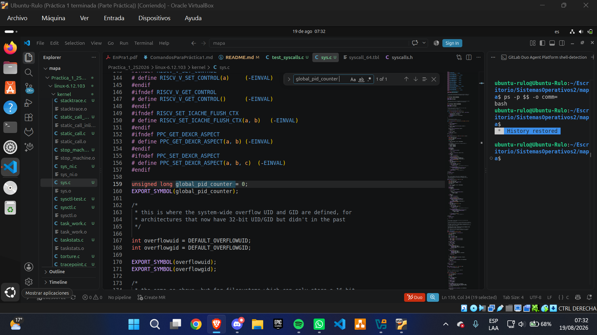

#### 4.2.2 Modificación de sys_getpid()

Archivo: `kernel/sys.c`
Se modificó la función sys_getpid() para incrementar el contador en cada invocación:
```c
SYSCALL_DEFINE0(getpid)
{
    // Incrementar el contador global
    global_pid_counter++;
    return task_tgid_vnr(current);
}
```

#### 4.2.3 Implementación de sys_getpid_counter()

Archivo: `kernel/sys.c`
Se implementó la nueva llamada al sistema:
```c
SYSCALL_DEFINE0(getpid_counter)
{
    printk(KERN_INFO "Buen día caballero, el contador global es %lu\n", global_pid_counter);
    return global_pid_counter;
}
```

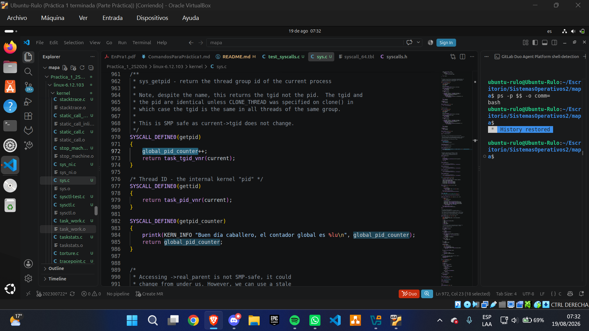

#### 4.2.4 Registro de la Nueva Syscall

Archivo: `arch/x86/entry/syscalls/syscall_64.tbl`
Se añadió una nueva entrada en la tabla de syscalls:
```text
472    common    getpid_counter    sys_getpid_counter
```

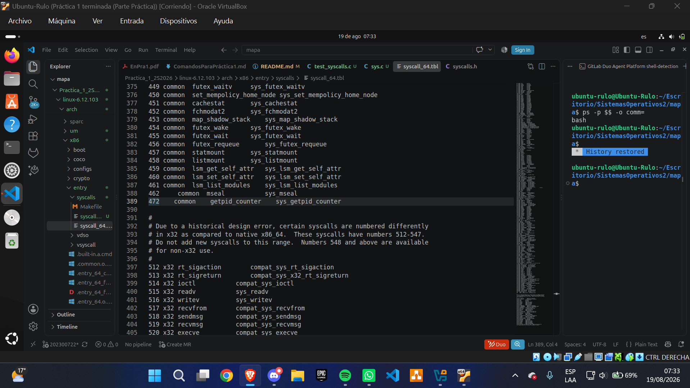

#### 4.2.5 Declaración de la Función

Archivo: `include/linux/syscalls.h`
Se declaró la función para que esté disponible globalmente:
```c
asmlinkage long sys_getpid_counter(void);
```

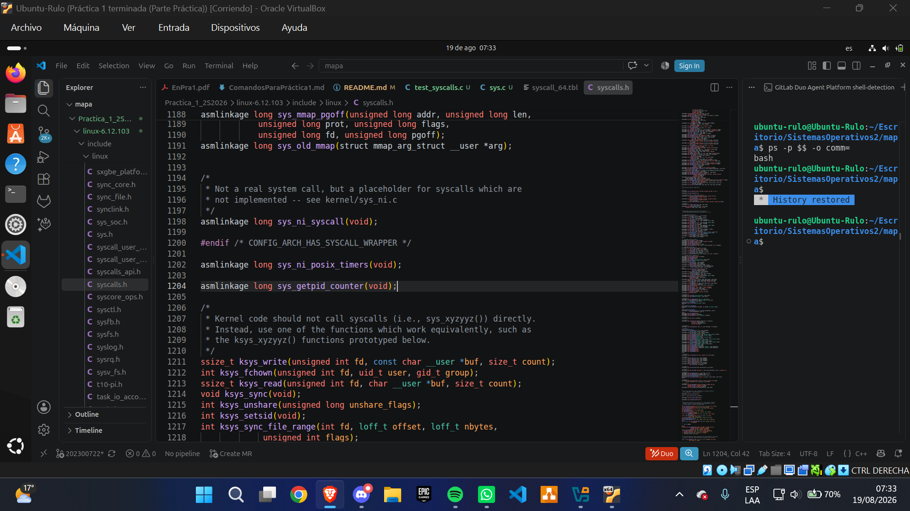

### 4.3 Configuración y Compilación del Kernel
#### 4.3.1 Configuración Inicial
Se copió la configuración del sistema actual:
```bash
cp /boot/config-$(uname -r) .config
```

#### 4.3.2 Configuración con menuconfig
Se ejecutó make menuconfig para revisar y ajustar la configuración:
```bash
make menuconfig
```
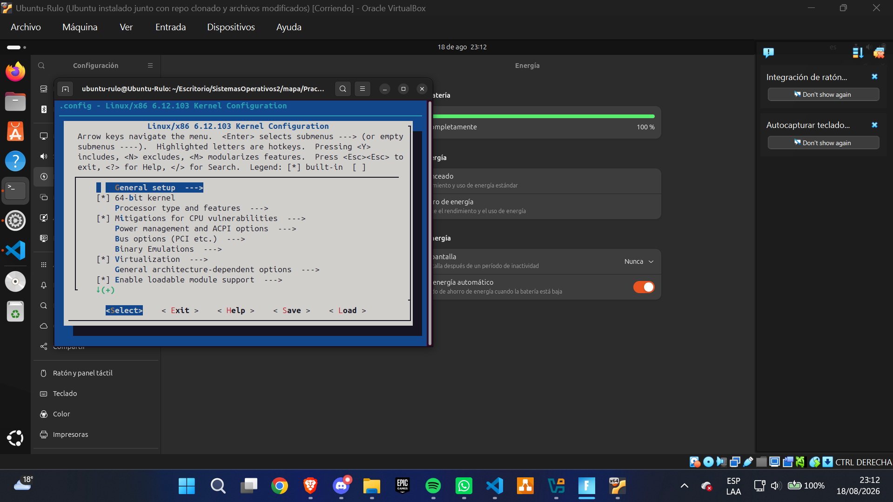
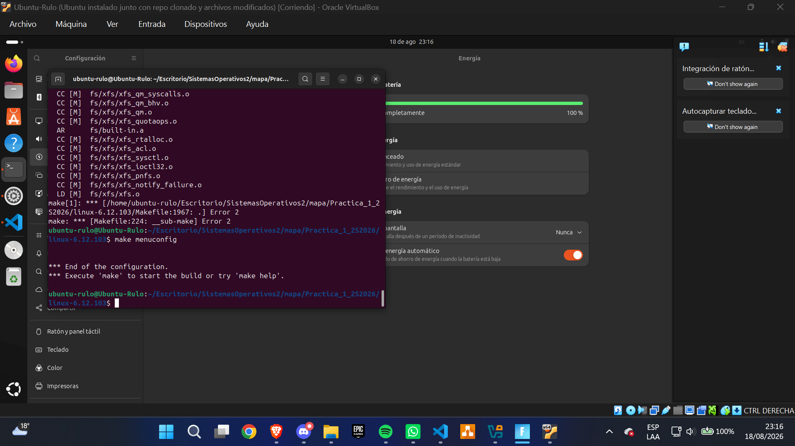

#### 4.3.3 Compilación del Kernel
Se ejecutó el comando de compilación:
```bash
make -j$(nproc)
```
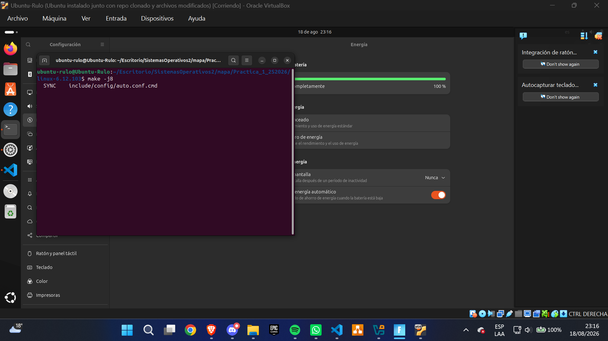
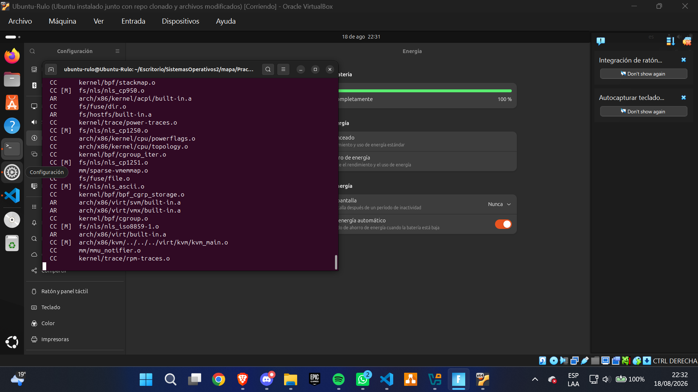

Verificación de archivos generados:
```bash
echo $?
# 0

ls -lh arch/x86/boot/bzImage
# -rw-rw-r-- 1 ubuntu-rulo ubuntu-rulo 15M ago 19 02:23 arch/x86/boot/bzImage

ls -lh vmlinux
# -rwxrwxr-x 1 ubuntu-rulo ubuntu-rulo 429M ago 19 02:17 vmlinux

ls -lh System.map
# -rw-rw-r-- 1 ubuntu-rulo ubuntu-rulo 9.0M ago 19 02:17 System.map
```

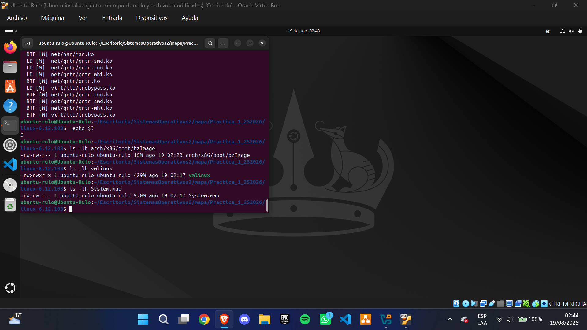

### 4.4 Instalación del Kernel
#### 4.4.1 Instalación de Módulos
```bash
sudo make modules_install
```
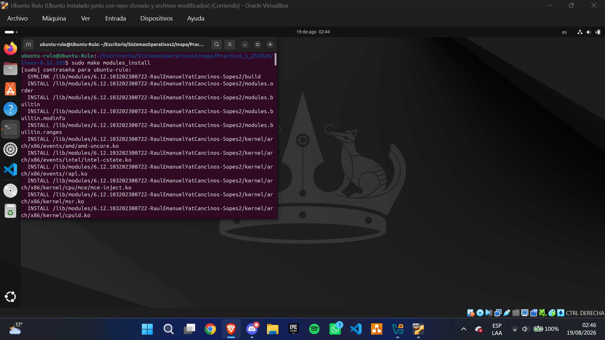

#### 4.4.2 Instalación del Kernel
```bash
sudo make install
```
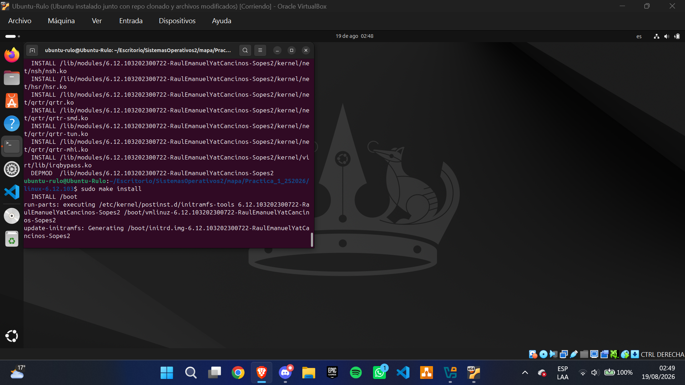

#### 4.4.3 Actualización de GRUB
```bash
sudo update-grub
```
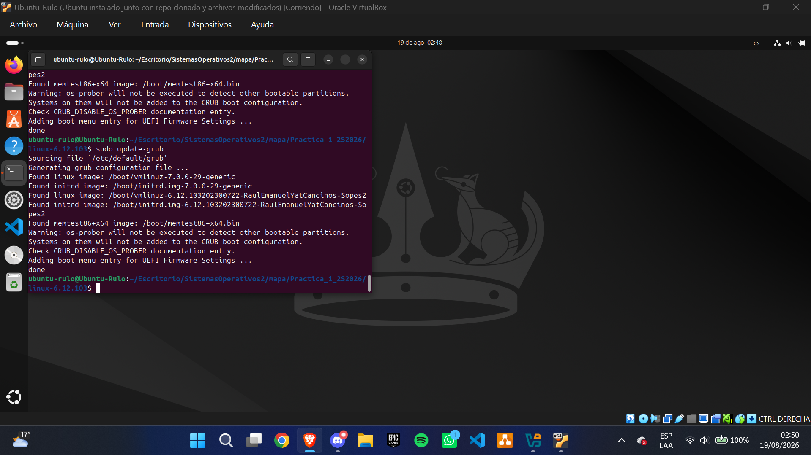

### 4.5 Verificación y Pruebas
#### 4.5.1 Reinicio y Selección del Kernel
Se reinició el sistema y se seleccionó el nuevo kernel desde el menú de GRUB:
1. sudo reboot
2. Presionar Shift durante el arranque
3. Seleccionar "Opciones avanzadas para Ubuntu"
4. Seleccionar "Ubuntu, con Linux 6.12.103"

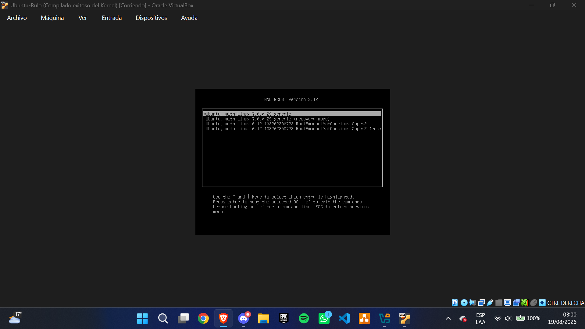

#### 4.5.2 Verificación del Kernel Activo
```bash
uname -r
# 6.12.103

uname -a
# Linux Ubuntu-Rulo 6.12.103 #1 SMP PREEMPT_DYNAMIC Mon Aug 19 02:17:00 UTC 2026 x86_64 x86_64 x86_64 GNU/Linux
```

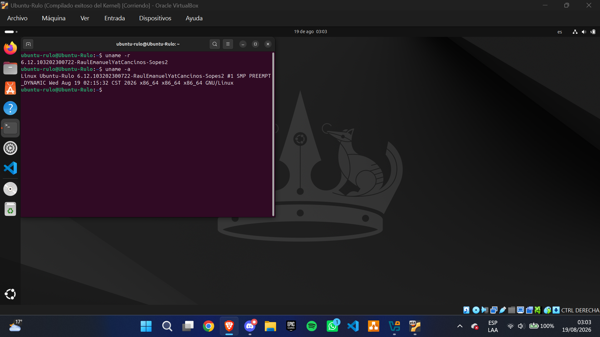

#### 4.5.3 Programa de Prueba en C
Se creó el programa `test_syscalls.c`.
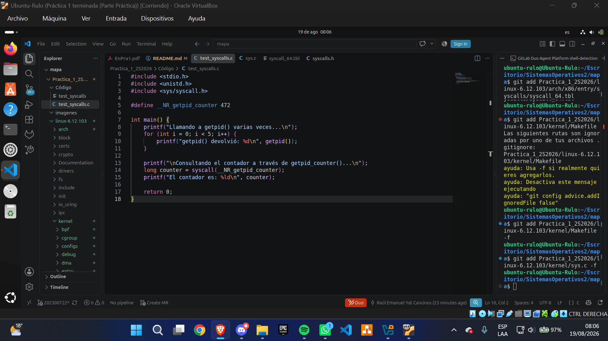

#### 4.5.4 Compilación y Ejecución del Programa
```bash
gcc test_syscalls.c -o test_syscalls
./test_syscalls
```
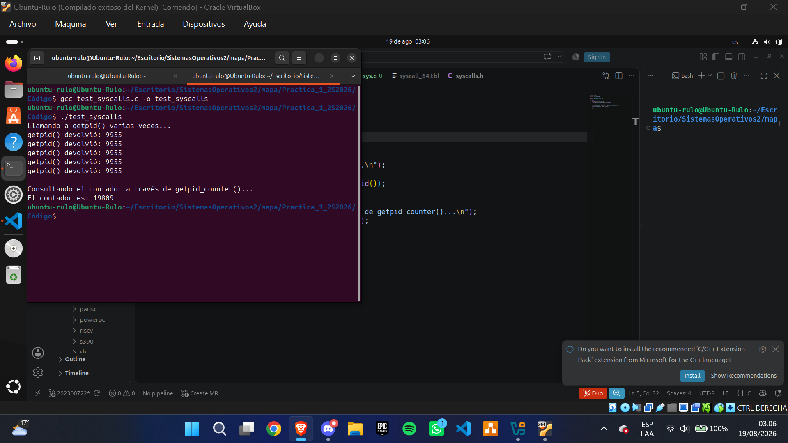

#### 4.5.5 Verificación con dmesg
```bash
dmesg | grep "getpid_counter"
```
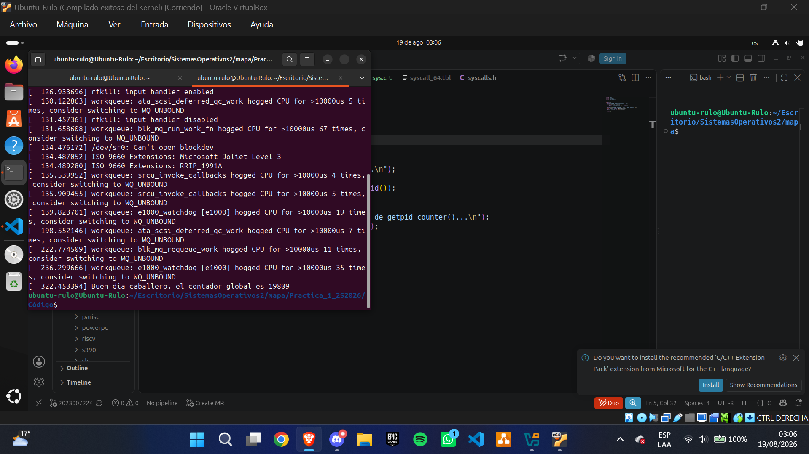

## Conclusiones
1. Comprensión del Kernel: La práctica permitió comprender la estructura interna del kernel de Linux y la ubicación de las llamadas al sistema. Se logró identificar correctamente el archivo kernel/sys.c como el contenedor de sys_getpid().

2. Modificación Exitosa: Se implementó exitosamente un contador global dentro de sys_getpid() y se creó una nueva llamada al sistema getpid_counter() que permite visualizar el contador desde el espacio de usuario.

3. Proceso de Compilación: Se dominó el proceso completo de compilación del kernel, incluyendo la configuración con menuconfig, la compilación con make -j$(nproc) y la instalación de módulos y del kernel.

4. Resolución de Problemas: Se enfrentaron y resolvieron errores comunes como:

   - Problemas con certificados de Secure Boot (canonical-certs.pem)

   - Herramientas faltantes (gawk)

5. Validación Funcional: El programa de prueba y el comando dmesg confirmaron que el contador se incrementa correctamente con cada llamada a sys_getpid().

6. Seguridad y Estabilidad: Las modificaciones realizadas no comprometen la estabilidad del sistema, ya que el kernel arranca correctamente y las llamadas al sistema funcionan como se espera.

## Lecciones Aprendidas
### Técnicas
1. Importancia de la Preparación: Tener todas las dependencias instaladas antes de comenzar la compilación ahorra tiempo y evita errores frustrantes.

2. Uso de scripts/config: Aprender a usar scripts/config para modificar opciones de compilación desde la línea de comandos es más eficiente que hacerlo manualmente con menuconfig.

3. Manejo de Errores: Identificar errores como gawk: not found o problemas con certificados es fundamental para resolverlos rápidamente.

4. Documentación Continua: Tomar capturas de pantalla durante todo el proceso facilita la elaboración del informe técnico.

### Habilidades Blandas
1. Pensamiento Analítico: La capacidad de entender el flujo de una llamada al sistema desde el espacio de usuario hasta el kernel fue fundamental.

2. Resolución de Problemas: Diagnosticar y corregir errores de compilación requirió paciencia y análisis sistemático.

3. Resiliencia: La compilación del kernel es un proceso largo que requiere tolerancia a la frustración y perseverancia.

## Referencias
1. Love, R. (2010). Linux Kernel Development (3rd Edition). Addison-Wesley.

2. Corbet, J., Rubini, A., & Kroah-Hartman, G. (2005). Linux Device Drivers (3rd Edition). O'Reilly Media.

3. Documentación oficial del kernel Linux. (2026). Recuperado de: https://www.kernel.org/doc/html/latest/

4. The Linux Kernel Archives. (2026). Recuperado de: https://www.kernel.org/

5. About dmesg command. (2026). Recuperado de: https://www.man7.org/linux/man-pages/man1/dmesg.1.html